# Data analysis of metabolomics and other omics datasets using the structToolbox

Abstract

Data (pre-)processing and data analysis of Metabolomics and other omics
datasets using struct and structToolbox, including
univariate/multivariate statistics and machine learning approaches.

## Introduction

The ‘structToolbox’ includes an extensive set of data (pre-)processing
and analysis tools for metabolomics and other omics, with a strong
emphasis on statistics and machine learning. The methods and tools have
been implemented using class-based templates available via the `struct`
(Statistics in R Using Class-based Templates) package. The aim of this
vignette is to introduce the reader to basic and more advanced
structToolbox-based operations and implementations, such as the use of
`struct` objects, getting/setting methods/parameters, and building
workflows for the analysis of mass spectrometry (MS) and nuclear
magnetic resonance (NMR)-based Metabolomics and proteomics datasets. The
workflows demonstrated here include a wide range of methods and tools
including pre-processing such as filtering, normalisation and scaling,
followed by univariate and/or multivariate statistics, and machine
learning approaches.

## Getting started

The latest version of `structToolbox` compatible with your current R
version can be installed using `BiocManager`.

\
`# install BiocManager if not present`\
`if`` ``(``!`[`requireNamespace`](https://rdrr.io/r/base/ns-load.html)`(``"BiocManager"``, quietly ``=`` ``TRUE``)``)`\
`    `[`install.packages`](https://rdrr.io/r/utils/install.packages.html)`(``"BiocManager"``)`\
\
`# install structToolbox and dependencies`\
`BiocManager``::`[`install`](https://bioconductor.github.io/BiocManager/reference/install.html)`(``"structToolbox"``)`

A number of additional packages are needed for this vignette.

\
`## install additional bioc packages for vignette if needed`\
`#BiocManager::install(c('pmp', 'ropls', 'BiocFileCache'))`\
\
`## install additional CRAN packages if needed`\
`#install.packages(c('cowplot', 'openxlsx'))`\
\
[`suppressPackageStartupMessages`](https://rdrr.io/r/base/message.html)`(``{`\
`    ``# Bioconductor packages`\
`    `[`library`](https://rdrr.io/r/base/library.html)`(`[`structToolbox`](https://github.com/computational-metabolomics/structToolbox)`)`\
`    `[`library`](https://rdrr.io/r/base/library.html)`(``pmp``)`\
`    `[`library`](https://rdrr.io/r/base/library.html)`(`[`ropls`](https://doi.org/10.1021/acs.jproteome.5b00354)`)`\
`    `[`library`](https://rdrr.io/r/base/library.html)`(``BiocFileCache``)`\
`    `[`library`](https://rdrr.io/r/base/library.html)`(`[`BiocStyle`](https://github.com/Bioconductor/BiocStyle)`)`\
`  `\
`    ``# CRAN libraries`\
`    `[`library`](https://rdrr.io/r/base/library.html)`(`[`ggplot2`](https://ggplot2.tidyverse.org)`)`\
`    `[`library`](https://rdrr.io/r/base/library.html)`(``gridExtra``)`\
`    `[`library`](https://rdrr.io/r/base/library.html)`(`[`cowplot`](https://wilkelab.org/cowplot/)`)`\
`    `[`library`](https://rdrr.io/r/base/library.html)`(`[`openxlsx`](https://ycphs.github.io/openxlsx/index.html)`)`\
`}``)`\
\
\
`# use the BiocFileCache`\
`bfc`` ``<-`` `[`BiocFileCache`](https://rdrr.io/pkg/BiocFileCache/man/BiocFileCache-class.html)`(``ask ``=`` ``FALSE``)`

## Introduction to `struct` objects, including models, model sequences, model charts and ontology.

### Introduction

PCA (Principal Component Analysis) and PLS (Partial Least Squares) are
commonly applied methods for exploring and analysing multivariate
datasets. Here we use these two statistical methods to demonstrate the
different types of `struct` (STatistics in R Using Class Templates)
objects that are available as part of the `structToolbox` and how these
objects (i.e. class templates) can be used to conduct unsupervised and
supervised multivariate statistical analysis.

### Dataset

For demonstration purposes we will use the “Iris” dataset. This famous
(Fisher’s or Anderson’s) dataset contains measurements of sepal length
and width and petal length and width, in centimeters, for 50 flowers
from each of 3 class of Iris. The class are Iris setosa, versicolor, and
virginica. See here
(<https://stat.ethz.ch/R-manual/R-devel/library/datasets/html/iris.html>)
for more information.

Note: this vignette is also compatible with the Direct infusion mass
spectrometry metabolomics “benchmark” dataset described in Kirwan et
al., *Sci Data* *1*, 140012 (2014)
(<https://doi.org/10.1038/sdata.2014.12>).

Both datasets are available as part of the structToolbox package and
already prepared as a `DatasetExperiment` object.

\
`## Iris dataset (comment if using MTBLS79 benchmark data)`\
`D`` ``=`` `[`iris_DatasetExperiment`](https://rdrr.io/pkg/struct/man/iris_DatasetExperiment.html)`(``)`\
`D``$``sample_meta``$``class`` ``=`` ``D``$``sample_meta``$``Species`\
\
`## MTBLS (comment if using Iris data)`\
`# D = MTBLS79_DatasetExperiment(filtered=TRUE)`\
`# M = pqn_norm(qc_label='QC',factor_name='sample_type') + `\
`#   knn_impute(neighbours=5) +`\
`#   glog_transform(qc_label='QC',factor_name='sample_type') +`\
`#   filter_smeta(mode='exclude',levels='QC',factor_name='sample_type')`\
`# M = model_apply(M,D)`\
`# D = predicted(M)`\
\
`# show info`\
`D`

    ## A "DatasetExperiment" object
    ## ----------------------------
    ## name:          Fisher's Iris dataset
    ## description:   This famous (Fisher's or Anderson's) iris data set gives the measurements in centimeters of
    ##                  the variables sepal length and width and petal length and width,
    ##                  respectively, for 50 flowers from each of 3 species of iris. The species are
    ##                  Iris setosa, versicolor, and virginica.
    ## data:          150 rows x 4 columns
    ## sample_meta:   150 rows x 2 columns
    ## variable_meta: 4 rows x 1 columns

#### DatasetExperiment objects

The `DatasetExperiment` object is an extension of the
`SummarizedExperiment` class used by the Bioconductor community. It
contains three main parts:

1.  `data` A data frame containing the measured data for each sample.
2.  `sample_meta` A data frame of additional information related to the
    samples e.g. group labels.
3.  `variable_meta` A data frame of additional information related to
    the variables (features) e.g. annotations

Like all `struct` objects it also contains `name` and `description`
fields (called “slots” is R language).

A key difference between `DatasetExperiment` and `SummarizedExperiment`
objects is that the data is transposed. i.e. for `DatasetExperiment`
objects the samples are in rows and the features are in columns, while
the opposite is true for `SummarizedExperiment` objects.

All slots are accessible using dollar notation.

\
`# show some data`\
[`head`](https://rdrr.io/r/utils/head.html)`(``D``$``data``[``,``1``:``4``]``)`

    ##   Sepal.Length Sepal.Width Petal.Length Petal.Width
    ## 1          5.1         3.5          1.4         0.2
    ## 2          4.9         3.0          1.4         0.2
    ## 3          4.7         3.2          1.3         0.2
    ## 4          4.6         3.1          1.5         0.2
    ## 5          5.0         3.6          1.4         0.2
    ## 6          5.4         3.9          1.7         0.4

### Using `struct` model objects

#### Statistical models

Before we can apply e.g. PCA we first need to create a PCA object. This
object contains all the inputs, outputs and methods needed to apply PCA.
We can set parameters such as the number of components when the PCA
model is created, but we can also use dollar notation to change/view it
later.

\
`P`` ``=`` `[`PCA`](https://computational-metabolomics.github.io/structToolbox/reference/PCA.md)`(``number_components``=``15``)`\
`P``$``number_components``=``5`\
`P``$``number_components`

    ## [1] 5

The inputs for a model can be listed using `param_ids(object)`:

\
[`param_ids`](https://rdrr.io/pkg/struct/man/param_ids.html)`(``P``)`

    ## [1] "number_components"

Or a summary of the object can be printed to the console:

\
`P`

    ## A "PCA" object
    ## --------------
    ## name:          Principal Component Analysis (PCA)
    ## description:   PCA is a multivariate data reduction technique. It summarises the data in a smaller number of
    ##                  Principal Components that maximise variance.
    ## input params:  number_components 
    ## outputs:       scores, loadings, eigenvalues, ssx, correlation, that 
    ## predicted:     that
    ## seq_in:        data

#### Model sequences

Unless you have good reason not to, it is usually sensible to mean
centre the columns of the data before PCA. Using the `STRUCT` framework
we can create a model sequence that will mean centre and then apply PCA
to the mean centred data.

\
`M`` ``=`` `[`mean_centre`](https://computational-metabolomics.github.io/structToolbox/reference/mean_centre.md)`(``)`` ``+`` `[`PCA`](https://computational-metabolomics.github.io/structToolbox/reference/PCA.md)`(``number_components ``=`` ``4``)`

In `structToolbox` mean centring and PCA are both model objects, and
joining them using “+” creates a model_sequence object. In a
model_sequence the outputs of the first object (mean centring) are
automatically passed to the inputs of the second object (PCA), which
allows you chain together modelling steps in order to build a workflow.

The objects in the model_sequence can be accessed by indexing, and we
can combine this with dollar notation. For example, the PCA object is
the second object in our sequence and we can access the number of
components as follows:

\
`M``[``2``]``$``number_components`

    ## [1] 4

#### Training/testing models

Model and model_sequence objects need to be trained using data in the
form of a `DatasetExperiment` object. For example, the PCA model
sequence we created (`M`) can be trained using the iris
`DatasetExperiment` object (‘D’).

\
`M`` ``=`` `[`model_train`](https://computational-metabolomics.github.io/structToolbox/reference/model_train.md)`(``M``,``D``)`

This model sequence has now mean centred the original data and
calculated the PCA scores and loadings.

Model objects can be used to generate predictions for test datasets. For
the PCA model sequence this involves mean centring the test data using
the mean of training data, and the projecting the centred test data onto
the PCA model using the loadings. The outputs are all stored in the
model sequence and can be accessed using dollar notation. For this
example we will just use the training data again (sometimes called
autoprediction), which for PCA allows us to explore the training data in
more detail.

\
`M`` ``=`` `[`model_predict`](https://computational-metabolomics.github.io/structToolbox/reference/model_predict.md)`(``M``,``D``)`

Sometimes models don’t make use the training/test approach
e.g. univariate statsitics, filtering etc. For these models the
`model_apply` method can be used instead. For models that do provide
training/test methods, `model_apply` applies autoprediction by default
i.e. it is a short-cut for applying `model_train` and `model_predict` to
the same data.

\
`M`` ``=`` `[`model_apply`](https://computational-metabolomics.github.io/structToolbox/reference/model_apply.md)`(``M``,``D``)`

The available outputs for an object can be listed and accessed like
input params, using dollar notation:

\
[`output_ids`](https://rdrr.io/pkg/struct/man/output_ids.html)`(``M``[``2``]``)`

    ## [1] "scores"      "loadings"    "eigenvalues" "ssx"         "correlation"
    ## [6] "that"

\
`M``[``2``]``$``scores`

    ## A "DatasetExperiment" object
    ## ----------------------------
    ## name:          
    ## description:   
    ## data:          150 rows x 4 columns
    ## sample_meta:   150 rows x 2 columns
    ## variable_meta: 4 rows x 1 columns

#### Model charts

The `struct` framework includes chart objects. Charts associated with a
model object can be listed.

\
[`chart_names`](https://rdrr.io/pkg/struct/man/chart_names.html)`(``M``[``2``]``)`

    ## [1] "pca_biplot"           "pca_correlation_plot" "pca_dstat_plot"      
    ## [4] "pca_loadings_plot"    "pca_scores_plot"      "pca_scree_plot"

Like model objects, chart objects need to be created before they can be
used. Here we will plot the PCA scores plot for our mean centred PCA
model.

\
`C`` ``=`` `[`pca_scores_plot`](https://computational-metabolomics.github.io/structToolbox/reference/pca_scores_plot.md)`(``factor_name``=``'class'``)`` ``# colour by class`\
[`chart_plot`](https://computational-metabolomics.github.io/structToolbox/reference/chart_plot.md)`(``C``,``M``[``2``]``)`

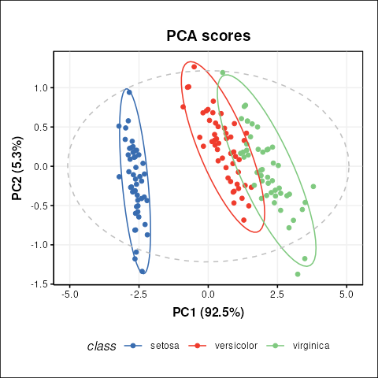

Note that indexing the PCA model is required because the
`pca_scores_plot` object requires a PCA object as input, not a
model_sequence.

If we make changes to the input parameters of the chart, `chart_plot`
must be called again to see the effects.

\
`# add petal width to meta data of pca scores`\
`M``[``2``]``$``scores``$``sample_meta``$``example``=``D``$``data``[``,``1``]`\
`# update plot`\
`C``$``factor_name``=``'example'`\
[`chart_plot`](https://computational-metabolomics.github.io/structToolbox/reference/chart_plot.md)`(``C``,``M``[``2``]``)`

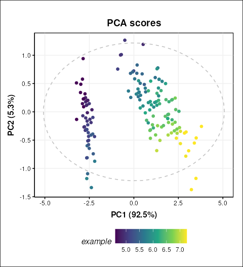

The `chart_plot` method returns a ggplot object so that you can easily
combine it with other plots using the `gridExtra` or `cowplot` packages
for example.

\
`# scores plot`\
`C1`` ``=`` `[`pca_scores_plot`](https://computational-metabolomics.github.io/structToolbox/reference/pca_scores_plot.md)`(``factor_name``=``'class'``)`` ``# colour by class`\
`g1`` ``=`` `[`chart_plot`](https://computational-metabolomics.github.io/structToolbox/reference/chart_plot.md)`(``C1``,``M``[``2``]``)`\
\
`# scree plot`\
`C2`` ``=`` `[`pca_scree_plot`](https://computational-metabolomics.github.io/structToolbox/reference/pca_scree_plot.md)`(``)`\
`g2`` ``=`` `[`chart_plot`](https://computational-metabolomics.github.io/structToolbox/reference/chart_plot.md)`(``C2``,``M``[``2``]``)`\
\
`# arange in grid`\
[`grid.arrange`](https://rdrr.io/pkg/gridExtra/man/arrangeGrob.html)`(``grobs``=`[`list`](https://rdrr.io/r/base/list.html)`(``g1``,``g2``)``,nrow``=``1``)`

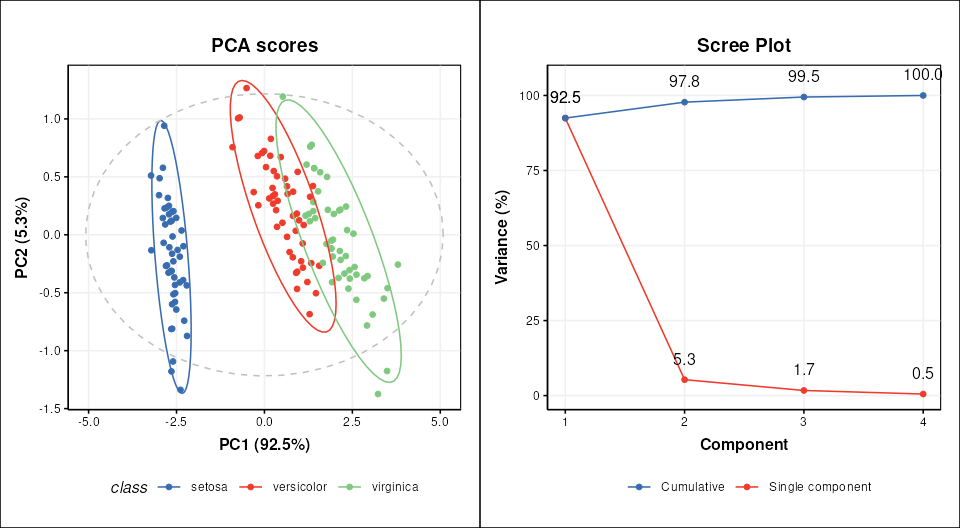

#### Ontology

Within the `struct` framework (and `structToolbox`) an `ontology` slot
is provided to allow for standardardised definitions for objects and its
inputs and outputs using the Ontology Lookup Service (OLS).

For example, STATO is a general purpose STATistics Ontology
(<http://stato-ontology.org>). From the webpage:

> Its aim is to provide coverage for processes such as statistical
> tests, their conditions of application, and information needed or
> resulting from statistical methods, such as probability distributions,
> variables, spread and variation metrics. STATO also covers aspects of
> experimental design and description of plots and graphical
> representations commonly used to provide visual cues of data
> distribution or layout and to assist review of the results.

The ontology for an object can be set by assigning the ontology term
identifier to the ontology slot of any `struct_class` object at design
time. The ids can be listed using `$` notation:

\
`# create an example PCA object`\
`P``=`[`PCA`](https://computational-metabolomics.github.io/structToolbox/reference/PCA.md)`(``)`\
\
`# ontology for the PCA object`\
`P``$``ontology`

    ## [1] "OBI:0200051"

The `ontology` method can be used obtain more detailed ontology
information. When `cache = NULL` the `struct` package will automatically
attempt to use the OLS API (via the `rols` package) to obtain a name and
description for the provided identifiers. Here we used cached versions
of the ontology definitions provided in the `structToolbox` package to
prevent issues connecting to the OLS API when building the package.

\
[`ontology`](https://rdrr.io/pkg/struct/man/ontology.html)`(``P``,cache ``=`` `[`ontology_cache`](https://computational-metabolomics.github.io/structToolbox/reference/ontology_cache.md)`(``)``)`` ``# set cache = NULL (default) for online use`

    ## Warning: The `cache` argument to ontology() is deprecated and ignored; ontology
    ## terms are resolved via OLS when IDs are present.

    ## An "ontology_list" with  2  terms
    ## [[1]]
    ## term id:       OBI:0200051
    ## ontology:      obi
    ## label:         principal components analysis dimensionality reduction
    ## description:   A principal components analysis dimensionality reduction is a dimensionality reduction
    ##                  achieved by applying principal components analysis and by keeping low-order principal
    ##                  components and excluding higher-order ones.
    ## iri:           http://purl.obolibrary.org/obo/OBI_0200051
    ## 
    ## [[2]]
    ## term id:       STATO:0000555
    ## ontology:      stato
    ## label:         number of predictive components
    ## description:   number of predictive components is a count used as input to the principle component analysis
    ##                  (PCA)
    ## iri:           http://purl.obolibrary.org/obo/STATO_0000555

Note that the `ontology` method returns definitions for the object (PCA)
and the inputs/outputs (number_of_components).

### Validating supervised statistical models

Validation is an important aspect of chemometric modelling. The `struct`
framework enables this kind of iterative model testing through
`iterator` objects.

#### Cross-validation

Cross validation is a common technique for assessing the performance of
classification models. For this example we will use a Partial least
squares-discriminant analysis (PLS-DA) model. Data should be mean
centred prior to PLS, so we will build a model sequence first.

\
`M`` ``=`` `[`mean_centre`](https://computational-metabolomics.github.io/structToolbox/reference/mean_centre.md)`(``)`` ``+`` `[`PLSDA`](https://computational-metabolomics.github.io/structToolbox/reference/PLSDA.md)`(``number_components``=``2``,factor_name``=``'class'``)`\
`M`

    ## A model_seq object containing:
    ## 
    ## [1]
    ## A "mean_centre" object
    ## ----------------------
    ## name:          Mean centre
    ## description:   The mean sample is subtracted from all samples in the data matrix. The features in the centred
    ##                  matrix all have zero mean.
    ## input params:  mode 
    ## outputs:       centred, mean_data, mean_sample_meta 
    ## predicted:     centred
    ## seq_in:        data
    ## 
    ## [2]
    ## A "PLSDA" object
    ## ----------------
    ## name:          Partial least squares discriminant analysis
    ## description:   PLS is a multivariate regression technique that extracts latent variables maximising
    ##                  covariance between the input data and the response. The Discriminant Analysis
    ##                  variant uses group labels in the response variable. For >2 groups a 1-vs-all
    ##                  approach is used. Group membership can be predicted for test samples based on
    ##                  a probability estimate of group membership, or the estimated y-value.
    ## input params:  number_components, factor_name, pred_method 
    ## outputs:       scores, loadings, yhat, design_matrix, y, reg_coeff, probability, vip, pls_model, sr, sr_pvalue, predicted_labels, prob_model 
    ## predicted:     predicted_labels
    ## seq_in:        data

`iterator` objects like the k-fold cross-validation object
(`kfold_xval`) can be created just like any other `struct` object.
Parameters can be set at creation using the equals sign, and accessed or
changed later using dollar notation.

\
`# create object`\
`XCV`` ``=`` `[`kfold_xval`](https://computational-metabolomics.github.io/structToolbox/reference/kfold_xval.md)`(``folds``=``5``,factor_name``=``'class'``)`\
\
`# change the number of folds`\
`XCV``$``folds``=``10`\
`XCV``$``folds`

    ## [1] 10

The model to be cross-validated can be set/accessed using the `models`
method.

\
[`models`](https://rdrr.io/pkg/struct/man/models.html)`(``XCV``)``=``M`\
[`models`](https://rdrr.io/pkg/struct/man/models.html)`(``XCV``)`

    ## A model_seq object containing:
    ## 
    ## [1]
    ## A "mean_centre" object
    ## ----------------------
    ## name:          Mean centre
    ## description:   The mean sample is subtracted from all samples in the data matrix. The features in the centred
    ##                  matrix all have zero mean.
    ## input params:  mode 
    ## outputs:       centred, mean_data, mean_sample_meta 
    ## predicted:     centred
    ## seq_in:        data
    ## 
    ## [2]
    ## A "PLSDA" object
    ## ----------------
    ## name:          Partial least squares discriminant analysis
    ## description:   PLS is a multivariate regression technique that extracts latent variables maximising
    ##                  covariance between the input data and the response. The Discriminant Analysis
    ##                  variant uses group labels in the response variable. For >2 groups a 1-vs-all
    ##                  approach is used. Group membership can be predicted for test samples based on
    ##                  a probability estimate of group membership, or the estimated y-value.
    ## input params:  number_components, factor_name, pred_method 
    ## outputs:       scores, loadings, yhat, design_matrix, y, reg_coeff, probability, vip, pls_model, sr, sr_pvalue, predicted_labels, prob_model 
    ## predicted:     predicted_labels
    ## seq_in:        data

Alternatively, iterators can be combined with models using the
multiplication symbol was shorthand for the `models` assignement method:

\
`# cross validation of a mean centred PLSDA model`\
`XCV`` ``=`` `[`kfold_xval`](https://computational-metabolomics.github.io/structToolbox/reference/kfold_xval.md)`(`\
`        folds``=``5``,`\
`        method``=``'venetian'``,`\
`        factor_name``=``'class'``)`` ``*`` `\
`      ``(`[`mean_centre`](https://computational-metabolomics.github.io/structToolbox/reference/mean_centre.md)`(``)`` ``+`` `[`PLSDA`](https://computational-metabolomics.github.io/structToolbox/reference/PLSDA.md)`(``factor_name``=``'class'``)``)`

The `run` method can be used with any `iterator` object. The iterator
will then run the set model or model sequence multiple times.

In this case we run cross-validation 5 times, splitting the data into
different training and test sets each time.

The `run` method also needs a `metric` to be specified, which is another
type of `struct` object. This metric may be calculated once after all
iterations, or after each iteration, depending on the iterator type
(resampling, permutation etc). For cross-validation we will calculate
“balanced accuracy” after all iterations.

\
`XCV`` ``=`` `[`run`](https://computational-metabolomics.github.io/structToolbox/reference/run.md)`(``XCV``,``D``,`[`balanced_accuracy`](https://computational-metabolomics.github.io/structToolbox/reference/balanced_accuracy.md)`(``)``)`\
`XCV``$``metric`

    ##              metric      mean sd
    ## 1 balanced_accuracy 0.8533333 NA

Note The `balanced_accuracy` metric actually reports 1-accuracy, so a
value of 0 indicates perfect performance. The standard deviation “sd” is
NA in this example because there is only one permutation.

Like other `struct` objects, iterators can have chart objects associated
with them. The `chart_names` function will list them for an object.

\
[`chart_names`](https://rdrr.io/pkg/struct/man/chart_names.html)`(``XCV``)`

    ## [1] "kfoldxcv_grid"   "kfoldxcv_metric"

Charts for `iterator` objects can be plotted in the same way as charts
for any other object.

\
`C`` ``=`` `[`kfoldxcv_grid`](https://computational-metabolomics.github.io/structToolbox/reference/kfoldxcv_grid.md)`(`\
`  factor_name``=``'class'``,`\
`  level``=`[`levels`](https://rdrr.io/r/base/levels.html)`(``D``$``sample_meta``$``class``)``[``2``]``)`` ``# first level`\
[`chart_plot`](https://computational-metabolomics.github.io/structToolbox/reference/chart_plot.md)`(``C``,``XCV``)`

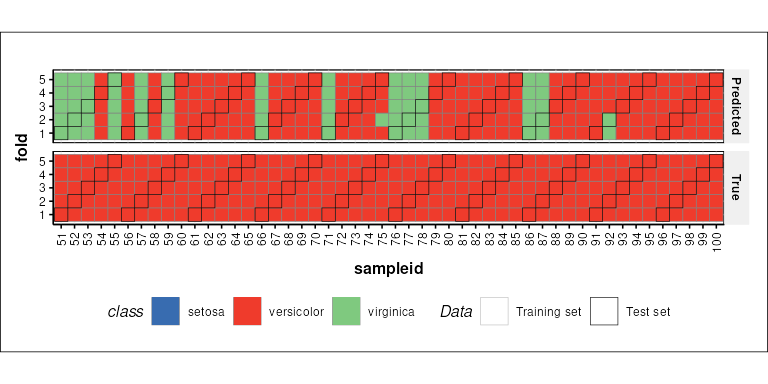

It is possible to combine multiple iterators by using the multiplication
symbol. This is equivalent to nesting one iterator inside the other. For
example, we can repeat our cross-validation multiple times by permuting
the sample order.

\
`# permute sample order 10 times and run cross-validation`\
`P`` ``=`` `[`permute_sample_order`](https://computational-metabolomics.github.io/structToolbox/reference/permute_sample_order.md)`(``number_of_permutations ``=`` ``10``)`` ``*`` `\
`    `[`kfold_xval`](https://computational-metabolomics.github.io/structToolbox/reference/kfold_xval.md)`(``folds``=``5``,factor_name``=``'class'``)``*`\
`    ``(`[`mean_centre`](https://computational-metabolomics.github.io/structToolbox/reference/mean_centre.md)`(``)`` ``+`` `[`PLSDA`](https://computational-metabolomics.github.io/structToolbox/reference/PLSDA.md)`(``factor_name``=``'class'``,number_components``=``2``)``)`\
`P`` ``=`` `[`run`](https://computational-metabolomics.github.io/structToolbox/reference/run.md)`(``P``,``D``,`[`balanced_accuracy`](https://computational-metabolomics.github.io/structToolbox/reference/balanced_accuracy.md)`(``)``)`\
`P``$``metric`

    ##              metric  mean          sd
    ## 1 balanced_accuracy 0.854 0.006629526

## Case Studies

### Introduction

This vignette provides an overview of a `structToolbox` workflow
implemented to process (e.g. filter features, signal drift and batch
correction, normalise and missing value imputation) mass spectrometry
data. The workflow exists of methods that are part of the Peak Matrix
Processing (*[pmp](https://bioconductor.org/packages/3.24/pmp)*)
package, including a range of additional filters that are described in
Kirwan et al.,
[2013](https://link.springer.com/article/10.1007/s00216-013-6856-7),
[2014](https://doi.org/10.1038/sdata.2014.12).

Some packages are required for this vignette in addition
`structToolbox`:

### Dataset

For demonstration purposes we will process and analyse the MTBLS79
dataset (‘Dataset 7:SFPM’ Kirwan et al.,
[2014](https://doi.org/10.1038/sdata.2014.12). This dataset represents a
systematic evaluation of the reproducibility of a multi-batch
direct-infusion mass spectrometry (DIMS)-based metabolomics study of
cardiac tissue extracts. It comprises twenty biological samples (cow
vs. sheep) that were analysed repeatedly, in 8 batches across 7 days,
together with a concurrent set of quality control (QC) samples. Data are
presented from each step of the data processing workflow and are
available through MetaboLights
(<https://www.ebi.ac.uk/metabolights/MTBLS79>).

The `MTBLS79_DatasetExperiment` object included in the `structToolbox`
package is a processed version of the MTBLS79 dataset available in peak
matrix processing (*[pmp](https://bioconductor.org/packages/3.24/pmp)*)
package. This vignette describes step by step how the `structToolbox`
version was created from the `pmp` version (i.e. ‘Dataset 7:SFPM’ from
the Scientific Data publication -
<https://doi.org/10.1038/sdata.2014.12>).

The `SummarizedExperiment` object from the `pmp` package needs to be
converted to a `DatasetExperiment` object for use with `structToolbox`.

\
`# the pmp SE object`\
`SE`` ``=`` ``MTBLS79`\
\
`# convert to DE`\
`DE`` ``=`` `[`as.DatasetExperiment`](https://rdrr.io/pkg/struct/man/as.DatasetExperiment.html)`(``SE``)`\
`DE``$``name`` ``=`` ``'MTBLS79'`\
`DE``$``description`` ``=`` ``'Converted from SE provided by the pmp package'`\
\
`# add a column indicating the order the samples were measured in`\
`DE``$``sample_meta``$``run_order`` ``=`` ``1``:`[`nrow`](https://rdrr.io/r/base/nrow.html)`(``DE``)`\
\
`# add a column indicating if the sample is biological or a QC`\
`Type``=`[`as.character`](https://rdrr.io/r/base/character.html)`(``DE``$``sample_meta``$``Class``)`\
`Type``[``Type`` ``!=`` ``'QC'``]`` ``=`` ``'Sample'`\
`DE``$``sample_meta``$``Type`` ``=`` `[`factor`](https://rdrr.io/r/base/factor.html)`(``Type``)`\
\
`# add a column for plotting batches`\
`DE``$``sample_meta``$``batch_qc`` ``=`` ``DE``$``sample_meta``$``Batch`\
`DE``$``sample_meta``$``batch_qc``[``DE``$``sample_meta``$``Type``==``'QC'``]``=``'QC'`\
\
`# convert to factors`\
`DE``$``sample_meta``$``Batch`` ``=`` `[`factor`](https://rdrr.io/r/base/factor.html)`(``DE``$``sample_meta``$``Batch``)`\
`DE``$``sample_meta``$``Type`` ``=`` `[`factor`](https://rdrr.io/r/base/factor.html)`(``DE``$``sample_meta``$``Type``)`\
`DE``$``sample_meta``$``Class`` ``=`` `[`factor`](https://rdrr.io/r/base/factor.html)`(``DE``$``sample_meta``$``Class``)`\
`DE``$``sample_meta``$``batch_qc`` ``=`` `[`factor`](https://rdrr.io/r/base/factor.html)`(``DE``$``sample_meta``$``batch_qc``)`\
\
`# print summary`\
`DE`

    ## A "DatasetExperiment" object
    ## ----------------------------
    ## name:          MTBLS79
    ## description:   Converted from SE provided by the pmp package
    ## data:          172 rows x 2488 columns
    ## sample_meta:   172 rows x 7 columns
    ## variable_meta: 2488 rows x 0 columns

Full processing of the data set requires a number of steps. These will
be applied using a single `struct` model sequence (`model_seq`).

### Signal drift and batch correction

A batch correction algorithm is applied to reduce intra- and inter-
batch variations in the dataset. Quality Control-Robust Spline
Correction (QC-RSC) is provided in the `pmp` package, and it has been
wrapped into a `structToolbox` object called `sb_corr`.

\
`M`` ``=`` ``# batch correction`\
`    `[`sb_corr`](https://computational-metabolomics.github.io/structToolbox/reference/sb_corr.md)`(`\
`      order_col``=``'run_order'``,`\
`      batch_col``=``'Batch'``, `\
`      qc_col``=``'Type'``, `\
`      qc_label``=``'QC'``,`\
`      spar_lim ``=`` `[`c`](https://rdrr.io/r/base/c.html)`(``0.6``,``0.8``)`` `\
`    ``)`\
\
`M`` ``=`` `[`model_apply`](https://computational-metabolomics.github.io/structToolbox/reference/model_apply.md)`(``M``,``DE``)`

The figure below shows a plot of a feature vs run order, before and
after the correction. The fitted spline for each batch is shown in grey.
It can be seen that the correction has removed instrument drift within
and between batches.

\
`C`` ``=`` `[`feature_profile`](https://computational-metabolomics.github.io/structToolbox/reference/feature_profile.md)`(`\
`      run_order``=``'run_order'``,`\
`      qc_label``=``'QC'``,`\
`      qc_column``=``'Type'``,`\
`      colour_by``=``'batch_qc'``,`\
`      feature_to_plot``=``'200.03196'``,`\
`      plot_sd``=``FALSE`\
`  ``)`\
\
`# plot and modify using ggplot2 `\
[`chart_plot`](https://computational-metabolomics.github.io/structToolbox/reference/chart_plot.md)`(``C``,``M``,``DE``)``+`[`ylab`](https://ggplot2.tidyverse.org/reference/labs.html)`(``'Peak area'``)``+`[`ggtitle`](https://ggplot2.tidyverse.org/reference/labs.html)`(``'Before'``)`

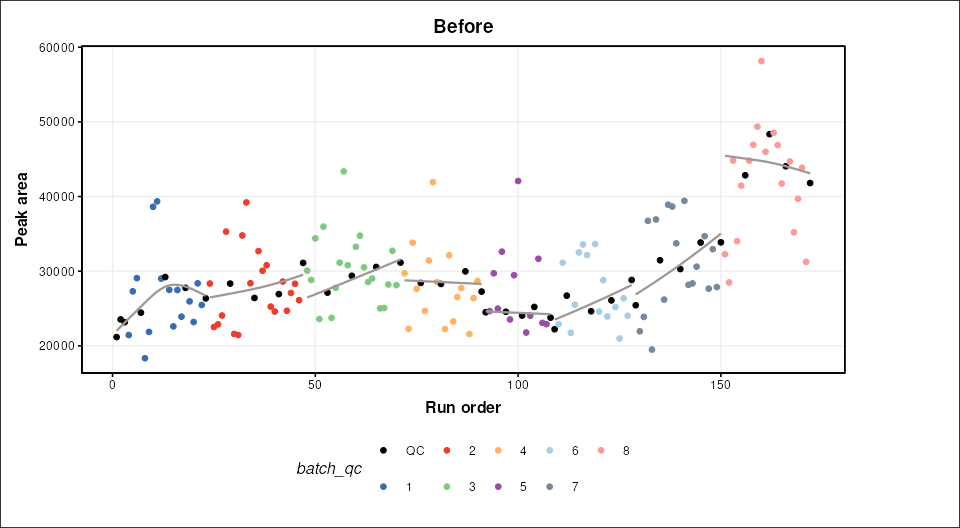

\
[`chart_plot`](https://computational-metabolomics.github.io/structToolbox/reference/chart_plot.md)`(``C``,`[`predicted`](https://rdrr.io/pkg/struct/man/predicted.html)`(``M``)``)``+`[`ylab`](https://ggplot2.tidyverse.org/reference/labs.html)`(``'Peak area'``)``+`[`ggtitle`](https://ggplot2.tidyverse.org/reference/labs.html)`(``'After'``)`

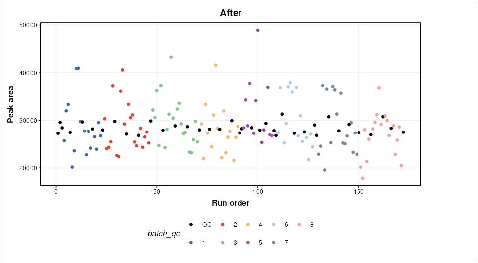

An additional step is added to the published workflow to remove any
feature not corrected by QCRCMS. This can occur if there are not enough
measured QC values within a batch. `QCRMS` in the `pmp` package
currently returns NA for all samples in the feature where this occurs.
Features where this occurs will be excluded.

\
`M2`` ``=`` `[`filter_na_count`](https://computational-metabolomics.github.io/structToolbox/reference/filter_na_count.md)`(`\
`      threshold``=``3``,`\
`      factor_name``=``'Batch'`\
`    ``)`\
`M2`` ``=`` `[`model_apply`](https://computational-metabolomics.github.io/structToolbox/reference/model_apply.md)`(``M2``,`[`predicted`](https://rdrr.io/pkg/struct/man/predicted.html)`(``M``)``)`\
\
`# calculate number of features removed`\
`nc`` ``=`` `[`ncol`](https://rdrr.io/r/base/nrow.html)`(``DE``)`` ``-`` `[`ncol`](https://rdrr.io/r/base/nrow.html)`(`[`predicted`](https://rdrr.io/pkg/struct/man/predicted.html)`(``M2``)``)`\
\
[`cat`](https://rdrr.io/r/base/cat.html)`(`[`paste0`](https://rdrr.io/r/base/paste.html)`(``'Number of features removed: '``, ``nc``)``)`

    ## Number of features removed: 425

The output of this step is the output of
`MTBLS79_DatasetExperiment(filtered=FALSE)`.

### Feature filtering

In the journal article three spectral cleaning steps are applied. In the
first filter a Kruskal-Wallis test is used to identify features not
reliably detected in the QC samples (p \< 0.0001) of all batches. We
follow the same parameters as the original article and do not use
multiple test correction (`mtc = 'none'`).

\
`M3`` ``=`` `[`kw_rank_sum`](https://computational-metabolomics.github.io/structToolbox/reference/kw_rank_sum.md)`(`\
`      alpha``=``0.0001``,`\
`      mtc``=``'none'``,`\
`      factor_names``=``'Batch'``,`\
`      predicted``=``'significant'`\
`    ``)`` ``+`\
`    `[`filter_by_name`](https://computational-metabolomics.github.io/structToolbox/reference/filter_by_name.md)`(`\
`      mode``=``'exclude'``,`\
`      dimension ``=`` ``'variable'``,`\
`      seq_in ``=`` ``'names'``, `\
`      names``=``'seq_fcn'``, ``# this is a placeholder and will be replaced by seq_fcn`\
`      seq_fcn``=``function``(``x``)``{`[`return`](https://rdrr.io/r/base/function.html)`(``x``[``,``1``]``)``}`\
`    ``)`\
`M3`` ``=`` `[`model_apply`](https://computational-metabolomics.github.io/structToolbox/reference/model_apply.md)`(``M3``, `[`predicted`](https://rdrr.io/pkg/struct/man/predicted.html)`(``M2``)``)`\
\
`nc`` ``=`` `[`ncol`](https://rdrr.io/r/base/nrow.html)`(`[`predicted`](https://rdrr.io/pkg/struct/man/predicted.html)`(``M2``)``)`` ``-`` `[`ncol`](https://rdrr.io/r/base/nrow.html)`(`[`predicted`](https://rdrr.io/pkg/struct/man/predicted.html)`(``M3``)``)`\
[`cat`](https://rdrr.io/r/base/cat.html)`(`[`paste0`](https://rdrr.io/r/base/paste.html)`(``'Number of features removed: '``, ``nc``)``)`

    ## Number of features removed: 262

To make use of univariate tests such as `kw_rank_sum` as a filter some
advanced features of `struct` are needed. Slots `predicted`, and
`seq_in` are used to ensure the correct output of the univariate test is
connected to the correct input of a feature filter using
`filter_by_name`. Another slot `seq_fcn` is used to extract the relevant
column of the `predicted` output so that it is compatible with the
`seq_in` input. A placeholder is used for the “names” parameter
(`names = 'place_holder'`) as this input will be replaced by the output
from `seq_fcn`.

The second filter is a Wilcoxon Signed-Rank test. It is used to identify
features that are not representative of the average of the biological
samples (p \< 1e-14). Again we make use of `seq_in` and `seq_fcn`.

\
`M4`` ``=`` `[`wilcox_test`](https://computational-metabolomics.github.io/structToolbox/reference/wilcox_test.md)`(`\
`      alpha``=``1e-14``,`\
`      factor_names``=``'Type'``, `\
`      mtc``=``'none'``, `\
`      predicted ``=`` ``'significant'`\
`    ``)`` ``+`\
`    `[`filter_by_name`](https://computational-metabolomics.github.io/structToolbox/reference/filter_by_name.md)`(`\
`      mode``=``'exclude'``,`\
`      dimension``=``'variable'``,`\
`      seq_in``=``'names'``, `\
`      names``=``'place_holder'``,`\
`      seq_fcn``=``function``(``x``)``{`[`return`](https://rdrr.io/r/base/function.html)`(``x``$``significant``)``}`\
`    ``)`\
`M4`` ``=`` `[`model_apply`](https://computational-metabolomics.github.io/structToolbox/reference/model_apply.md)`(``M4``, `[`predicted`](https://rdrr.io/pkg/struct/man/predicted.html)`(``M3``)``)`\
\
`nc`` ``=`` `[`ncol`](https://rdrr.io/r/base/nrow.html)`(`[`predicted`](https://rdrr.io/pkg/struct/man/predicted.html)`(``M3``)``)`` ``-`` `[`ncol`](https://rdrr.io/r/base/nrow.html)`(`[`predicted`](https://rdrr.io/pkg/struct/man/predicted.html)`(``M4``)``)`\
[`cat`](https://rdrr.io/r/base/cat.html)`(`[`paste0`](https://rdrr.io/r/base/paste.html)`(``'Number of features removed: '``, ``nc``)``)`

    ## Number of features removed: 169

Finally, an RSD filter is used to remove features with high analytical
variation (QC RSD \> 20 removed)

\
`M5`` ``=`` `[`rsd_filter`](https://computational-metabolomics.github.io/structToolbox/reference/rsd_filter.md)`(`\
`     rsd_threshold``=``20``,`\
`     factor_name``=``'Type'`\
`)`\
`M5`` ``=`` `[`model_apply`](https://computational-metabolomics.github.io/structToolbox/reference/model_apply.md)`(``M5``,`[`predicted`](https://rdrr.io/pkg/struct/man/predicted.html)`(``M4``)``)`\
\
`nc`` ``=`` `[`ncol`](https://rdrr.io/r/base/nrow.html)`(`[`predicted`](https://rdrr.io/pkg/struct/man/predicted.html)`(``M4``)``)`` ``-`` `[`ncol`](https://rdrr.io/r/base/nrow.html)`(`[`predicted`](https://rdrr.io/pkg/struct/man/predicted.html)`(``M5``)``)`\
[`cat`](https://rdrr.io/r/base/cat.html)`(`[`paste0`](https://rdrr.io/r/base/paste.html)`(``'Number of features removed: '``, ``nc``)``)`

    ## Number of features removed: 53

The output of this filter is the output of
`MTBLS79_DatasetExperiment(filtered=TRUE)`.

### Normalisation, missing value imputation and scaling

We will apply a number of common pre-processing steps to the filtered
peak matrix that are identical to steps applied in are described in
Kirwan et
al. [2013](https://link.springer.com/article/10.1007/s00216-013-6856-7),
[2014](https://doi.org/10.1038/sdata.2014.12).

- Probabilistic Quotient Normalisation (PQN)
- k-nearest neighbours imputation (k = 5)
- Generalised log transform (glog)

These steps prepare the data for multivariate analysis by accounting for
sample concentration differences, imputing missing values and scaling
the data.

\
`# peak matrix processing`\
`M6`` ``=`` `[`pqn_norm`](https://computational-metabolomics.github.io/structToolbox/reference/pqn_norm.md)`(``qc_label``=``'QC'``,factor_name``=``'Type'``)`` ``+`` `\
`     `[`knn_impute`](https://computational-metabolomics.github.io/structToolbox/reference/knn_impute.md)`(``neighbours``=``5``)`` ``+`\
`     `[`glog_transform`](https://computational-metabolomics.github.io/structToolbox/reference/glog_transform.md)`(``qc_label``=``'QC'``,factor_name``=``'Type'``)`\
`M6`` ``=`` `[`model_apply`](https://computational-metabolomics.github.io/structToolbox/reference/model_apply.md)`(``M6``,`[`predicted`](https://rdrr.io/pkg/struct/man/predicted.html)`(``M5``)``)`

### Exploratory Analysis

Principal Component Analysis (PCA) can be used to visualise
high-dimensional data. It is an unsupervised method that maximises
variance in a reduced number of latent variables, or principal
components.

\
`# PCA`\
`M7``  ``=`` `[`mean_centre`](https://computational-metabolomics.github.io/structToolbox/reference/mean_centre.md)`(``)`` ``+`` `[`PCA`](https://computational-metabolomics.github.io/structToolbox/reference/PCA.md)`(``number_components ``=`` ``2``)`\
\
`# apply model sequence to data`\
`M7`` ``=`` `[`model_apply`](https://computational-metabolomics.github.io/structToolbox/reference/model_apply.md)`(``M7``,`[`predicted`](https://rdrr.io/pkg/struct/man/predicted.html)`(``M6``)``)`\
\
`# plot pca scores`\
`C`` ``=`` `[`pca_scores_plot`](https://computational-metabolomics.github.io/structToolbox/reference/pca_scores_plot.md)`(``factor_name``=`[`c`](https://rdrr.io/r/base/c.html)`(``'Sample_Rep'``,``'Class'``)``,ellipse``=``'none'``)`\
[`chart_plot`](https://computational-metabolomics.github.io/structToolbox/reference/chart_plot.md)`(``C``,``M7``[``2``]``)`` ``+`` `[`coord_fixed`](https://ggplot2.tidyverse.org/reference/coord_fixed.html)`(``)`` ``+`[`guides`](https://ggplot2.tidyverse.org/reference/guides.html)`(``colour``=``FALSE``)`

    ## Warning: The `<scale>` argument of `guides()` cannot be `FALSE`. Use "none" instead as
    ## of ggplot2 3.3.4.
    ## This warning is displayed once per session.
    ## Call `lifecycle::last_lifecycle_warnings()` to see where this warning was
    ## generated.

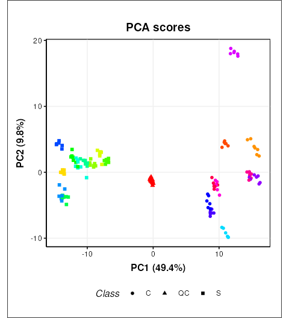

This plot is very similar to Figure 3b of the original publication
[link](https://www.nature.com/articles/sdata201412/figures/3). Sample
replicates are represented by colours and samples groups (C = cow and S
= Sheep) by different shapes.

Plotting the scores and colouring by Batch indicates that the
signal/batch correction was effective as all batches are overlapping.

\
`# chart object`\
`C`` ``=`` `[`pca_scores_plot`](https://computational-metabolomics.github.io/structToolbox/reference/pca_scores_plot.md)`(``factor_name``=`[`c`](https://rdrr.io/r/base/c.html)`(``'Batch'``)``,ellipse``=``'none'``)`\
`# plot`\
[`chart_plot`](https://computational-metabolomics.github.io/structToolbox/reference/chart_plot.md)`(``C``,``M7``[``2``]``)`` ``+`` `[`coord_fixed`](https://ggplot2.tidyverse.org/reference/coord_fixed.html)`(``)`

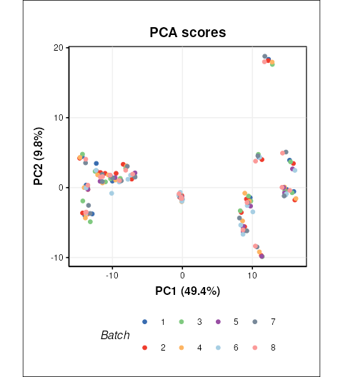

### Introduction

The aim of this vignette is to demonstrate how to 1) apply and validate
Partial Least Squares (PLS) analysis using the structToolbox, 2)
reproduce statistical analysis in [Thevenot et
al. (2015)](https://pubs.acs.org/doi/10.1021/acs.jproteome.5b00354) and
3. compare different implementations of PLS.

### Dataset

The objective of the original study was to:

> …study the influence of age, body mass index (bmi), and gender on
> metabolite concentrations in urine, by analysing 183 samples from a
> cohort of adults with liquid chromatography coupled to high-resolution
> mass spectrometry.

[Thevenot et
al. (2015)](https://pubs.acs.org/doi/10.1021/acs.jproteome.5b00354)

The “Sacurine” dataset needs to be converted to a `DatasetExperiment`
object. The *[ropls](https://bioconductor.org/packages/3.24/ropls)*
package provides the data as a list containing a `dataMatrix`,
`sampleMetadata` and `variableMetadata`.

\
[`data`](https://rdrr.io/r/utils/data.html)`(``'sacurine'``,package ``=`` ``'ropls'``)`\
`# the 'sacurine' list should now be available`\
\
`# move the annotations to a new column and rename the features by index to avoid issues`\
`# later when data.frames get transposed and names get checked/changed`\
`sacurine``$``variableMetadata``$``annotation``=`[`rownames`](https://rdrr.io/r/base/colnames.html)`(``sacurine``$``variableMetadata``)`\
[`rownames`](https://rdrr.io/r/base/colnames.html)`(``sacurine``$``variableMetadata``)``=``1``:`[`nrow`](https://rdrr.io/r/base/nrow.html)`(``sacurine``$``variableMetadata``)`\
[`colnames`](https://rdrr.io/r/base/colnames.html)`(``sacurine``$``dataMatrix``)``=``1``:`[`ncol`](https://rdrr.io/r/base/nrow.html)`(``sacurine``$``dataMatrix``)`\
\
`# create DatasetExperiment`\
`DE`` ``=`` `[`DatasetExperiment`](https://rdrr.io/pkg/struct/man/struct_DatasetExperiment.html)`(``data ``=`` `[`data.frame`](https://rdrr.io/r/base/data.frame.html)`(``sacurine``$``dataMatrix``)``,`\
`                       sample_meta ``=`` ``sacurine``$``sampleMetadata``,`\
`                       variable_meta ``=`` ``sacurine``$``variableMetadata``,`\
`                       name ``=`` ``'Sacurine data'``,`\
`                       description ``=`` ``'See ropls package documentation for details'``)`\
\
`# print summary`\
`DE`

    ## A "DatasetExperiment" object
    ## ----------------------------
    ## name:          Sacurine data
    ## description:   See ropls package documentation for details
    ## data:          183 rows x 109 columns
    ## sample_meta:   183 rows x 3 columns
    ## variable_meta: 109 rows x 4 columns

### Data preprocessing

The Sacurine dataset used within this vignette has already been
pre-processed:

> After signal drift and batch effect correction of intensities, each
> urine profile was normalized to the osmolality of the sample. Finally,
> the data were log10 transformed.

### Exploratory data analysis

Since the data has already been processed the data can be visualised
using Principal Component Analysis (PCA) without further pre-processing.
The `ropls` package automatically applies unit variance scaling
(autoscaling) by default. The same approach is applied here.

\
`# prepare model sequence`\
`M`` ``=`` `[`autoscale`](https://computational-metabolomics.github.io/structToolbox/reference/autoscale.md)`(``)`` ``+`` `[`PCA`](https://computational-metabolomics.github.io/structToolbox/reference/PCA.md)`(``number_components ``=`` ``5``)`\
`# apply model sequence to dataset`\
`M`` ``=`` `[`model_apply`](https://computational-metabolomics.github.io/structToolbox/reference/model_apply.md)`(``M``,``DE``)`\
\
`# pca scores plots`\
`g``=`[`list`](https://rdrr.io/r/base/list.html)`(``)`\
`for`` ``(``k`` ``in`` `[`colnames`](https://rdrr.io/r/base/colnames.html)`(``DE``$``sample_meta``)``)`` ``{`\
`    ``C`` ``=`` `[`pca_scores_plot`](https://computational-metabolomics.github.io/structToolbox/reference/pca_scores_plot.md)`(``factor_name ``=`` ``k``)`\
`    ``g``[[``k``]``]`` ``=`` `[`chart_plot`](https://computational-metabolomics.github.io/structToolbox/reference/chart_plot.md)`(``C``,``M``[``2``]``)`\
`}`\
`# plot using cowplot`\
[`plot_grid`](https://wilkelab.org/cowplot/reference/plot_grid.html)`(``plotlist``=``g``, nrow``=``1``, align``=``'vh'``, labels``=`[`c`](https://rdrr.io/r/base/c.html)`(``'A'``,``'B'``,``'C'``)``)`

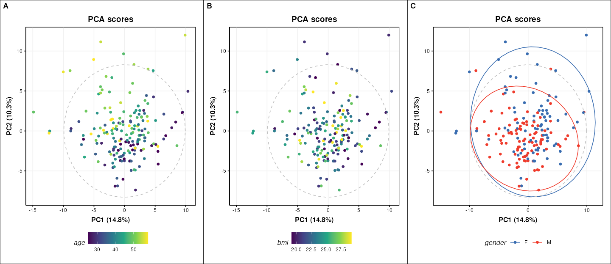

The third plot coloured by gender (C) is identical to Figure 2 of the
*[ropls](https://bioconductor.org/packages/3.24/ropls)* package
vignette. The `structToolbox` package provides a range of PCA-related
diagnostic plots, including D-statistic, scree, and loadings plots.
These plots can be used to further explore the variance of the data.

\
`C`` ``=`` `[`pca_scree_plot`](https://computational-metabolomics.github.io/structToolbox/reference/pca_scree_plot.md)`(``)`\
`g1`` ``=`` `[`chart_plot`](https://computational-metabolomics.github.io/structToolbox/reference/chart_plot.md)`(``C``,``M``[``2``]``)`\
\
`C`` ``=`` `[`pca_loadings_plot`](https://computational-metabolomics.github.io/structToolbox/reference/pca_loadings_plot.md)`(``)`\
`g2`` ``=`` `[`chart_plot`](https://computational-metabolomics.github.io/structToolbox/reference/chart_plot.md)`(``C``,``M``[``2``]``)`\
\
`C`` ``=`` `[`pca_dstat_plot`](https://computational-metabolomics.github.io/structToolbox/reference/pca_dstat_plot.md)`(``alpha``=``0.95``)`\
`g3`` ``=`` `[`chart_plot`](https://computational-metabolomics.github.io/structToolbox/reference/chart_plot.md)`(``C``,``M``[``2``]``)`\
\
`p1``=`[`plot_grid`](https://wilkelab.org/cowplot/reference/plot_grid.html)`(``plotlist ``=`` `[`list`](https://rdrr.io/r/base/list.html)`(``g1``,``g2``)``,align``=``'h'``,nrow``=``1``,axis``=``'b'``)`\
`p2``=`[`plot_grid`](https://wilkelab.org/cowplot/reference/plot_grid.html)`(``plotlist ``=`` `[`list`](https://rdrr.io/r/base/list.html)`(``g3``)``,nrow``=``1``)`\
[`plot_grid`](https://wilkelab.org/cowplot/reference/plot_grid.html)`(``p1``,``p2``,nrow``=``2``)`

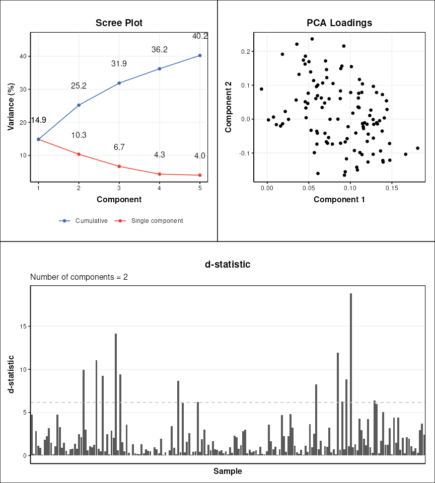

### Partial Least Squares (PLS) analysis

The `ropls` package uses its own implementation of the (O)PLS
algorithms. `structToolbox` uses the `pls` package, so it is interesting
to compare the outputs from both approaches. For simplicity only the
scores plots are compared.

\
`# prepare model sequence`\
`M`` ``=`` `[`autoscale`](https://computational-metabolomics.github.io/structToolbox/reference/autoscale.md)`(``)`` ``+`` `[`PLSDA`](https://computational-metabolomics.github.io/structToolbox/reference/PLSDA.md)`(``factor_name``=``'gender'``)`\
`M`` ``=`` `[`model_apply`](https://computational-metabolomics.github.io/structToolbox/reference/model_apply.md)`(``M``,``DE``)`\
\
`C`` ``=`` `[`pls_scores_plot`](https://computational-metabolomics.github.io/structToolbox/reference/pls_scores_plot.md)`(``factor_name ``=`` ``'gender'``)`\
[`chart_plot`](https://computational-metabolomics.github.io/structToolbox/reference/chart_plot.md)`(``C``,``M``[``2``]``)`

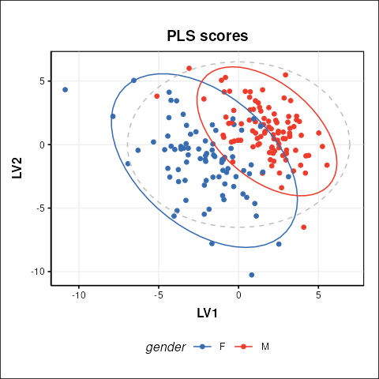

The plot is similar to fig.3 of the
*[ropls](https://bioconductor.org/packages/3.24/ropls)* vignette.
Differences are due to inverted LV axes, a common occurrence with the
NIPALS algorithm (used by both `structToolbox` and `ropls`) which
depends on how the algorithm is initialised.

To compare the R2 values for the model in structToolbox we have to use a
regression model, instead of a discriminant model. For this we convert
the gender factor to a numeric variable before applying the model.

\
`# convert gender to numeric`\
`DE``$``sample_meta``$``gender``=`[`as.numeric`](https://rdrr.io/r/base/numeric.html)`(``DE``$``sample_meta``$``gender``)`\
\
`# models sequence`\
`M`` ``=`` `[`autoscale`](https://computational-metabolomics.github.io/structToolbox/reference/autoscale.md)`(``mode``=``'both'``)`` ``+`` `[`PLSR`](https://computational-metabolomics.github.io/structToolbox/reference/PLSR.md)`(``factor_name``=``'gender'``,number_components``=``3``)`\
`M`` ``=`` `[`model_apply`](https://computational-metabolomics.github.io/structToolbox/reference/model_apply.md)`(``M``,``DE``)`\
\
`# some diagnostic charts`\
`C`` ``=`` `[`plsr_cook_dist`](https://computational-metabolomics.github.io/structToolbox/reference/plsr_cook_dist.md)`(``)`\
`g1`` ``=`` `[`chart_plot`](https://computational-metabolomics.github.io/structToolbox/reference/chart_plot.md)`(``C``,``M``[``2``]``)`\
\
`C`` ``=`` `[`plsr_prediction_plot`](https://computational-metabolomics.github.io/structToolbox/reference/plsr_prediction_plot.md)`(``)`\
`g2`` ``=`` `[`chart_plot`](https://computational-metabolomics.github.io/structToolbox/reference/chart_plot.md)`(``C``,``M``[``2``]``)`\
\
`C`` ``=`` `[`plsr_qq_plot`](https://computational-metabolomics.github.io/structToolbox/reference/plsr_qq_plot.md)`(``)`\
`g3`` ``=`` `[`chart_plot`](https://computational-metabolomics.github.io/structToolbox/reference/chart_plot.md)`(``C``,``M``[``2``]``)`\
\
`C`` ``=`` `[`plsr_residual_hist`](https://computational-metabolomics.github.io/structToolbox/reference/plsr_residual_hist.md)`(``)`\
`g4`` ``=`` `[`chart_plot`](https://computational-metabolomics.github.io/structToolbox/reference/chart_plot.md)`(``C``,``M``[``2``]``)`\
\
[`plot_grid`](https://wilkelab.org/cowplot/reference/plot_grid.html)`(``plotlist ``=`` `[`list`](https://rdrr.io/r/base/list.html)`(``g1``,``g2``,``g3``,``g4``)``, nrow``=``2``,align``=``'vh'``)`

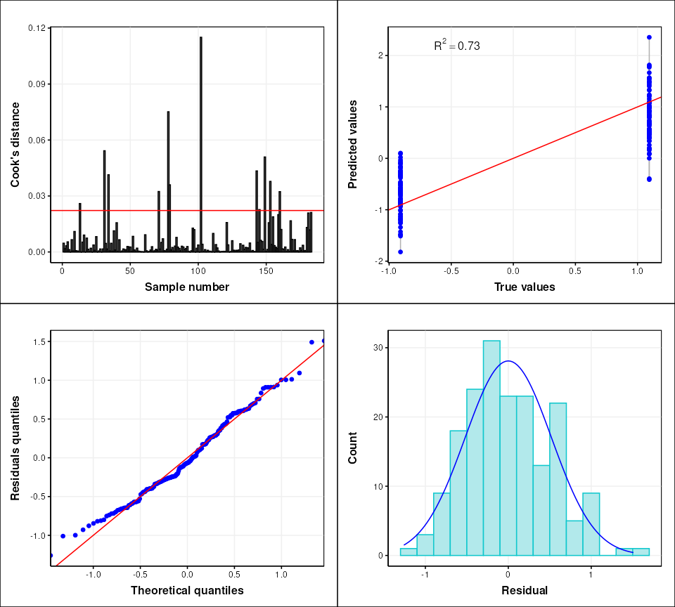

The `ropls` package automatically applies cross-validation to asses the
performance of the PLSDA model. In `structToolbox` this is applied
separately to give more control over the approach used if desired. The
default cross-validation used by the `ropls` package is 7-fold
cross-validation and we replicate that here.

\
`# model sequence`\
`M`` ``=`` `[`kfold_xval`](https://computational-metabolomics.github.io/structToolbox/reference/kfold_xval.md)`(``folds``=``7``, factor_name``=``'gender'``)`` ``*`` `\
`    ``(`[`autoscale`](https://computational-metabolomics.github.io/structToolbox/reference/autoscale.md)`(``mode``=``'both'``)`` ``+`` `[`PLSR`](https://computational-metabolomics.github.io/structToolbox/reference/PLSR.md)`(``factor_name``=``'gender'``)``)`\
`M`` ``=`` `[`run`](https://computational-metabolomics.github.io/structToolbox/reference/run.md)`(``M``,``DE``,`[`r_squared`](https://computational-metabolomics.github.io/structToolbox/reference/r_squared.md)`(``)``)`

Training set R2: 0.6975706 0.6798415 0.646671 0.6532914 0.7109769
0.670777 0.6935344

Test set Q2: 0.5460723

The validity of the model can further be assessed using permutation
testing. For this we will return to a discriminant model.

\
`# reset gender to original factor`\
`DE``$``sample_meta``$``gender``=``sacurine``$``sampleMetadata``$``gender`\
`# model sequence`\
`M`` ``=`` `[`permutation_test`](https://computational-metabolomics.github.io/structToolbox/reference/permutation_test.md)`(``number_of_permutations ``=`` ``10``, factor_name``=``'gender'``)`` ``*`\
`    `[`kfold_xval`](https://computational-metabolomics.github.io/structToolbox/reference/kfold_xval.md)`(``folds``=``7``,factor_name``=``'gender'``)`` ``*`\
`    ``(`[`autoscale`](https://computational-metabolomics.github.io/structToolbox/reference/autoscale.md)`(``)`` ``+`` `[`PLSDA`](https://computational-metabolomics.github.io/structToolbox/reference/PLSDA.md)`(``factor_name``=``'gender'``,number_components ``=`` ``3``)``)`\
`M`` ``=`` `[`run`](https://computational-metabolomics.github.io/structToolbox/reference/run.md)`(``M``,``DE``,`[`balanced_accuracy`](https://computational-metabolomics.github.io/structToolbox/reference/balanced_accuracy.md)`(``)``)`\
\
`C`` ``=`` `[`permutation_test_plot`](https://computational-metabolomics.github.io/structToolbox/reference/permutation_test_plot.md)`(``style``=``'boxplot'``)`\
[`chart_plot`](https://computational-metabolomics.github.io/structToolbox/reference/chart_plot.md)`(``C``,``M``)``+`[`ylab`](https://ggplot2.tidyverse.org/reference/labs.html)`(``'1 - balanced accuracy'``)`

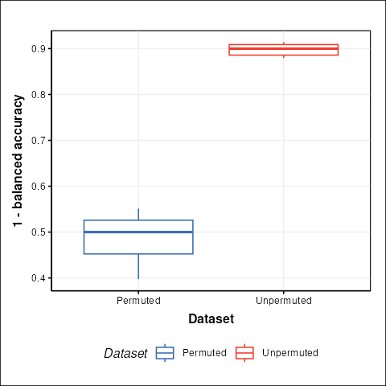

The permuted models have a balanced accuracy of around 50%, which is to
be expected for a dataset with two groups. The unpermuted models have a
balanced accuracy of around 90% and is therefore much better than might
be expected to occur by chance.

### Introduction

The purpose of this vignette is to demonstrate the different
functionalities and methods that are available as part of the
structToolbox and reproduce the data analysis reported in [Mendez et
al.,
(2020)](https://link.springer.com/article/10.1007/s11306-019-1588-0) and
[Chan et al., (2016)](https://www.nature.com/articles/bjc2015414).

### Dataset

The 1H-NMR dataset used and described in [Mendez et al.,
(2020)](https://link.springer.com/article/10.1007/s11306-019-1588-0) and
in this vignette contains processed spectra of urine samples obtained
from gastric cancer and healthy patients [Chan et al.,
(2016)](https://www.nature.com/articles/bjc2015414). The experimental
raw data is available through Metabolomics Workbench
([PR000699](http://dx.doi.org/10.21228/M8B10B)) and the processed
version is available from
[here](https://github.com/CIMCB/MetabWorkflowTutorial/raw/master/GastricCancer_NMR.xlsx)
as an Excel data file.

As a first step we need to reorganise and convert the Excel data file
into a DatasetExperiment object. Using the `openxlsx` package the file
can be read directly into an R `data.frame` and then manipulated as
required.

\
`url`` ``=`` ``'https://github.com/CIMCB/MetabWorkflowTutorial/raw/master/GastricCancer_NMR.xlsx'`\
\
`# read in file directly from github...`\
`# X=read.xlsx(url)`\
\
`# ...or use BiocFileCache`\
`path`` ``=`` `[`bfcrpath`](https://rdrr.io/pkg/BiocFileCache/man/BiocFileCache-class.html)`(``bfc``,``url``)`\
`X`` ``=`` `[`read.xlsx`](https://rdrr.io/pkg/openxlsx/man/read.xlsx.html)`(``path``)`\
\
`# sample meta data`\
`SM``=``X``[``,``1``:``4``]`\
[`rownames`](https://rdrr.io/r/base/colnames.html)`(``SM``)``=``SM``$``SampleID`\
`# convert to factors`\
`SM``$``SampleType``=`[`factor`](https://rdrr.io/r/base/factor.html)`(``SM``$``SampleType``)`\
`SM``$``Class``=`[`factor`](https://rdrr.io/r/base/factor.html)`(``SM``$``Class``)`\
`# keep a numeric version of class for regression`\
`SM``$``Class_num`` ``=`` `[`as.numeric`](https://rdrr.io/r/base/numeric.html)`(``SM``$``Class``)`\
\
`## data matrix`\
`# remove meta data`\
`X``[``,``1``:``4``]``=``NULL`\
[`rownames`](https://rdrr.io/r/base/colnames.html)`(``X``)``=``SM``$``SampleID`\
\
`# feature meta data`\
`VM``=`[`data.frame`](https://rdrr.io/r/base/data.frame.html)`(``idx``=``1``:`[`ncol`](https://rdrr.io/r/base/nrow.html)`(``X``)``)`\
[`rownames`](https://rdrr.io/r/base/colnames.html)`(``VM``)``=`[`colnames`](https://rdrr.io/r/base/colnames.html)`(``X``)`\
\
`# prepare DatasetExperiment`\
`DE`` ``=`` `[`DatasetExperiment`](https://rdrr.io/pkg/struct/man/struct_DatasetExperiment.html)`(`\
`    data``=``X``,`\
`    sample_meta``=``SM``,`\
`    variable_meta``=``VM``,`\
`    description``=``'1H-NMR urinary metabolomic profiling for diagnosis of gastric cancer'``,`\
`    name``=``'Gastric cancer (NMR)'``)`\
\
`DE`

    ## A "DatasetExperiment" object
    ## ----------------------------
    ## name:          Gastric cancer (NMR)
    ## description:   1H-NMR urinary metabolomic profiling for diagnosis of gastric cancer
    ## data:          140 rows x 149 columns
    ## sample_meta:   140 rows x 5 columns
    ## variable_meta: 149 rows x 1 columns

### Data pre-processing and quality assessment

It is good practice to remove any features that may be of low quality,
and to assess the quality of the data in general. In the Tutorial
features with QC-RSD \> 20% and where more than 10% of the features are
missing are retained.

\
`# prepare model sequence`\
`M`` ``=`` `[`rsd_filter`](https://computational-metabolomics.github.io/structToolbox/reference/rsd_filter.md)`(``rsd_threshold``=``20``,qc_label``=``'QC'``,factor_name``=``'Class'``)`` ``+`\
`    `[`mv_feature_filter`](https://computational-metabolomics.github.io/structToolbox/reference/mv_feature_filter.md)`(``threshold ``=`` ``10``,method``=``'across'``,factor_name``=``'Class'``)`\
\
`# apply model`\
`M`` ``=`` `[`model_apply`](https://computational-metabolomics.github.io/structToolbox/reference/model_apply.md)`(``M``,``DE``)`\
\
`# get the model output`\
`filtered`` ``=`` `[`predicted`](https://rdrr.io/pkg/struct/man/predicted.html)`(``M``)`\
\
`# summary of filtered data`\
`filtered`

    ## A "DatasetExperiment" object
    ## ----------------------------
    ## name:          Gastric cancer (NMR)
    ## description:   1H-NMR urinary metabolomic profiling for diagnosis of gastric cancer
    ## data:          140 rows x 53 columns
    ## sample_meta:   140 rows x 5 columns
    ## variable_meta: 53 rows x 1 columns

Note there is an additional feature vs the the processing reported by
Mendez et. al. because the filters here use \>= or \<= instead of \> and
\<.

After suitable scaling and transformation PCA can be used to assess data
quality. It is expected that the biological variance (samples) will be
larger than the technical variance (QCs). In the workflow that we are
reproducing
([link](https://cimcb.github.io/MetabWorkflowTutorial/Tutorial1.html))
the following steps were applied:

- log10 transform
- autoscaling (scaled to unit variance)
- knn imputation (3 neighbours)

The transformed and scaled matrix in then used as input to PCA. Using
`struct` we can chain all of these steps into a single model sequence.

\
`# prepare the model sequence`\
`M`` ``=`` `[`log_transform`](https://computational-metabolomics.github.io/structToolbox/reference/log_transform.md)`(``base ``=`` ``10``)`` ``+`\
`    `[`autoscale`](https://computational-metabolomics.github.io/structToolbox/reference/autoscale.md)`(``)`` ``+`` `\
`    `[`knn_impute`](https://computational-metabolomics.github.io/structToolbox/reference/knn_impute.md)`(``neighbours ``=`` ``3``)`` ``+`\
`    `[`PCA`](https://computational-metabolomics.github.io/structToolbox/reference/PCA.md)`(``number_components ``=`` ``10``)`\
\
`# apply model sequence to data`\
`M`` ``=`` `[`model_apply`](https://computational-metabolomics.github.io/structToolbox/reference/model_apply.md)`(``M``,``filtered``)`\
\
`# get the transformed, scaled and imputed matrix`\
`TSI`` ``=`` `[`predicted`](https://rdrr.io/pkg/struct/man/predicted.html)`(``M``[``3``]``)`\
\
`# scores plot`\
`C`` ``=`` `[`pca_scores_plot`](https://computational-metabolomics.github.io/structToolbox/reference/pca_scores_plot.md)`(``factor_name ``=`` ``'SampleType'``)`\
`g1`` ``=`` `[`chart_plot`](https://computational-metabolomics.github.io/structToolbox/reference/chart_plot.md)`(``C``,``M``[``4``]``)`\
\
`# loadings plot`\
`C`` ``=`` `[`pca_loadings_plot`](https://computational-metabolomics.github.io/structToolbox/reference/pca_loadings_plot.md)`(``)`\
`g2`` ``=`` `[`chart_plot`](https://computational-metabolomics.github.io/structToolbox/reference/chart_plot.md)`(``C``,``M``[``4``]``)`\
\
[`plot_grid`](https://wilkelab.org/cowplot/reference/plot_grid.html)`(``g1``,``g2``,align``=``'hv'``,nrow``=``1``,axis``=``'tblr'``)`

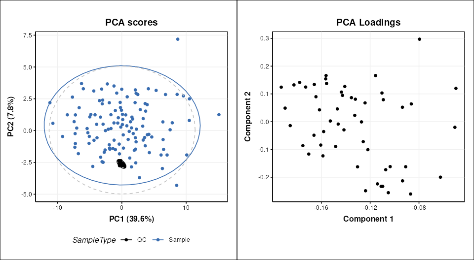

### Univariate statistics

`structToolbox` provides a number of objects for ttest, counting numbers
of features etc. For brevity only the ttest is calculated for comparison
with the workflow we are following
([link](https://cimcb.github.io/MetabWorkflowTutorial/Tutorial1.html)).
The QC samples need to be excluded, and the data reduced to only the GC
and HE groups.

\
`# prepare model`\
`TT`` ``=`` `[`filter_smeta`](https://computational-metabolomics.github.io/structToolbox/reference/filter_smeta.md)`(``mode``=``'include'``,factor_name``=``'Class'``,levels``=`[`c`](https://rdrr.io/r/base/c.html)`(``'GC'``,``'HE'``)``)`` ``+``  `\
`     `[`ttest`](https://computational-metabolomics.github.io/structToolbox/reference/ttest.md)`(``alpha``=``0.05``,mtc``=``'fdr'``,factor_names``=``'Class'``)`\
\
`# apply model`\
`TT`` ``=`` `[`model_apply`](https://computational-metabolomics.github.io/structToolbox/reference/model_apply.md)`(``TT``,``filtered``)`\
\
`# keep the data filtered by group for later`\
`filtered`` ``=`` `[`predicted`](https://rdrr.io/pkg/struct/man/predicted.html)`(``TT``[``1``]``)`\
\
`# convert to data frame`\
`out``=`[`as_data_frame`](https://computational-metabolomics.github.io/structToolbox/reference/as_data_frame.md)`(``TT``[``2``]``)`\
\
`# show first few features`\
[`head`](https://rdrr.io/r/utils/head.html)`(``out``)`

    ##     t_statistic   t_p_value t_significant estimate.mean.GC estimate.mean.HE
    ## M4    3.5392652 0.008421042          TRUE         51.73947         26.47778
    ## M5   -1.4296604 0.410396437         FALSE        169.91500        265.11860
    ## M7   -2.7456506 0.051494976         FALSE         53.98718        118.52558
    ## M8    2.1294198 0.178392032         FALSE         79.26750         54.39535
    ## M11  -0.5106536 0.776939682         FALSE        171.27949        201.34390
    ## M14   1.4786810 0.403091881         FALSE         83.90250         61.53171
    ##           lower     upper
    ## M4    10.961769  39.56162
    ## M5  -228.454679  38.04747
    ## M7  -111.468619 -17.60818
    ## M8     1.543611  48.20069
    ## M11 -147.434869  87.30604
    ## M14   -7.835950  52.57754

### Multivariate statistics and machine learning

#### Training and Test sets

Splitting data into training and test sets is an important aspect of
machine learning. In `structToolbox` this is implemented using the
`split_data` object for random subsampling across the whole dataset, and
`stratified_split` for splitting based on group sizes, which is the
approach used by Mendez et al.

\
`# prepare model`\
`M`` ``=`` `[`stratified_split`](https://computational-metabolomics.github.io/structToolbox/reference/stratified_split.md)`(``p_train``=``0.75``,factor_name``=``'Class'``)`\
`# apply to filtered data`\
`M`` ``=`` `[`model_apply`](https://computational-metabolomics.github.io/structToolbox/reference/model_apply.md)`(``M``,``filtered``)`\
`# get data from object`\
`train`` ``=`` ``M``$``training`\
`train`

    ## A "DatasetExperiment" object
    ## ----------------------------
    ## name:          Gastric cancer (NMR)
    ##                (Training set)
    ## description:   • 1H-NMR urinary metabolomic profiling for diagnosis of gastric cancer
    ##                • A subset of the data has been selected as a training set
    ## data:          62 rows x 53 columns
    ## sample_meta:   62 rows x 5 columns
    ## variable_meta: 53 rows x 1 columns

\
[`cat`](https://rdrr.io/r/base/cat.html)`(``'\n'``)`

\
`test`` ``=`` ``M``$``testing`\
`test`

    ## A "DatasetExperiment" object
    ## ----------------------------
    ## name:          Gastric cancer (NMR)
    ##                (Testing set)
    ## description:   • 1H-NMR urinary metabolomic profiling for diagnosis of gastric cancer
    ##                • A subset of the data has been selected as a test set
    ## data:          21 rows x 53 columns
    ## sample_meta:   21 rows x 5 columns
    ## variable_meta: 53 rows x 1 columns

#### Optimal number of PLS components

In Mendez et al a k-fold cross-validation is used to determine the
optimal number of PLS components. 100 bootstrap iterations are used to
generate confidence intervals. In `strucToolbox` these are implemented
using “iterator” objects, that can be combined with model objects. R2 is
used as the metric for optimisation, so the `PLSR` model in
structToolbox will be used. For speed only 10 bootstrap iterations are
used here.

\
`# scale/transform training data`\
`M`` ``=`` `[`log_transform`](https://computational-metabolomics.github.io/structToolbox/reference/log_transform.md)`(``base ``=`` ``10``)`` ``+`\
`    `[`autoscale`](https://computational-metabolomics.github.io/structToolbox/reference/autoscale.md)`(``)`` ``+`` `\
`    `[`knn_impute`](https://computational-metabolomics.github.io/structToolbox/reference/knn_impute.md)`(``neighbours ``=`` ``3``,by``=``'samples'``)`\
\
`# apply model`\
`M`` ``=`` `[`model_apply`](https://computational-metabolomics.github.io/structToolbox/reference/model_apply.md)`(``M``,``train``)`\
\
`# get scaled/transformed training data`\
`train_st`` ``=`` `[`predicted`](https://rdrr.io/pkg/struct/man/predicted.html)`(``M``)`\
\
`# prepare model sequence`\
`MS`` ``=`` `[`grid_search_1d`](https://computational-metabolomics.github.io/structToolbox/reference/grid_search_1d.md)`(`\
`        param_to_optimise ``=`` ``'number_components'``,`\
`        search_values ``=`` `[`as.numeric`](https://rdrr.io/r/base/numeric.html)`(`[`c`](https://rdrr.io/r/base/c.html)`(``1``:``6``)``)``,`\
`        model_index ``=`` ``2``,`\
`        factor_name ``=`` ``'Class_num'``,`\
`        max_min ``=`` ``'max'``)`` ``*`\
`     `[`permute_sample_order`](https://computational-metabolomics.github.io/structToolbox/reference/permute_sample_order.md)`(`\
`        number_of_permutations ``=`` ``10``)`` ``*`\
`     `[`kfold_xval`](https://computational-metabolomics.github.io/structToolbox/reference/kfold_xval.md)`(`\
`        folds ``=`` ``5``,`\
`        factor_name ``=`` ``'Class_num'``)`` ``*`` `\
`     ``(`[`mean_centre`](https://computational-metabolomics.github.io/structToolbox/reference/mean_centre.md)`(``mode``=``'sample_meta'``)``+`\
`      `[`PLSR`](https://computational-metabolomics.github.io/structToolbox/reference/PLSR.md)`(``factor_name``=``'Class_num'``)``)`\
\
`# run the validation`\
`MS`` ``=`` ``struct``::`[`run`](https://rdrr.io/pkg/struct/man/iterator.html)`(``MS``,``train_st``,`[`r_squared`](https://computational-metabolomics.github.io/structToolbox/reference/r_squared.md)`(``)``)`\
\
`#`\
`C`` ``=`` `[`gs_line`](https://computational-metabolomics.github.io/structToolbox/reference/gs_line.md)`(``)`\
[`chart_plot`](https://computational-metabolomics.github.io/structToolbox/reference/chart_plot.md)`(``C``,``MS``)`

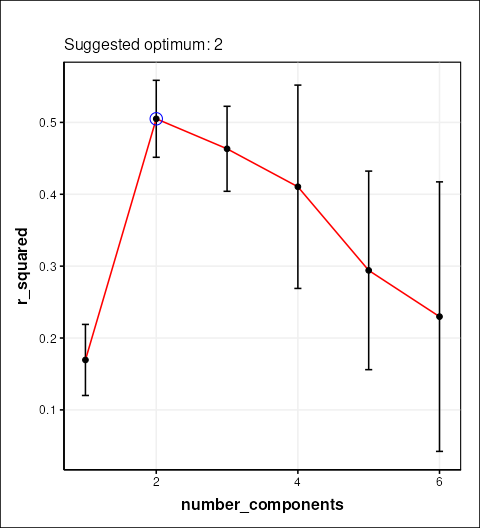

The chart plotted shows Q2, which is comparable with Figure 13 of
[Mendez et al](NA) . Two components were selected by Mendez et al, so we
will use that here.

#### PLS model evalutation

To evaluate the model for discriminant analysis in structToolbox the
`PLSDA` model is appropriate.

\
`# prepare the discriminant model`\
`P`` ``=`` `[`PLSDA`](https://computational-metabolomics.github.io/structToolbox/reference/PLSDA.md)`(``number_components ``=`` ``2``, factor_name``=``'Class'``)`\
\
`# apply the model`\
`P`` ``=`` `[`model_apply`](https://computational-metabolomics.github.io/structToolbox/reference/model_apply.md)`(``P``,``train_st``)`\
\
`# charts`\
`C`` ``=`` `[`plsda_predicted_plot`](https://computational-metabolomics.github.io/structToolbox/reference/plsda_predicted_plot.md)`(``factor_name``=``'Class'``,style``=``'boxplot'``)`\
`g1`` ``=`` `[`chart_plot`](https://computational-metabolomics.github.io/structToolbox/reference/chart_plot.md)`(``C``,``P``)`\
\
`C`` ``=`` `[`plsda_predicted_plot`](https://computational-metabolomics.github.io/structToolbox/reference/plsda_predicted_plot.md)`(``factor_name``=``'Class'``,style``=``'density'``)`\
`g2`` ``=`` `[`chart_plot`](https://computational-metabolomics.github.io/structToolbox/reference/chart_plot.md)`(``C``,``P``)``+`[`xlim`](https://ggplot2.tidyverse.org/reference/lims.html)`(`[`c`](https://rdrr.io/r/base/c.html)`(``-``2``,``2``)``)`\
\
`C`` ``=`` `[`plsda_roc_plot`](https://computational-metabolomics.github.io/structToolbox/reference/plsda_roc_plot.md)`(``factor_name``=``'Class'``)`\
`g3`` ``=`` `[`chart_plot`](https://computational-metabolomics.github.io/structToolbox/reference/chart_plot.md)`(``C``,``P``)`\
\
[`plot_grid`](https://wilkelab.org/cowplot/reference/plot_grid.html)`(``g1``,``g2``,``g3``,align``=``'vh'``,axis``=``'tblr'``,nrow``=``1``, labels``=`[`c`](https://rdrr.io/r/base/c.html)`(``'A'``,``'B'``,``'C'``)``)`

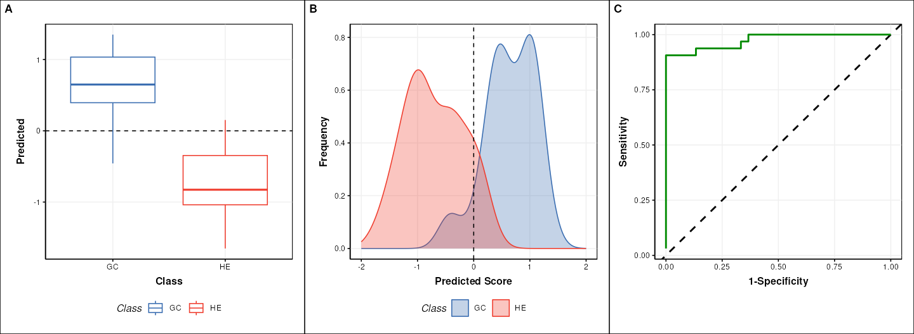

\
`# AUC for comparison with Mendez et al`\
`MET`` ``=`` `[`calculate`](https://computational-metabolomics.github.io/structToolbox/reference/calculate.md)`(`[`AUC`](https://computational-metabolomics.github.io/structToolbox/reference/AUC.md)`(``)``,``P``$``y``$``Class``,``P``$``yhat``[``,``1``]``)`\
`MET`

    ## A "AUC" object
    ## --------------
    ## name:          Area under ROC curve
    ## description:   The area under the ROC curve of a classifier is estimated using the trapezoid method.
    ## value:         0.9739583

Note that the default cutoff in A and B of the figure above for the PLS
models in `structToolbox` is 0, because groups are encoded as +/-1. This
has no impact on the overall performance of the model.

#### Permutation test

A permutation test can be used to assess how likely the observed result
is to have occurred by chance. In structToolbox `permutation_test` is an
iterator object that can be combined with other iterators and models.

\
`# model sequence`\
`MS`` ``=`` `[`permutation_test`](https://computational-metabolomics.github.io/structToolbox/reference/permutation_test.md)`(``number_of_permutations ``=`` ``20``,factor_name ``=`` ``'Class_num'``)`` ``*`` `\
`     `[`kfold_xval`](https://computational-metabolomics.github.io/structToolbox/reference/kfold_xval.md)`(``folds ``=`` ``5``,factor_name ``=`` ``'Class_num'``)`` ``*`\
`     ``(`[`mean_centre`](https://computational-metabolomics.github.io/structToolbox/reference/mean_centre.md)`(``mode``=``'sample_meta'``)`` ``+`` `[`PLSR`](https://computational-metabolomics.github.io/structToolbox/reference/PLSR.md)`(``factor_name``=``'Class_num'``, number_components ``=`` ``2``)``)`\
\
`# run iterator`\
`MS`` ``=`` ``struct``::`[`run`](https://rdrr.io/pkg/struct/man/iterator.html)`(``MS``,``train_st``,`[`r_squared`](https://computational-metabolomics.github.io/structToolbox/reference/r_squared.md)`(``)``)`\
\
`# chart`\
`C`` ``=`` `[`permutation_test_plot`](https://computational-metabolomics.github.io/structToolbox/reference/permutation_test_plot.md)`(``style ``=`` ``'density'``)`` `\
[`chart_plot`](https://computational-metabolomics.github.io/structToolbox/reference/chart_plot.md)`(``C``,``MS``)`` ``+`` `[`xlim`](https://ggplot2.tidyverse.org/reference/lims.html)`(`[`c`](https://rdrr.io/r/base/c.html)`(``-``1``,``1``)``)`` ``+`` `[`xlab`](https://ggplot2.tidyverse.org/reference/labs.html)`(``'R Squared'``)`

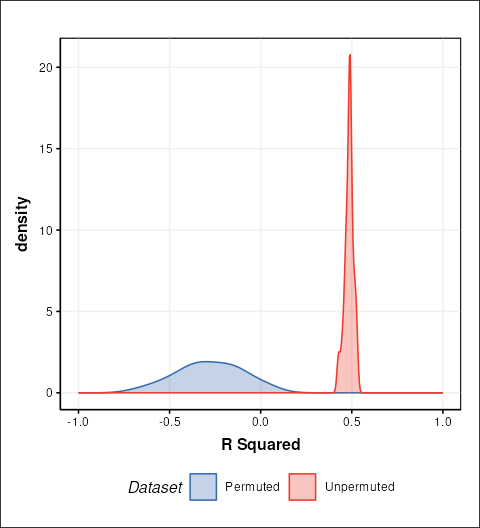

This plot is comparable to the bottom half of Figure 17 in [Mendez et.
al.](https://cimcb.github.io/MetabWorkflowTutorial/Tutorial1.html). The
unpermuted (true) Q2 values are consistently better than the permuted
(null) models. i.e. the model is reliable.

#### PLS projection plots

PLS can also be used to visualise the model and interpret the latent
variables.

\
`# prepare the discriminant model`\
`P`` ``=`` `[`PLSDA`](https://computational-metabolomics.github.io/structToolbox/reference/PLSDA.md)`(``number_components ``=`` ``2``, factor_name``=``'Class'``)`\
\
`# apply the model`\
`P`` ``=`` `[`model_apply`](https://computational-metabolomics.github.io/structToolbox/reference/model_apply.md)`(``P``,``train_st``)`\
\
`C`` ``=`` `[`pls_scores_plot`](https://computational-metabolomics.github.io/structToolbox/reference/pls_scores_plot.md)`(``components``=`[`c`](https://rdrr.io/r/base/c.html)`(``1``,``2``)``,factor_name ``=`` ``'Class'``)`\
[`chart_plot`](https://computational-metabolomics.github.io/structToolbox/reference/chart_plot.md)`(``C``,``P``)`

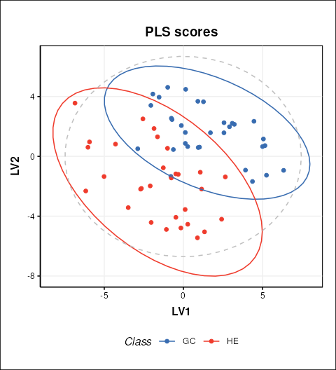

#### PLS feature importance

Regression coefficients and VIP scores can be used to estimate the
importance of individual features to the PLS model. In Mendez et al
bootstrapping is used to estimate the confidence intervals, but for
brevity here we will skip this.

\
`# prepare chart`\
`C`` ``=`` `[`pls_vip_plot`](https://computational-metabolomics.github.io/structToolbox/reference/pls_vip_plot.md)`(``ycol ``=`` ``'HE'``)`\
`g1`` ``=`` `[`chart_plot`](https://computational-metabolomics.github.io/structToolbox/reference/chart_plot.md)`(``C``,``P``)`\
\
`C`` ``=`` `[`pls_regcoeff_plot`](https://computational-metabolomics.github.io/structToolbox/reference/pls_regcoeff_plot.md)`(``ycol``=``'HE'``)`\
`g2`` ``=`` `[`chart_plot`](https://computational-metabolomics.github.io/structToolbox/reference/chart_plot.md)`(``C``,``P``)`\
\
[`plot_grid`](https://wilkelab.org/cowplot/reference/plot_grid.html)`(``g1``,``g2``,align``=``'hv'``,axis``=``'tblr'``,nrow``=``2``)`

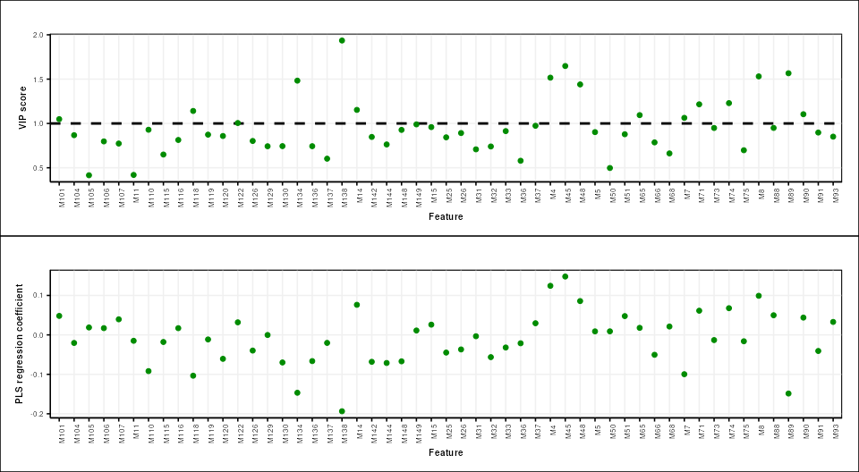

## Exploratory data analysis of LC-MS-based proteomics and metabolomics datasets (STATegra project)

### Introduction

The aim of this vignette is to conduct data preprocessing and
exploratory analysis of data from the STATegra project
(<https://www.nature.com/articles/s41597-019-0202-7>). For demonstration
purposes we will focus on the Proteomics and Metabolomics datasets that
are publicly available as part of the STATegra multi-omics dataset.

> …the STATegra multi-omics dataset combines measurements from up to 10
> different omics technologies applied to the same biological system,
> namely the well-studied mouse pre-B-cell differentiation. STATegra
> includes high-throughput measurements of chromatin structure, gene
> expression, proteomics and metabolomics, and it is complemented with
> single-cell data. [Gomez-Cabrero et
> al](https://www.nature.com/articles/s41597-019-0202-7)

STATegra includes high-throughput measurements of chromatin structure,
gene expression, proteomics and metabolomics, and it is complemented
with single-cell data.

### LC-MS-based proteomics dataset

The LC-MS-based proteomics dataset from the STATegra multi-omics dataset
(see Introduction) can be found on
[github](https://github.com/STATegraData/STATegraData) and must be
extracted from the zip file prior to data analysis.

\
`# path to zip`\
`zipfile`` ``=`` ``"https://raw.github.com/STATegraData/STATegraData/master/Script_STATegra_Proteomics.zip"`\
\
`## retrieve from BiocFileCache`\
`path`` ``=`` `[`bfcrpath`](https://rdrr.io/pkg/BiocFileCache/man/BiocFileCache-class.html)`(``bfc``,``zipfile``)`\
`temp`` ``=`` `[`bfccache`](https://rdrr.io/pkg/BiocFileCache/man/BiocFileCache-class.html)`(``bfc``)`\
\
`## ... or download to temp location`\
`# path = tempfile()`\
`# temp = tempdir()`\
`# download.file(zipfile,path)`\
\
`# unzip`\
[`unzip`](https://rdrr.io/r/utils/unzip.html)`(``path``, files ``=`` ``"Proteomics_01_uniprot_canonical_normalized.txt"``, exdir``=``temp``)`\
`# read samples`\
`all_data`` ``<-``  `[`read.delim`](https://rdrr.io/r/utils/read.table.html)`(`[`file.path`](https://rdrr.io/r/base/file.path.html)`(``temp``,``"Proteomics_01_uniprot_canonical_normalized.txt"``)``, as.is ``=`` ``TRUE``, header ``=`` ``TRUE``, sep ``=`` ``"\t"``)`

The imported data needs to be converted to `DatasetExperiment` format
for use with `structToolbox`.

\
`# extract data matrix`\
`data`` ``=`` ``all_data``[``1``:``2527``,``51``:``86``]`\
`# shorten sample names`\
[`colnames`](https://rdrr.io/r/base/colnames.html)`(``data``)`` ``=`` `[`lapply`](https://rdrr.io/r/base/lapply.html)`(`[`colnames`](https://rdrr.io/r/base/colnames.html)`(``data``)``, ``function`` ``(``x``)`` `[`substr`](https://rdrr.io/r/base/substr.html)`(``x``, ``27``, `[`nchar`](https://rdrr.io/r/base/nchar.html)`(``x``)``)``)`\
`# replace 0 with NA`\
`data``[``data`` ``==`` ``0``]`` ``<-`` ``NA`\
`# transpose`\
`data``=`[`as.data.frame`](https://rdrr.io/r/base/as.data.frame.html)`(`[`t`](https://rdrr.io/r/base/t.html)`(``data``)``)`\
\
`# prepare sample meta`\
`SM`` ``=`` `[`lapply`](https://rdrr.io/r/base/lapply.html)`(`[`rownames`](https://rdrr.io/r/base/colnames.html)`(``data``)``,``function``(``x``)`` ``{`\
`  ``s``=`[`strsplit`](https://rdrr.io/r/base/strsplit.html)`(``x``,``'_'``)``[[``1``]``]`` ``# split at underscore`\
`  ``out``=`[`data.frame`](https://rdrr.io/r/base/data.frame.html)`(`\
`    ``'treatment'`` ``=`` ``s``[[``1``]``]``,`\
`    ``'time'`` ``=`` `[`substr`](https://rdrr.io/r/base/substr.html)`(``s``[[``2``]``]``,``1``,`[`nchar`](https://rdrr.io/r/base/nchar.html)`(``s``[[``2``]``]``)``-``1``)`` ,    `\
`    ``'batch'`` ``=`` `[`substr`](https://rdrr.io/r/base/substr.html)`(``s``[[``3``]``]``,``6``,`[`nchar`](https://rdrr.io/r/base/nchar.html)`(``s``[[``3``]``]``)``)``,`\
`    ``'condition'`` ``=`` `[`substr`](https://rdrr.io/r/base/substr.html)`(``x``,``1``,``6``)`` ``# interaction between treatment and time`\
`  ``)`\
`  `[`return`](https://rdrr.io/r/base/function.html)`(``out``)`\
`}``)`\
`SM`` ``=`` `[`do.call`](https://rdrr.io/r/base/do.call.html)`(``rbind``,``SM``)`\
[`rownames`](https://rdrr.io/r/base/colnames.html)`(``SM``)``=`[`rownames`](https://rdrr.io/r/base/colnames.html)`(``data``)`\
`# convert to factors`\
`SM``$``treatment``=`[`factor`](https://rdrr.io/r/base/factor.html)`(``SM``$``treatment``)`\
`SM``$``time``=`[`ordered`](https://rdrr.io/r/base/factor.html)`(``SM``$``time``,`[`c`](https://rdrr.io/r/base/c.html)`(``"0"``,``"2"``,``"6"``,``"12"``,``"18"``,``"24"``)``)`\
`SM``$``batch``=`[`ordered`](https://rdrr.io/r/base/factor.html)`(``SM``$``batch``,`[`c`](https://rdrr.io/r/base/c.html)`(``1``,``3``,``4``,``5``,``6``,``7``)``)`\
`SM``$``condition``=`[`factor`](https://rdrr.io/r/base/factor.html)`(``SM``$``condition``)`\
\
`# variable meta data`\
`VM`` ``=`` ``all_data``[``1``:``2527``,`[`c`](https://rdrr.io/r/base/c.html)`(``1``,``6``,``7``)``]`\
[`rownames`](https://rdrr.io/r/base/colnames.html)`(``VM``)``=`[`colnames`](https://rdrr.io/r/base/colnames.html)`(``data``)`\
\
`# prepare DatasetExperiment`\
`DS`` ``=`` `[`DatasetExperiment`](https://rdrr.io/pkg/struct/man/struct_DatasetExperiment.html)`(`\
`  data ``=`` ``data``, `\
`  sample_meta ``=`` ``SM``, `\
`  variable_meta ``=`` ``VM``, `\
`  name ``=`` ``'STATegra Proteomics'``,`\
`  description ``=`` ``'downloaded from: https://github.com/STATegraData/STATegraData/'`\
`)`\
`DS`

    ## A "DatasetExperiment" object
    ## ----------------------------
    ## name:          STATegra Proteomics
    ## description:   downloaded from: https://github.com/STATegraData/STATegraData/
    ## data:          36 rows x 2527 columns
    ## sample_meta:   36 rows x 4 columns
    ## variable_meta: 2527 rows x 3 columns

A number of Reporter genes were included in the study. We plot two of
them here to illustrate some trends in the data.

\
`# find id of reporters`\
`Ldha`` ``=`` `[`which`](https://rdrr.io/r/base/which.html)`(``DS``$``variable_meta``$``Gene.names``==``'Ldha'``)`\
`Hk2`` ``=`` `[`which`](https://rdrr.io/r/base/which.html)`(``DS``$``variable_meta``$``Gene.names``==``'Hk2'``)`\
\
`# chart object`\
`C`` ``=`` `[`feature_boxplot`](https://computational-metabolomics.github.io/structToolbox/reference/feature_boxplot.md)`(``feature_to_plot``=``Ldha``,factor_name``=``'time'``,label_outliers``=``FALSE``)`\
`g1``=`[`chart_plot`](https://computational-metabolomics.github.io/structToolbox/reference/chart_plot.md)`(``C``,``DS``)``+`[`ggtitle`](https://ggplot2.tidyverse.org/reference/labs.html)`(``'Ldha'``)``+`[`ylab`](https://ggplot2.tidyverse.org/reference/labs.html)`(``'expression'``)`\
`C`` ``=`` `[`feature_boxplot`](https://computational-metabolomics.github.io/structToolbox/reference/feature_boxplot.md)`(``feature_to_plot``=``Hk2``,factor_name``=``'time'``,label_outliers``=``FALSE``)`\
`g2``=`[`chart_plot`](https://computational-metabolomics.github.io/structToolbox/reference/chart_plot.md)`(``C``,``DS``)``+`[`ggtitle`](https://ggplot2.tidyverse.org/reference/labs.html)`(``'Hk2'``)``+`[`ylab`](https://ggplot2.tidyverse.org/reference/labs.html)`(``'expression'``)`\
\
[`plot_grid`](https://wilkelab.org/cowplot/reference/plot_grid.html)`(``g1``,``g2``,nrow``=``1``,align``=``'vh'``,axis``=``'tblr'``)`

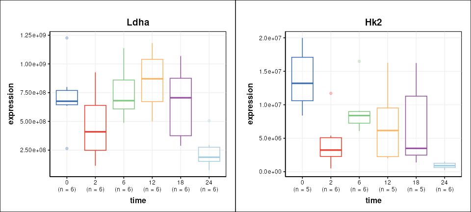

#### Data transformation

The data is log2 transformed, then scaled such that the mean of the
medians is equal for all conditions. These steps are available in
`structToolbox` using `log_transform` and `mean_of_medians` objects.

\
`# prepare model sequence`\
`M`` ``=`` `[`log_transform`](https://computational-metabolomics.github.io/structToolbox/reference/log_transform.md)`(`\
`  base``=``2``)`` ``+`` `\
`  `[`mean_of_medians`](https://computational-metabolomics.github.io/structToolbox/reference/mean_of_medians.md)`(`\
`    factor_name ``=`` ``'condition'``)`\
`# apply model sequence`\
`M`` ``=`` `[`model_apply`](https://computational-metabolomics.github.io/structToolbox/reference/model_apply.md)`(``M``,``DS``)`` `\
\
`# get transformed data`\
`DST`` ``=`` `[`predicted`](https://rdrr.io/pkg/struct/man/predicted.html)`(``M``)`

The Reporter genes are plotted again for comparison.

\
`# chart object`\
`C`` ``=`` `[`feature_boxplot`](https://computational-metabolomics.github.io/structToolbox/reference/feature_boxplot.md)`(``feature_to_plot``=``Ldha``,factor_name``=``'time'``,label_outliers``=``FALSE``)`\
`g1``=`[`chart_plot`](https://computational-metabolomics.github.io/structToolbox/reference/chart_plot.md)`(``C``,``DST``)``+`[`ggtitle`](https://ggplot2.tidyverse.org/reference/labs.html)`(``'Ldha'``)``+`[`ylab`](https://ggplot2.tidyverse.org/reference/labs.html)`(``'log2(expression)'``)`\
`C`` ``=`` `[`feature_boxplot`](https://computational-metabolomics.github.io/structToolbox/reference/feature_boxplot.md)`(``feature_to_plot``=``Hk2``,factor_name``=``'time'``,label_outliers``=``FALSE``)`\
`g2``=`[`chart_plot`](https://computational-metabolomics.github.io/structToolbox/reference/chart_plot.md)`(``C``,``DST``)``+`[`ggtitle`](https://ggplot2.tidyverse.org/reference/labs.html)`(``'Hk2'``)``+`[`ylab`](https://ggplot2.tidyverse.org/reference/labs.html)`(``'log2(expression)'``)`\
\
[`plot_grid`](https://wilkelab.org/cowplot/reference/plot_grid.html)`(``g1``,``g2``,nrow``=``1``,align``=``'vh'``,axis``=``'tblr'``)`

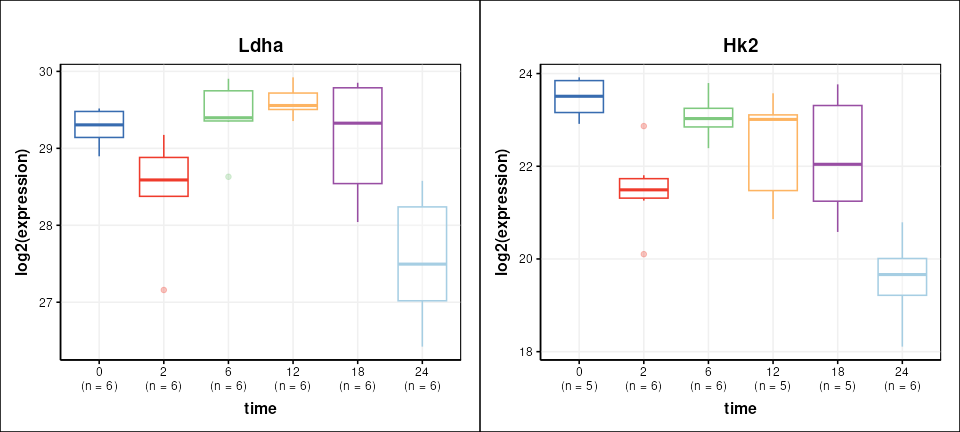

#### Missing value filtering

Missing value filtering involves removing any feature (gene) where there
are at least 3 missing values per group in at least 11 samples.

This specific filter is not in `structToolbox` at this time, but can be
achieved by combining `filter_na_count` and `filter_by_name` objects.

Specifically, the default output of `filter_na_count` is changed to
return a matrix of NA counts per class. This output is then connected to
the ‘names’ input of `filter_by_names` and converted to TRUE/FALSE using
the ‘seq_fcn’ input.

The ‘seq_fcn’ function processes the NA counts *before* they are used as
inputs for `filter_by_names`. When data is passed along the model
sequence it passes unchanged through the `filter_na_count` object
becuase the default output has been changed, so the `filter_na_count`
and `filter_by_name` objects are working together as a single filter.

\
`# build model sequence`\
`M2`` ``=`` `[`filter_na_count`](https://computational-metabolomics.github.io/structToolbox/reference/filter_na_count.md)`(`\
`  threshold``=``2``,`\
`  factor_name``=``'condition'``, `\
`  predicted``=``'na_count'``)`` ``+``    ``# override the default output`\
`  `[`filter_by_name`](https://computational-metabolomics.github.io/structToolbox/reference/filter_by_name.md)`(`\
`    mode``=``'exclude'``,`\
`    dimension``=``'variable'``,`\
`    names``=``'place_holder'``,`\
`    seq_in``=``'names'``,`\
`    seq_fcn``=``function``(``x``)`` ``{``      ``# convert NA count pre group to true/false`\
`      ``x``=``x``>``2``                  ``# more the two missing per group`\
`      ``x``=`[`rowSums`](https://rdrr.io/r/base/colSums.html)`(``x``)``>``10``        ``# in more than 10 groups`\
`      `[`return`](https://rdrr.io/r/base/function.html)`(``x``)`\
`    ``}`\
`  ``)`\
`# apply to transformed data`\
`M2`` ``=`` `[`model_apply`](https://computational-metabolomics.github.io/structToolbox/reference/model_apply.md)`(``M2``,``DST``)`\
\
`# get the filtered data`\
`DSTF`` ``=`` `[`predicted`](https://rdrr.io/pkg/struct/man/predicted.html)`(``M2``)`

#### Missing value imputation

STATegra uses two imputation methods that are not available as `struct`
objects, so we create temporary `STATegra_impute` objects to do this
using some functions from the `struct` package.

The first imputation method imputes missing values for any treatment
where values are missing for all samples using a “random value below
discovery”. We create a new struct object using `set_struct_obj` in the
global environment, and a “method_apply” method that implements the
imputation.

\
`# create new imputation object`\
[`set_struct_obj`](https://rdrr.io/pkg/struct/man/set_struct_obj.html)`(`\
`  class_name ``=`` ``'STATegra_impute1'``,`\
`  struct_obj ``=`` ``'model'``,`\
`  params``=`[`c`](https://rdrr.io/r/base/c.html)`(``factor_sd``=``'character'``,factor_name``=``'character'``)``,`\
`  outputs``=`[`c`](https://rdrr.io/r/base/c.html)`(``imputed``=``'DatasetExperiment'``)``,`\
`  prototype ``=`` `[`list`](https://rdrr.io/r/base/list.html)`(`\
`    name ``=`` ``'STATegra imputation 1'``,`\
`    description ``=`` ``'If missing values are present for all one group then they are replaced with min/2 + "random value below discovery".'``,`\
`    predicted ``=`` ``'imputed'`\
`  ``)`` `\
`)`\
\
`# create method_apply for imputation method 1`\
[`set_obj_method`](https://rdrr.io/pkg/struct/man/set_obj_method.html)`(`\
`  class_name``=``'STATegra_impute1'``,`\
`  method_name``=``'model_apply'``,`\
`  definition``=``function``(``M``,``D``)`` ``{`\
`    `\
`    ``# for each feature count NA within each level`\
`    ``na`` ``=`` `[`apply`](https://rdrr.io/r/base/apply.html)`(``D``$``data``,``2``,``function``(``x``)``{`\
`      `[`tapply`](https://rdrr.io/r/base/tapply.html)`(``x``,``D``$``sample_meta``[[``M``$``factor_name``]``]``,``function``(``y``)``{`\
`        `[`sum`](https://rdrr.io/r/base/sum.html)`(`[`is.na`](https://rdrr.io/r/base/NA.html)`(``y``)``)`\
`      ``}``)`\
`    ``}``)`\
`    ``# count number of samples in each group`\
`    ``count``=`[`summary`](https://rdrr.io/r/base/summary.html)`(``D``$``sample_meta``[[``M``$``factor_name``]``]``)`\
`    ``# standard deviation of features within levels of factor_sd`\
`    ``sd`` ``=`` `[`apply`](https://rdrr.io/r/base/apply.html)`(``D``$``data``,``2``,``function``(``x``)`` ``{`[`tapply`](https://rdrr.io/r/base/tapply.html)`(``x``,``D``$``sample_meta``[[``M``$``factor_sd``]``]``,``sd``,na.rm``=``TRUE``)``}``)`\
`    ``sd`` ``=`` `[`median`](https://rdrr.io/r/stats/median.html)`(``sd``,na.rm``=``TRUE``)`\
`    `\
`    ``# impute or not`\
`    ``check``=``na`` ``==`` `[`matrix`](https://rdrr.io/r/base/matrix.html)`(``count``,nrow``=``2``,ncol``=`[`ncol`](https://rdrr.io/r/base/nrow.html)`(``D``)``)`` ``# all missing in one class`\
`    `\
`    ``# impute matrix`\
`    ``mi`` ``=`` ``D``$``data`\
`    ``for`` ``(``j`` ``in`` ``1``:`[`nrow`](https://rdrr.io/r/base/nrow.html)`(``mi``)``)`` ``{`\
`      ``# index of group for this sample`\
`      ``g`` ``=`` `[`which`](https://rdrr.io/r/base/which.html)`(`[`levels`](https://rdrr.io/r/base/levels.html)`(``D``$``sample_meta``[[``M``$``factor_name``]``]``)``==``D``$``sample_meta``[[``M``$``factor_name``]``]``[``j``]``)`\
`      ``iv``=`[`rnorm`](https://rdrr.io/r/stats/Normal.html)`(`[`ncol`](https://rdrr.io/r/base/nrow.html)`(``D``)``,`[`min`](https://rdrr.io/r/base/Extremes.html)`(``D``$``data``[``j``,``]``,na.rm``=``TRUE``)``/``2``,``sd``)`\
`      ``mi``[``j``,`[`is.na`](https://rdrr.io/r/base/NA.html)`(``mi``[``j``,``]``)`` ``&`` ``check``[``g``,``]``]`` ``=`` ``iv``[`[`is.na`](https://rdrr.io/r/base/NA.html)`(``mi``[``j``,``]``)`` ``&`` ``check``[``g``,``]``]`\
`    ``}`\
`    ``D``$``data`` ``=`` ``mi`\
`    ``M``$``imputed``=``D`\
`    `[`return`](https://rdrr.io/r/base/function.html)`(``M``)`\
`  ``}`\
`)`

The second imputation method replacing missing values in any condition
with exactly 1 missing value with the mean of the values for that
condition. Again we create a new struct object and corresponding method
for the the new object to implement the filter.

\
`# create new imputation object`\
[`set_struct_obj`](https://rdrr.io/pkg/struct/man/set_struct_obj.html)`(`\
`  class_name ``=`` ``'STATegra_impute2'``,`\
`  struct_obj ``=`` ``'model'``,`\
`  params``=`[`c`](https://rdrr.io/r/base/c.html)`(``factor_name``=``'character'``)``,`\
`  outputs``=`[`c`](https://rdrr.io/r/base/c.html)`(``imputed``=``'DatasetExperiment'``)``,`\
`  prototype ``=`` `[`list`](https://rdrr.io/r/base/list.html)`(`\
`    name ``=`` ``'STATegra imputation 2'``,`\
`    description ``=`` ``'For those conditions with only 1 NA impute with the mean of the condition.'``,`\
`    predicted ``=`` ``'imputed'`\
`  ``)`` `\
`)`\
\
`# create method_apply for imputation method 2`\
[`set_obj_method`](https://rdrr.io/pkg/struct/man/set_obj_method.html)`(`\
`  class_name``=``'STATegra_impute2'``,`\
`  method_name``=``'model_apply'``,`\
`  definition``=``function``(``M``,``D``)`` ``{`\
`    ``# levels in condition`\
`    ``L`` ``=`` `[`levels`](https://rdrr.io/r/base/levels.html)`(``D``$``sample_meta``[[``M``$``factor_name``]``]``)`\
`    `\
`    ``# for each feature count NA within each level`\
`    ``na`` ``=`` `[`apply`](https://rdrr.io/r/base/apply.html)`(``D``$``data``,``2``,``function``(``x``)``{`\
`      `[`tapply`](https://rdrr.io/r/base/tapply.html)`(``x``,``D``$``sample_meta``[[``M``$``factor_name``]``]``,``function``(``y``)``{`\
`        `[`sum`](https://rdrr.io/r/base/sum.html)`(`[`is.na`](https://rdrr.io/r/base/NA.html)`(``y``)``)`\
`      ``}``)`\
`    ``}``)`\
`    `\
`    ``# standard deviation of features within levels of factor_sd`\
`    ``sd`` ``=`` `[`apply`](https://rdrr.io/r/base/apply.html)`(``D``$``data``,``2``,``function``(``x``)`` ``{`[`tapply`](https://rdrr.io/r/base/tapply.html)`(``x``,``D``$``sample_meta``[[``M``$``factor_name``]``]``,``sd``,na.rm``=``TRUE``)``}``)`\
`    ``sd`` ``=`` `[`median`](https://rdrr.io/r/stats/median.html)`(``sd``,na.rm``=``TRUE``)`\
`    `\
`    ``# impute or not`\
`    ``check``=``na`` ``==`` ``1`` ``# only one missing for a condition`\
`    `\
`    ``# index of samples for each condition`\
`    ``IDX`` ``=`` `[`list`](https://rdrr.io/r/base/list.html)`(``)`\
`    ``for`` ``(``k`` ``in`` ``L``)`` ``{`\
`      ``IDX``[[``k``]``]``=`[`which`](https://rdrr.io/r/base/which.html)`(``D``$``sample_meta``[[``M``$``factor_name``]``]``==``k``)`\
`    ``}`\
`    `\
`    ``## impute`\
`    ``# for each feature`\
`    ``for`` ``(``k`` ``in`` ``1``:`[`ncol`](https://rdrr.io/r/base/nrow.html)`(``D``)``)`` ``{`\
`      ``# for each condition`\
`      ``for`` ``(``j`` ``in`` ``1``:`[`length`](https://rdrr.io/r/base/length.html)`(``L``)``)`` ``{`\
`        ``# if passes test`\
`        ``if`` ``(``check``[``j``,``k``]``)`` ``{`\
`          ``# mean of samples in group`\
`          ``m`` ``=`` `[`mean`](https://rdrr.io/r/base/mean.html)`(``D``$``data``[``IDX``[[``j``]``]``,``k``]``,na.rm``=``TRUE``)`\
`          ``# imputed value`\
`          ``im`` ``=`` `[`rnorm`](https://rdrr.io/r/stats/Normal.html)`(``1``,``m``,``sd``)`\
`          ``# replace NA with imputed`\
`          ``D``$``data``[`[`is.na`](https://rdrr.io/r/base/NA.html)`(``D``$``data``[``,``k``]``)`` ``&`` ``D``$``sample_meta``[[``M``$``factor_name``]``]``==``L``[``j``]``,``k``]``=``im`\
`        ``}`\
`      ``}`\
`    ``}`\
`    ``M``$``imputed``=``D`\
`    `[`return`](https://rdrr.io/r/base/function.html)`(``M``)`\
`  ``}`\
`)`

The new STATegra imputation objects can now be used in model sequences
like any other `struct` object. A final filter is added to remove any
feature that has missing values after imputation.

\
`# model sequence`\
`M3`` ``=`` ``STATegra_impute1``(``factor_name``=``'treatment'``,factor_sd``=``'condition'``)`` ``+`\
`     ``STATegra_impute2``(``factor_name ``=`` ``'condition'``)`` ``+`` `\
`     `[`filter_na_count`](https://computational-metabolomics.github.io/structToolbox/reference/filter_na_count.md)`(``threshold ``=`` ``3``, factor_name``=``'condition'``)`\
`# apply model`\
`M3`` ``=`` `[`model_apply`](https://computational-metabolomics.github.io/structToolbox/reference/model_apply.md)`(``M3``,``DSTF``)`\
`# get imputed data`\
`DSTFI`` ``=`` `[`predicted`](https://rdrr.io/pkg/struct/man/predicted.html)`(``M3``)`\
`DSTFI`

    ## A "DatasetExperiment" object
    ## ----------------------------
    ## name:          STATegra Proteomics
    ## description:   downloaded from: https://github.com/STATegraData/STATegraData/
    ## data:          36 rows x 864 columns
    ## sample_meta:   36 rows x 4 columns
    ## variable_meta: 864 rows x 3 columns

#### Exploratory analysis

It is often useful to visualise the distribution of values across
samples to verify that the transformations/normalisation/filtering etc
have been effective.

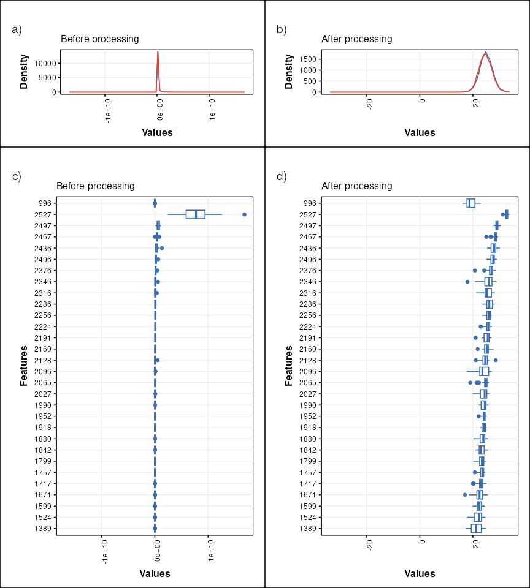

The values are no longer skewed and show an approximately normal
distribution. The boxplots are comparable in width with very few
outliers indicated, so the transformations etc have had an overall
positive effect.

PCA is used to provide a graphical representation of the data. For
comparison with the outputs from STATegra a filter is included to reduce
the data to include only the treated samples (IKA)

\
`# model sequence`\
`P`` ``=`` `[`filter_smeta`](https://computational-metabolomics.github.io/structToolbox/reference/filter_smeta.md)`(``mode``=``'include'``,factor_name``=``'treatment'``,levels``=``'IKA'``)`` ``+`\
`    `[`mean_centre`](https://computational-metabolomics.github.io/structToolbox/reference/mean_centre.md)`(``)`` ``+`` `\
`    `[`PCA`](https://computational-metabolomics.github.io/structToolbox/reference/PCA.md)`(``number_components ``=`` ``2``)`\
`# apply model`\
`P`` ``=`` `[`model_apply`](https://computational-metabolomics.github.io/structToolbox/reference/model_apply.md)`(``P``,``DSTFI``)`\
\
`# scores plots coloured by factors`\
`g`` ``=`` `[`list`](https://rdrr.io/r/base/list.html)`(``)`\
`for`` ``(``k`` ``in`` `[`c`](https://rdrr.io/r/base/c.html)`(``'batch'``,``'time'``)``)`` ``{`\
`  ``C`` ``=`` `[`pca_scores_plot`](https://computational-metabolomics.github.io/structToolbox/reference/pca_scores_plot.md)`(``factor_name``=``k``,ellipse``=``'none'``)`\
`  ``g``[[``k``]``]``=`[`chart_plot`](https://computational-metabolomics.github.io/structToolbox/reference/chart_plot.md)`(``C``,``P``[``3``]``)`\
`}`\
\
[`plot_grid`](https://wilkelab.org/cowplot/reference/plot_grid.html)`(``plotlist ``=`` ``g``,nrow``=``1``)`

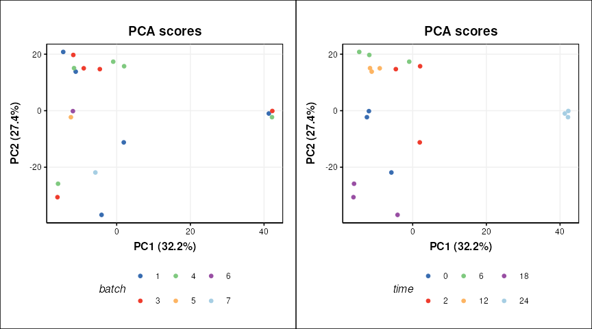

There does not appear to be a strong batch effect. PC1 is dominated by
time point “24” and some potentially outlying points from time points
“2” and “0”.

### LC-MS-based metabolomics dataset

The LC-MS-based metabolomics dataset from the STATegra multi-omics
dataset (see Introduction) can be found on
[github](https://github.com/STATegraData/STATegraData) and must be
extracted from zip file prior to data analysis.

\
`# path to zip`\
`zipfile`` ``=`` ``"https://raw.github.com/STATegraData/STATegraData/master/Script_STATegra_Metabolomics.zip"`\
\
`## retrieve from BiocFileCache`\
`path`` ``=`` `[`bfcrpath`](https://rdrr.io/pkg/BiocFileCache/man/BiocFileCache-class.html)`(``bfc``,``zipfile``)`\
`temp`` ``=`` `[`bfccache`](https://rdrr.io/pkg/BiocFileCache/man/BiocFileCache-class.html)`(``bfc``)`\
\
`## ... or download to temp location`\
`# path = tempfile()`\
`# temp = tempdir()`\
`# download.file(zipfile,path)`\
\
`# unzip`\
[`unzip`](https://rdrr.io/r/utils/unzip.html)`(``zipfile``=``path``, files ``=`` ``"LC_MS_raw_data.xlsx"``, exdir``=``temp``)`\
\
`# read samples`\
`data`` ``<-`` `[`as.data.frame`](https://rdrr.io/r/base/as.data.frame.html)`(`[`read.xlsx`](https://rdrr.io/pkg/openxlsx/man/read.xlsx.html)`(`[`file.path`](https://rdrr.io/r/base/file.path.html)`(``temp``,``"LC_MS_raw_data.xlsx"``)``,sheet ``=`` ``'Data'``)``)`

The imported data needs to be converted to `DatasetExperiment` format
for use with `structToolbox`.

\
`# extract sample meta data`\
`SM`` ``=`` ``data``[`` ,``1``:``8``]`\
\
`# add coloumn for sample type (QC, blank etc)`\
`blanks``=`[`c`](https://rdrr.io/r/base/c.html)`(``1``,``2``,``33``,``34``,``65``,``66``)`\
`QCs``=`[`c`](https://rdrr.io/r/base/c.html)`(``3``,``4``,``11``,``18``,``25``,``32``,``35``,``36``,``43``,``50``,``57``,``64``)`\
`SM``$``sample_type``=``'Sample'`\
`SM``$``sample_type``[``blanks``]``=``'Blank'`\
`SM``$``sample_type``[``QCs``]``=``'QC'`\
\
`# put qc/blank labels in all factors for plotting later`\
`SM``$``biol.batch``[``SM``$``sample_type``!=``'Sample'``]``=``SM``$``sample_type``[``SM``$``sample_type``!=``'Sample'``]`\
`SM``$``time.point``[``SM``$``sample_type``!=``'Sample'``]``=``SM``$``sample_type``[``SM``$``sample_type``!=``'Sample'``]`\
`SM``$``condition``[``SM``$``sample_type``!=``'Sample'``]``=``SM``$``sample_type``[``SM``$``sample_type``!=``'Sample'``]`\
\
`# convert to factors`\
`SM``$``biol.batch``=`[`ordered`](https://rdrr.io/r/base/factor.html)`(``SM``$``biol.batch``,`[`c`](https://rdrr.io/r/base/c.html)`(``'9'``,``'10'``,``'11'``,``'12'``,``'QC'``,``'Blank'``)``)`\
`SM``$``time.point``=`[`ordered`](https://rdrr.io/r/base/factor.html)`(``SM``$``time.point``,`[`c`](https://rdrr.io/r/base/c.html)`(``'0h'``,``'2h'``,``'6h'``,``'12h'``,``'18h'``,``'24h'``,``'QC'``,``'Blank'``)``)`\
`SM``$``condition``=`[`factor`](https://rdrr.io/r/base/factor.html)`(``SM``$``condition``)`\
`SM``$``sample_type``=`[`factor`](https://rdrr.io/r/base/factor.html)`(``SM``$``sample_type``)`\
\
`# variable meta data`\
`VM`` ``=`` `[`data.frame`](https://rdrr.io/r/base/data.frame.html)`(``'annotation'``=`[`colnames`](https://rdrr.io/r/base/colnames.html)`(``data``)``[``9``:`[`ncol`](https://rdrr.io/r/base/nrow.html)`(``data``)``]``)`\
\
`# raw data`\
`X`` ``=`` ``data``[``,``9``:`[`ncol`](https://rdrr.io/r/base/nrow.html)`(``data``)``]`\
`# convert 0 to NA`\
`X``[``X``==``0``]``=``NA`\
`# force to numeric; any non-numerics will become NA`\
`X``=`[`data.frame`](https://rdrr.io/r/base/data.frame.html)`(`[`lapply`](https://rdrr.io/r/base/lapply.html)`(``X``,``as.numeric``)``,check.names ``=`` ``FALSE``)`\
\
`# make sure row/col names match`\
[`rownames`](https://rdrr.io/r/base/colnames.html)`(``X``)``=``data``$``label`\
[`rownames`](https://rdrr.io/r/base/colnames.html)`(``SM``)``=``data``$``label`\
[`rownames`](https://rdrr.io/r/base/colnames.html)`(``VM``)``=`[`colnames`](https://rdrr.io/r/base/colnames.html)`(``X``)`\
\
\
`# create DatasetExperiment object`\
`DE`` ``=`` `[`DatasetExperiment`](https://rdrr.io/pkg/struct/man/struct_DatasetExperiment.html)`(`\
`  data ``=`` ``X``, `\
`  sample_meta ``=`` ``SM``, `\
`  variable_meta ``=`` ``VM``, `\
`  name ``=`` ``'STATegra Metabolomics LCMS'``,`\
`  description ``=`` ``'https://www.nature.com/articles/s41597-019-0202-7'`\
`)`\
\
`DE`

    ## A "DatasetExperiment" object
    ## ----------------------------
    ## name:          STATegra Metabolomics LCMS
    ## description:   https://www.nature.com/articles/s41597-019-0202-7
    ## data:          66 rows x 152 columns
    ## sample_meta:   66 rows x 9 columns
    ## variable_meta: 152 rows x 1 columns

#### Data preprocessing

In the STATegra project the LCMS data was combined with GCMS data and
multiblock analysis was conducted. Here only the LCMS will be explored,
so the data will be processed differently in comparison to
[Gomez-Cabrero et
al](https://www.nature.com/articles/s41597-019-0202-7). Some basic
processing steps will be applied in order to generate a valid PCA plot
from the biological and QC samples.

\
`# prepare model sequence`\
`MS`` ``=`` `[`filter_smeta`](https://computational-metabolomics.github.io/structToolbox/reference/filter_smeta.md)`(``mode ``=`` ``'include'``, levels``=``'QC'``, factor_name ``=`` ``'sample_type'``)`` ``+`\
`     `[`knn_impute`](https://computational-metabolomics.github.io/structToolbox/reference/knn_impute.md)`(``neighbours``=``5``)`` ``+`\
`     `[`vec_norm`](https://computational-metabolomics.github.io/structToolbox/reference/vec_norm.md)`(``)`` ``+`` `\
`     `[`log_transform`](https://computational-metabolomics.github.io/structToolbox/reference/log_transform.md)`(``base ``=`` ``10``)`` `\
\
`# apply model sequence`\
`MS`` ``=`` `[`model_apply`](https://computational-metabolomics.github.io/structToolbox/reference/model_apply.md)`(``MS``, ``DE``)`

    ## Warning in knnimp(x, k, maxmiss = rowmax, maxp = maxp): 3 rows with more than 50 % entries missing;
    ##  mean imputation used for these rows

#### Exploratory analysis

First we will use PCA to look at the QC samples in order to make an
assessment of the data quality.

\
`# pca model sequence`\
`M`` ``=``  `[`mean_centre`](https://computational-metabolomics.github.io/structToolbox/reference/mean_centre.md)`(``)`` ``+`\
`     `[`PCA`](https://computational-metabolomics.github.io/structToolbox/reference/PCA.md)`(``number_components ``=`` ``3``)`\
\
`# apply model`\
`M`` ``=`` `[`model_apply`](https://computational-metabolomics.github.io/structToolbox/reference/model_apply.md)`(``M``,`[`predicted`](https://rdrr.io/pkg/struct/man/predicted.html)`(``MS``)``)`\
\
\
`# PCA scores plot`\
`C`` ``=`` `[`pca_scores_plot`](https://computational-metabolomics.github.io/structToolbox/reference/pca_scores_plot.md)`(``factor_name ``=`` ``'sample_type'``,label_factor ``=`` ``'order'``,points_to_label ``=`` ``'all'``)`\
`# plot`\
[`chart_plot`](https://computational-metabolomics.github.io/structToolbox/reference/chart_plot.md)`(``C``,``M``[``2``]``)`

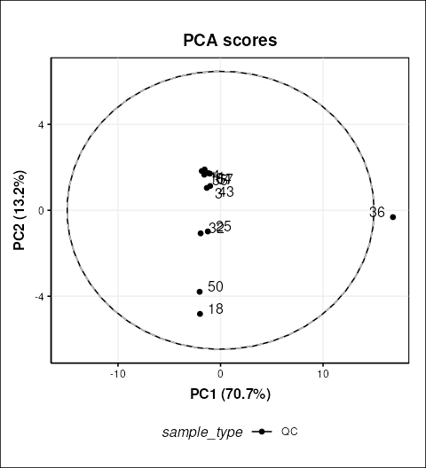

The QC labelled “36” is clearly very different to the other QCs. In
STATegra this QC was removed, so we will exclude it here as well. This
corresponds to QC H1. STATegra also excluded QC samples measured
immediately after a blank, which we will also do here.

\
`# prepare model sequence`\
`MS`` ``=`` `[`filter_smeta`](https://computational-metabolomics.github.io/structToolbox/reference/filter_smeta.md)`(`\
`      mode ``=`` ``'include'``, `\
`      levels``=``'QC'``, `\
`      factor_name ``=`` ``'sample_type'``)`` ``+`\
`  `\
`     `[`filter_by_name`](https://computational-metabolomics.github.io/structToolbox/reference/filter_by_name.md)`(`\
`      mode ``=`` ``'exclude'``, `\
`      dimension``=``'sample'``,`\
`      names ``=`` `[`c`](https://rdrr.io/r/base/c.html)`(``'1358BZU_0001QC_H1'``,``'1358BZU_0001QC_A1'``,``'1358BZU_0001QC_G1'``)``)`` ``+`\
`  `\
`     `[`knn_impute`](https://computational-metabolomics.github.io/structToolbox/reference/knn_impute.md)`(`\
`      neighbours``=``5``)`` ``+`\
`  `\
`     `[`vec_norm`](https://computational-metabolomics.github.io/structToolbox/reference/vec_norm.md)`(``)`` ``+`` `\
`  `\
`     `[`log_transform`](https://computational-metabolomics.github.io/structToolbox/reference/log_transform.md)`(`\
`       base ``=`` ``10``)`` ``+`` `\
`  `\
`     `[`mean_centre`](https://computational-metabolomics.github.io/structToolbox/reference/mean_centre.md)`(``)`` ``+`\
`  `\
`     `[`PCA`](https://computational-metabolomics.github.io/structToolbox/reference/PCA.md)`(`\
`       number_components ``=`` ``3``)`\
\
`# apply model sequence`\
`MS`` ``=`` `[`model_apply`](https://computational-metabolomics.github.io/structToolbox/reference/model_apply.md)`(``MS``, ``DE``)`

    ## Warning in knnimp(x, k, maxmiss = rowmax, maxp = maxp): 4 rows with more than 50 % entries missing;
    ##  mean imputation used for these rows

\
`# PCA scores plot`\
`C`` ``=`` `[`pca_scores_plot`](https://computational-metabolomics.github.io/structToolbox/reference/pca_scores_plot.md)`(``factor_name ``=`` ``'sample_type'``,label_factor ``=`` ``'order'``,points_to_label ``=`` ``'all'``)`\
`# plot`\
[`chart_plot`](https://computational-metabolomics.github.io/structToolbox/reference/chart_plot.md)`(``C``,``MS``[``7``]``)`

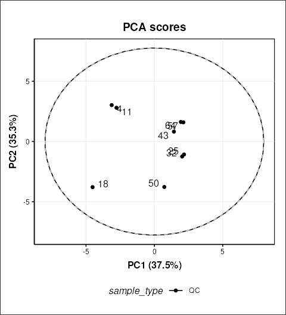

Now we will plot the QC samples in context with the samples. There are
several possible approaches, and we will apply the approach of applying
PCA to the full dataset including the QCs. We will exclude the blanks as
it is likely that they will dominate the plot if not removed. All
samples from batch 12 were excluded from STATegra and we will replicate
that here.

\
`# prepare model sequence`\
`MS`` ``=`` `[`filter_smeta`](https://computational-metabolomics.github.io/structToolbox/reference/filter_smeta.md)`(`\
`      mode ``=`` ``'exclude'``, `\
`      levels``=``'Blank'``, `\
`      factor_name ``=`` ``'sample_type'``)`` ``+`\
`  `\
`     `[`filter_smeta`](https://computational-metabolomics.github.io/structToolbox/reference/filter_smeta.md)`(`\
`      mode ``=`` ``'exclude'``, `\
`      levels``=``'12'``, `\
`      factor_name ``=`` ``'biol.batch'``)`` ``+`\
`  `\
`     `[`filter_by_name`](https://computational-metabolomics.github.io/structToolbox/reference/filter_by_name.md)`(`\
`      mode ``=`` ``'exclude'``, `\
`      dimension``=``'sample'``,`\
`      names ``=`` `[`c`](https://rdrr.io/r/base/c.html)`(``'1358BZU_0001QC_H1'``,`\
`                ``'1358BZU_0001QC_A1'``,`\
`                ``'1358BZU_0001QC_G1'``)``)`` ``+`\
`  `\
`     `[`knn_impute`](https://computational-metabolomics.github.io/structToolbox/reference/knn_impute.md)`(`\
`      neighbours``=``5``)`` ``+`\
`  `\
`     `[`vec_norm`](https://computational-metabolomics.github.io/structToolbox/reference/vec_norm.md)`(``)`` ``+`` `\
`  `\
`     `[`log_transform`](https://computational-metabolomics.github.io/structToolbox/reference/log_transform.md)`(`\
`       base ``=`` ``10``)`` ``+`` `\
`  `\
`     `[`mean_centre`](https://computational-metabolomics.github.io/structToolbox/reference/mean_centre.md)`(``)`` ``+`\
`  `\
`     `[`PCA`](https://computational-metabolomics.github.io/structToolbox/reference/PCA.md)`(`\
`       number_components ``=`` ``3``)`\
\
`# apply model sequence`\
`MS`` ``=`` `[`model_apply`](https://computational-metabolomics.github.io/structToolbox/reference/model_apply.md)`(``MS``, ``DE``)`

    ## Warning in knnimp(x, k, maxmiss = rowmax, maxp = maxp): 2 rows with more than 50 % entries missing;
    ##  mean imputation used for these rows

\
`# PCA scores plots`\
`C`` ``=`` `[`pca_scores_plot`](https://computational-metabolomics.github.io/structToolbox/reference/pca_scores_plot.md)`(``factor_name ``=`` ``'sample_type'``)`\
`# plot`\
[`chart_plot`](https://computational-metabolomics.github.io/structToolbox/reference/chart_plot.md)`(``C``,``MS``[``8``]``)`

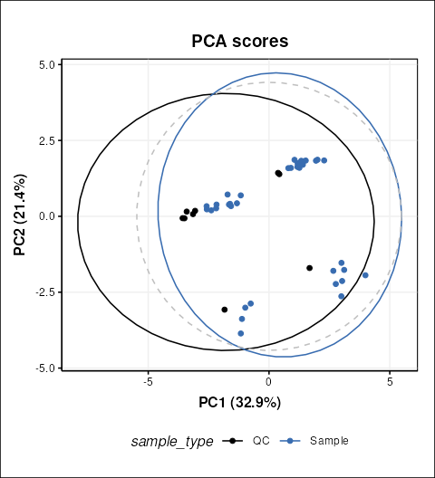

The QCs appear to representative of the samples, but there are strong
clusters in the data, including the QC samples which have no biological
variation. There is likely to be a number of ‘low quality’ features that
should be excluded, so we will do that now, and use more sophisticated
normalisation (PQN) and scaling methods (glog).

\
`MS`` ``=``  `[`filter_smeta`](https://computational-metabolomics.github.io/structToolbox/reference/filter_smeta.md)`(`\
`       mode ``=`` ``'exclude'``, `\
`       levels ``=`` ``'12'``, `\
`       factor_name ``=`` ``'biol.batch'``)`` ``+`\
`  `\
`      `[`filter_by_name`](https://computational-metabolomics.github.io/structToolbox/reference/filter_by_name.md)`(`\
`       mode ``=`` ``'exclude'``, `\
`       dimension``=``'sample'``,`\
`       names ``=`` `[`c`](https://rdrr.io/r/base/c.html)`(``'1358BZU_0001QC_H1'``,`\
`                 ``'1358BZU_0001QC_A1'``,`\
`                 ``'1358BZU_0001QC_G1'``)``)`` ``+`\
\
`      `[`blank_filter`](https://computational-metabolomics.github.io/structToolbox/reference/blank_filter.md)`(`\
`       fold_change ``=`` ``20``,`\
`       qc_label ``=`` ``'QC'``,`\
`       factor_name ``=`` ``'sample_type'``)`` ``+`\
\
`      `[`filter_smeta`](https://computational-metabolomics.github.io/structToolbox/reference/filter_smeta.md)`(`\
`       mode``=``'exclude'``,`\
`       levels``=``'Blank'``,`\
`       factor_name``=``'sample_type'``)`` ``+`\
`  `\
`      `[`mv_feature_filter`](https://computational-metabolomics.github.io/structToolbox/reference/mv_feature_filter.md)`(`\
`       threshold ``=`` ``80``, `\
`       qc_label ``=`` ``'QC'``, `\
`       factor_name ``=`` ``'sample_type'``, `\
`       method ``=`` ``'QC'``)`` ``+`\
`     `\
`      `[`mv_feature_filter`](https://computational-metabolomics.github.io/structToolbox/reference/mv_feature_filter.md)`(`\
`        threshold ``=`` ``50``, `\
`        factor_name ``=`` ``'sample_type'``, `\
`        method``=``'across'``)`` ``+`\
`  `\
`     `[`rsd_filter`](https://computational-metabolomics.github.io/structToolbox/reference/rsd_filter.md)`(`\
`       rsd_threshold``=``20``, `\
`       qc_label``=``'QC'``,`\
`       factor_name``=``'sample_type'``)`` ``+`\
`  `\
`     `[`mv_sample_filter`](https://computational-metabolomics.github.io/structToolbox/reference/mv_sample_filter.md)`(`\
`       mv_threshold ``=`` ``50``)`` ``+`\
`     `\
`     `[`pqn_norm`](https://computational-metabolomics.github.io/structToolbox/reference/pqn_norm.md)`(`\
`       qc_label``=``'QC'``,`\
`       factor_name``=``'sample_type'``)`` ``+`\
`     `\
`     `[`knn_impute`](https://computational-metabolomics.github.io/structToolbox/reference/knn_impute.md)`(`\
`       neighbours``=``5``, `\
`       by``=``'samples'``)`` ``+`\
`     `\
`     `[`glog_transform`](https://computational-metabolomics.github.io/structToolbox/reference/glog_transform.md)`(`\
`       qc_label ``=`` ``'QC'``,`\
`       factor_name ``=`` ``'sample_type'``)`` ``+`\
`     `\
`     `[`mean_centre`](https://computational-metabolomics.github.io/structToolbox/reference/mean_centre.md)`(``)`` ``+`` `\
`     `\
`     `[`PCA`](https://computational-metabolomics.github.io/structToolbox/reference/PCA.md)`(`\
`       number_components ``=`` ``10``)`\
\
`# apply model sequence`\
`MS`` ``=`` `[`model_apply`](https://computational-metabolomics.github.io/structToolbox/reference/model_apply.md)`(``MS``, ``DE``)`\
\
\
`# PCA plots using different factors`\
`g``=`[`list`](https://rdrr.io/r/base/list.html)`(``)`\
`for`` ``(``k`` ``in`` `[`c`](https://rdrr.io/r/base/c.html)`(``'order'``,``'biol.batch'``,``'time.point'``,``'condition'``)``)`` ``{`\
`  ``C`` ``=`` `[`pca_scores_plot`](https://computational-metabolomics.github.io/structToolbox/reference/pca_scores_plot.md)`(``factor_name ``=`` ``k``,ellipse``=``'none'``)`\
`  ``# plot`\
`  ``g``[[``k``]``]``=`[`chart_plot`](https://computational-metabolomics.github.io/structToolbox/reference/chart_plot.md)`(``C``,``MS``[`[`length`](https://rdrr.io/r/base/length.html)`(``MS``)``]``)`\
`}`\
\
[`plot_grid`](https://wilkelab.org/cowplot/reference/plot_grid.html)`(``plotlist ``=`` ``g``,align``=``'vh'``,axis``=``'tblr'``,nrow``=``2``,labels``=`[`c`](https://rdrr.io/r/base/c.html)`(``'A'``,``'B'``,``'C'``,``'D'``)``)`

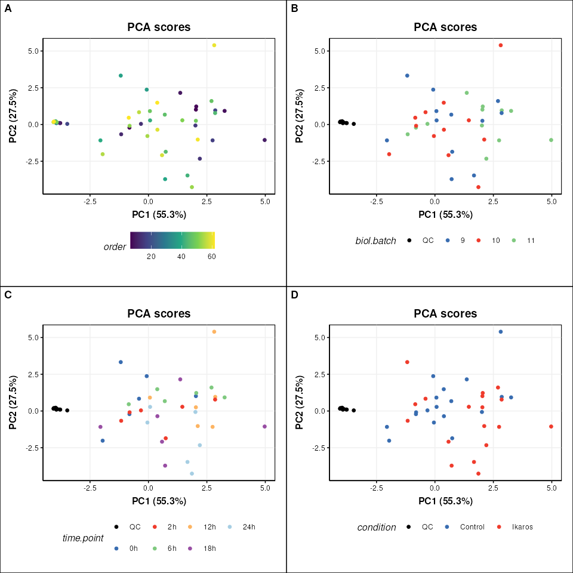

We can see now that the QCs are tightly clustered. This indicates that
the biological variance of the remaining high quality features is much
greater than the technical variance represented by the QCs.

There does not appear to be a trend by measurement order (A), which is
an important indicator that instrument drift throughout the run is not a
large source of variation in this dataset.

There does not appear to be strong clustering related to biological
batch (B).

There does not appear to be a strong trend with time (C) but this is
likely to be a more subtle variation and might be masked by other
sources of variance at this stage.

There is some clustering related to condition (D) but with overlap.

To further explore any trends with time, we will split the data by the
condition factor and only explore the Ikaros group. Removing the
condition factor variation will potentially make it easier to spot any
more subtle trends. We will extract the glog transformed matrix from the
previous model sequence and continue from there.

\
`# get the glog scaled data`\
`GL`` ``=`` `[`predicted`](https://rdrr.io/pkg/struct/man/predicted.html)`(``MS``[``11``]``)`\
\
`# extract the Ikaros group and apply PCA`\
`IK`` ``=`` `[`filter_smeta`](https://computational-metabolomics.github.io/structToolbox/reference/filter_smeta.md)`(`\
`      mode``=``'include'``,`\
`      factor_name``=``'condition'``,`\
`      levels``=``'Ikaros'``)`` ``+`\
`     `[`mean_centre`](https://computational-metabolomics.github.io/structToolbox/reference/mean_centre.md)`(``)`` ``+`` `\
`     `[`PCA`](https://computational-metabolomics.github.io/structToolbox/reference/PCA.md)`(``number_components ``=`` ``5``)`\
\
`# apply the model sequence to glog transformed data`\
`IK`` ``=`` `[`model_apply`](https://computational-metabolomics.github.io/structToolbox/reference/model_apply.md)`(``IK``,``GL``)`\
\
`# plot the PCA scores`\
`C`` ``=`` `[`pca_scores_plot`](https://computational-metabolomics.github.io/structToolbox/reference/pca_scores_plot.md)`(``factor_name``=``'time.point'``,ellipse ``=`` ``'sample'``)`\
`g1``=`[`chart_plot`](https://computational-metabolomics.github.io/structToolbox/reference/chart_plot.md)`(``C``,``IK``[``3``]``)`\
`g2``=``g1`` ``+`` `[`scale_color_viridis_d`](https://ggplot2.tidyverse.org/reference/scale_viridis.html)`(``)`` ``# add continuous scale colouring`\
\
[`plot_grid`](https://wilkelab.org/cowplot/reference/plot_grid.html)`(``g1``,``g2``,nrow``=``2``,align``=``'vh'``,axis ``=`` ``'tblr'``,labels``=`[`c`](https://rdrr.io/r/base/c.html)`(``'A'``,``'B'``)``)`

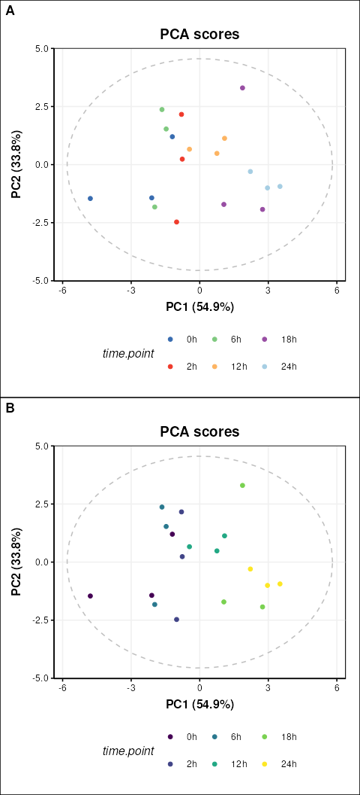

Colouring by groups (A) makes the time point trend difficult to see, but
by adding a `ggplot` continuous colour scale “viridis” (B) the trend
with time along PC1 becomes much clearer.

## Tutorials

### Introduction

The aim of this vignette is to illustrate how to apply SVM analysis for
Classifying Metabolomics data.

Support vector Machines (SVM) are a commonly used method in Machine
Learning. For classification tasks they are used to generate a boundary
between groups of samples in the training set. As well as generating
linear boundaries, SVM can be extended to exploit the use of kernels and
generate complex non-linear boundaries between groups if required.

For the `structToolbox` package, SVM functionality provided by the
*[e1071](https://CRAN.R-project.org/package=e1071)* package has been
incorporated into a `model` object. A chart object (`svm_plot_2d`) is
also available to plot SVM boundaries for data with two variables.

### Dataset

The 1H-NMR dataset used and described in [Mendez et al.,
(2020)](https://link.springer.com/article/10.1007/s11306-019-1588-0,%20https://github.com/CIMCB/MetabWorkflowTutorial)
and in this vignette contains processed spectra of urine samples
obtained from gastric cancer and healthy patients [Chan et al.,
(2016)](https://www.nature.com/articles/bjc2015414). The raw
experimental data is available through Metabolomics Workbench
([PR000699](http://dx.doi.org/10.21228/M8B10B)) and the processed
version is available from
[here](https://github.com/CIMCB/MetabWorkflowTutorial/raw/master/GastricCancer_NMR.xlsx)
as an Excel data file.

For simplicity we will use a pre-processed version of the 1H-NMR
“Gastric cancer” dataset using the `structToolbox` package. Details in
regards to pre-processing are reported in the “NMR-based clinical
metabolomics” vignette of the \`r Biocpkg(“structToolbox”) package.

\
`# summary of DatasetExperiment object`\
`DE`

    ## A "DatasetExperiment" object
    ## ----------------------------
    ## name:          
    ## description:   
    ## data:          140 rows x 53 columns
    ## sample_meta:   140 rows x 5 columns
    ## variable_meta: 53 rows x 1 columns

For the purposes of illustrating the effect of SVM parameters on the
boundary between groups, we reduce the data to include only the GC and
HE groups and apply PLS to reduce the data to two components. We then
treat the PLS scores as as a two group dataset with only two features.

\
`# model sequence and pls model (NB data already centred)`\
`MS`` ``=`` `[`filter_smeta`](https://computational-metabolomics.github.io/structToolbox/reference/filter_smeta.md)`(``mode ``=`` ``'include'``, levels ``=`` `[`c`](https://rdrr.io/r/base/c.html)`(``'GC'``,``'HE'``)``, factor_name ``=`` ``'Class'``)`` ``+`\
`     `[`PLSDA`](https://computational-metabolomics.github.io/structToolbox/reference/PLSDA.md)`(``factor_name ``=`` ``'Class'``,number_components ``=`` ``2``)`\
\
`# apply PLS model`\
`MS`` ``=`` `[`model_apply`](https://computational-metabolomics.github.io/structToolbox/reference/model_apply.md)`(``MS``,``DE``)`\
\
`# plot the data`\
`C`` ``=`` `[`pls_scores_plot`](https://computational-metabolomics.github.io/structToolbox/reference/pls_scores_plot.md)`(``factor_name ``=`` ``'Class'``)`\
[`chart_plot`](https://computational-metabolomics.github.io/structToolbox/reference/chart_plot.md)`(``C``,``MS``[``2``]``)`

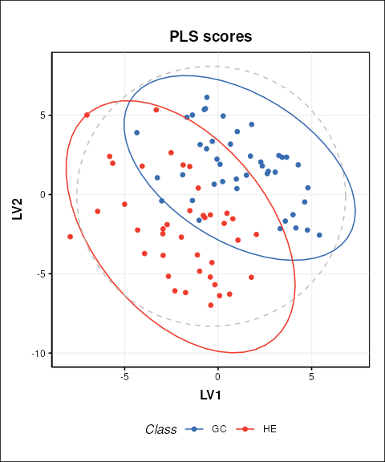

\
`# new DatasetExperiment object from the PLS scores`\
`DE2`` ``=`` `[`DatasetExperiment`](https://rdrr.io/pkg/struct/man/struct_DatasetExperiment.html)`(`\
`  data ``=`` ``MS``[``2``]``$``scores``$``data``, `\
`  sample_meta ``=`` `[`predicted`](https://rdrr.io/pkg/struct/man/predicted.html)`(``MS``[``1``]``)``$``sample_meta``,`\
`  variable_meta ``=`` `[`data.frame`](https://rdrr.io/r/base/data.frame.html)`(``'LV'``=`[`c`](https://rdrr.io/r/base/c.html)`(``1``,``2``)``,row.names ``=`` `[`colnames`](https://rdrr.io/r/base/colnames.html)`(``MS``[``2``]``$``scores``)``)``,`\
`  name ``=`` ``'Illustrativate SVM dataset'``,`\
`  description ``=`` ``'Generated by applying PLS to the processed Gastric cancer (NMR) dataset'`\
`)`\
\
`DE2`

    ## A "DatasetExperiment" object
    ## ----------------------------
    ## name:          Illustrativate SVM dataset
    ## description:   Generated by applying PLS to the processed Gastric cancer (NMR) dataset
    ## data:          83 rows x 2 columns
    ## sample_meta:   83 rows x 5 columns
    ## variable_meta: 2 rows x 1 columns

### Basic SVM model

The simplest SVM model uses a linear kernel. In `structToolbox` the
`SVM` model can be used to train and apply SVM models. A `svm_plot_2d`
chart object is provided for visualisation of boundaries in two
dimensions.

\
`# SVM model`\
`M`` ``=`` `[`SVM`](https://computational-metabolomics.github.io/structToolbox/reference/SVM.md)`(`\
`  factor_name ``=`` ``'Class'``,`\
`  kernel ``=`` ``'linear'`\
`)`\
\
`# apply model`\
`M`` ``=`` `[`model_apply`](https://computational-metabolomics.github.io/structToolbox/reference/model_apply.md)`(``M``,``DE2``)`\
\
`# plot boundary`\
`C`` ``=`` `[`svm_plot_2d`](https://computational-metabolomics.github.io/structToolbox/reference/svm_plot_2d.md)`(``factor_name ``=`` ``'Class'``)`\
[`chart_plot`](https://computational-metabolomics.github.io/structToolbox/reference/chart_plot.md)`(``C``,``M``, ``DE2``)`

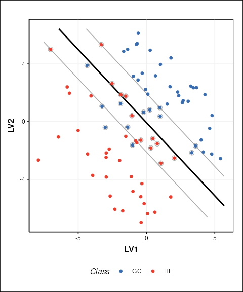

The SVM boundary is plotted in black, the margins in grey and support
vectors are indicated by grey circles.

### SVM cost function

The SVM cost function applies a penalty to samples on the wrong side of
the margins. A high penalty results in a narrow margin and tries to
force more samples to be on the correct side of the boundary. A low
penalty makes for a wider margin and is less strict about samples being
misclassified. The optimal cost to use is data dependent.

\
`# low cost`\
`M``$``cost``=``0.01`\
`M``=`[`model_apply`](https://computational-metabolomics.github.io/structToolbox/reference/model_apply.md)`(``M``,``DE2``)`\
`C``=`[`svm_plot_2d`](https://computational-metabolomics.github.io/structToolbox/reference/svm_plot_2d.md)`(``factor_name``=``'Species'``)`\
`g1``=`[`chart_plot`](https://computational-metabolomics.github.io/structToolbox/reference/chart_plot.md)`(``C``,``M``,``DE2``)`\
\
`# medium cost`\
`M``$``cost``=``0.05`\
`M``=`[`model_apply`](https://computational-metabolomics.github.io/structToolbox/reference/model_apply.md)`(``M``,``DE2``)`\
`C``=`[`svm_plot_2d`](https://computational-metabolomics.github.io/structToolbox/reference/svm_plot_2d.md)`(``factor_name``=``'Species'``)`\
`g2``=`[`chart_plot`](https://computational-metabolomics.github.io/structToolbox/reference/chart_plot.md)`(``C``,``M``,``DE2``)`\
\
`# high cost`\
`M``$``cost``=``100`\
`M``=`[`model_apply`](https://computational-metabolomics.github.io/structToolbox/reference/model_apply.md)`(``M``,``DE2``)`\
\
`C``=`[`svm_plot_2d`](https://computational-metabolomics.github.io/structToolbox/reference/svm_plot_2d.md)`(``factor_name``=``'Species'``)`\
`g3``=`[`chart_plot`](https://computational-metabolomics.github.io/structToolbox/reference/chart_plot.md)`(``C``,``M``,``DE2``)`\
\
`# plot`\
`prow`` ``<-`` `[`plot_grid`](https://wilkelab.org/cowplot/reference/plot_grid.html)`(`\
`  ``g1`` ``+`` `[`theme`](https://ggplot2.tidyverse.org/reference/theme.html)`(``legend.position``=``"none"``)``,`\
`  ``g2`` ``+`` `[`theme`](https://ggplot2.tidyverse.org/reference/theme.html)`(``legend.position``=``"none"``)``,`\
`  ``g3`` ``+`` `[`theme`](https://ggplot2.tidyverse.org/reference/theme.html)`(``legend.position``=``"none"``)``,`\
`  align ``=`` ``'vh'``,`\
`  labels ``=`` `[`c`](https://rdrr.io/r/base/c.html)`(``"Low cost"``, ``"Medium cost"``, ``"High cost"``)``,`\
`  hjust ``=`` ``-``1``,`\
`  nrow ``=`` ``2`\
`)`\
\
`legend`` ``<-`` `[`get_legend`](https://wilkelab.org/cowplot/reference/get_legend.html)`(`\
`  ``# create some space to the left of the legend`\
`  ``g1`` ``+`` `[`guides`](https://ggplot2.tidyverse.org/reference/guides.html)`(``color ``=`` `[`guide_legend`](https://ggplot2.tidyverse.org/reference/guide_legend.html)`(``nrow ``=`` ``1``)``)`` ``+`\
`  `[`theme`](https://ggplot2.tidyverse.org/reference/theme.html)`(``legend.position ``=`` ``"bottom"``)`\
`)`\
\
[`plot_grid`](https://wilkelab.org/cowplot/reference/plot_grid.html)`(``prow``, ``legend``, ncol``=``1``, rel_heights ``=`` `[`c`](https://rdrr.io/r/base/c.html)`(``1``, ``.1``)``)`

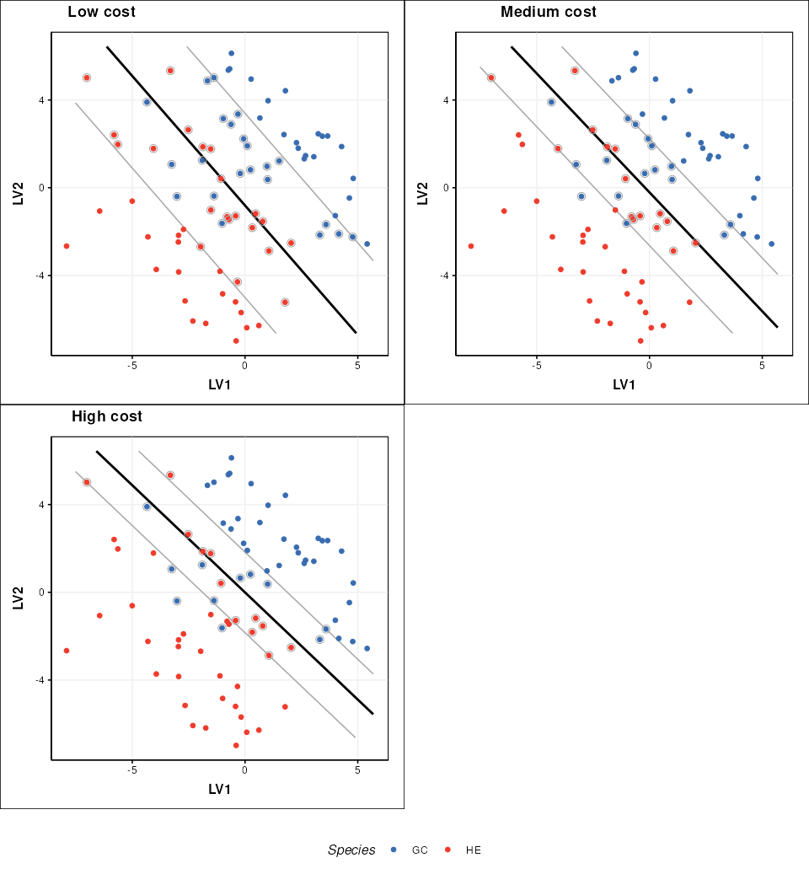

### Kernel functions

A number of different kernels can be used with support vector machines.
For the `structToolbox` wrapper ‘linear’, ‘polynomial’,‘radial’ and
‘sigmoid’ kernels can be specified. Using kernels allows the boundary to
be more flexible, but often require additional parameters to be
specified. The best kernel to use will vary depending on the dataset,
but a common choice is the radial kernel as it allows high flexibility
with a single parameter.

\
`# set a fixed cost for this comparison`\
`M``$``cost``=``1`\
\
`# linear kernel`\
`M``$``kernel``=``'linear'`\
`M``=`[`model_apply`](https://computational-metabolomics.github.io/structToolbox/reference/model_apply.md)`(``M``,``DE2``)`\
`C``=`[`svm_plot_2d`](https://computational-metabolomics.github.io/structToolbox/reference/svm_plot_2d.md)`(``factor_name``=``'Species'``)`\
`g1``=`[`chart_plot`](https://computational-metabolomics.github.io/structToolbox/reference/chart_plot.md)`(``C``,``M``,``DE2``)`\
\
`# polynomial kernel`\
`M``$``kernel``=``'polynomial'`\
`M``$``gamma``=``1`\
`M``$``coef0``=``0`\
`M``=`[`model_apply`](https://computational-metabolomics.github.io/structToolbox/reference/model_apply.md)`(``M``,``DE2``)`\
`C``=`[`svm_plot_2d`](https://computational-metabolomics.github.io/structToolbox/reference/svm_plot_2d.md)`(``factor_name``=``'Species'``)`\
`g2``=`[`chart_plot`](https://computational-metabolomics.github.io/structToolbox/reference/chart_plot.md)`(``C``,``M``,``DE2``)`\
\
`# rbf kernel`\
`M``$``kernel``=``'radial'`\
`M``$``gamma``=``1`\
`M``=`[`model_apply`](https://computational-metabolomics.github.io/structToolbox/reference/model_apply.md)`(``M``,``DE2``)`\
`C``=`[`svm_plot_2d`](https://computational-metabolomics.github.io/structToolbox/reference/svm_plot_2d.md)`(``factor_name``=``'Species'``)`\
`g3``=`[`chart_plot`](https://computational-metabolomics.github.io/structToolbox/reference/chart_plot.md)`(``C``,``M``,``DE2``)`\
\
`# sigmoid kernel`\
`M``$``kernel``=``'sigmoid'`\
`M``$``gamma``=``1`\
`M``$``coef0``=``0`\
`M``=`[`model_apply`](https://computational-metabolomics.github.io/structToolbox/reference/model_apply.md)`(``M``,``DE2``)`\
`C``=`[`svm_plot_2d`](https://computational-metabolomics.github.io/structToolbox/reference/svm_plot_2d.md)`(``factor_name``=``'Species'``)`\
`g4``=`[`chart_plot`](https://computational-metabolomics.github.io/structToolbox/reference/chart_plot.md)`(``C``,``M``,``DE2``)`\
\
`# plot`\
`prow`` ``<-`` `[`plot_grid`](https://wilkelab.org/cowplot/reference/plot_grid.html)`(`\
`  ``g1`` ``+`` `[`theme`](https://ggplot2.tidyverse.org/reference/theme.html)`(``legend.position``=``"none"``)``,`\
`  ``g2`` ``+`` `[`theme`](https://ggplot2.tidyverse.org/reference/theme.html)`(``legend.position``=``"none"``)``,`\
`  ``g3`` ``+`` `[`theme`](https://ggplot2.tidyverse.org/reference/theme.html)`(``legend.position``=``"none"``)``,`\
`  ``g4`` ``+`` `[`theme`](https://ggplot2.tidyverse.org/reference/theme.html)`(``legend.position``=``"none"``)``,`\
`  align ``=`` ``'vh'``,`\
`  labels ``=`` `[`c`](https://rdrr.io/r/base/c.html)`(``"Linear"``, ``"Polynomial"``, ``"Radial"``,``"Sigmoid"``)``,`\
`  hjust ``=`` ``-``1``,`\
`  nrow ``=`` ``2`\
`)`\
`legend`` ``<-`` `[`get_legend`](https://wilkelab.org/cowplot/reference/get_legend.html)`(`\
`  ``# create some space to the left of the legend`\
`  ``g1`` ``+`` `[`guides`](https://ggplot2.tidyverse.org/reference/guides.html)`(``color ``=`` `[`guide_legend`](https://ggplot2.tidyverse.org/reference/guide_legend.html)`(``nrow ``=`` ``1``)``)`` ``+`\
`    `[`theme`](https://ggplot2.tidyverse.org/reference/theme.html)`(``legend.position ``=`` ``"bottom"``)`\
`)`\
[`plot_grid`](https://wilkelab.org/cowplot/reference/plot_grid.html)`(``prow``, ``legend``, ncol ``=`` ``1``, rel_heights ``=`` `[`c`](https://rdrr.io/r/base/c.html)`(``1``, ``.1``)``)`

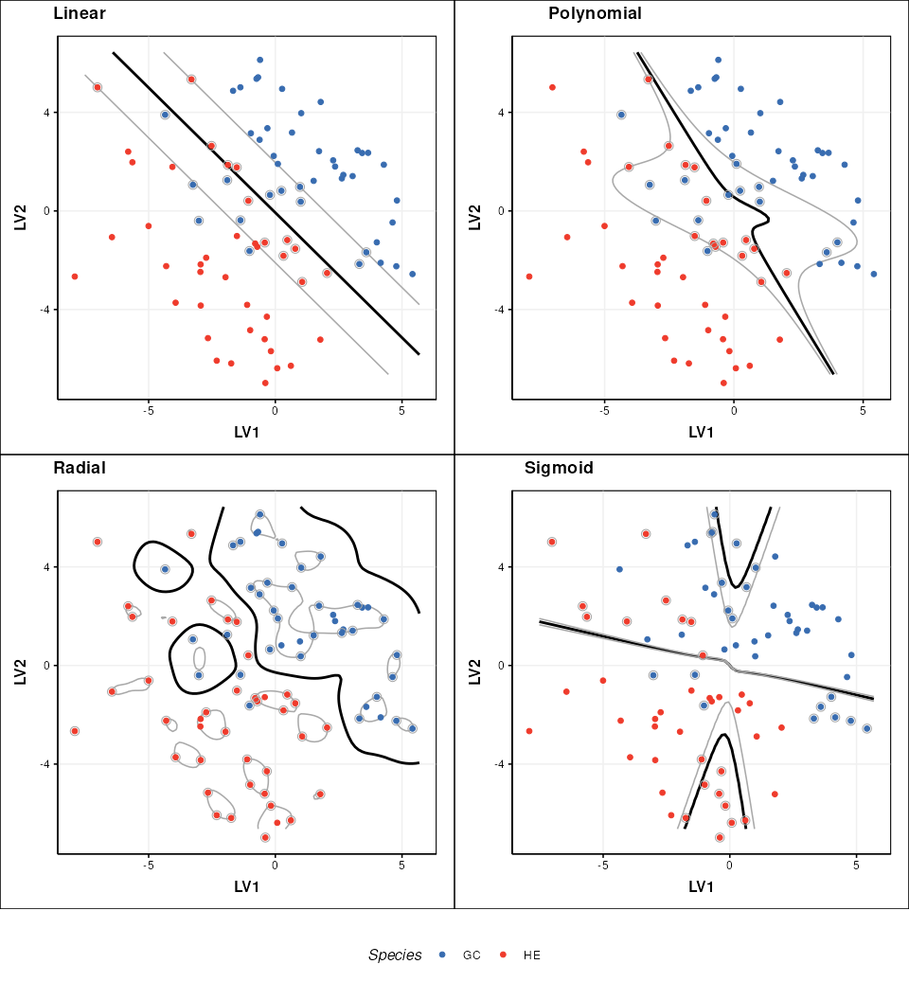

The parameters of a kernel can be used to control the complexity of the
boundary. Here I show how the radial kernel parameter “gamma” can be
used to change the complexity of the boundary. In combination with the
cost parameter (which I keep constant here) this allows for highly
flexible boundary models.

\
`# rbf kernel and cost`\
`M``$``kernel`` ``=`` ``'radial'`\
`M``$``cost`` ``=`` ``1`\
\
`# low gamma`\
`M``$``gamma``=``0.01`\
`M``=`[`model_apply`](https://computational-metabolomics.github.io/structToolbox/reference/model_apply.md)`(``M``,``DE2``)`\
`C``=`[`svm_plot_2d`](https://computational-metabolomics.github.io/structToolbox/reference/svm_plot_2d.md)`(``factor_name``=``'Species'``)`\
`g1``=`[`chart_plot`](https://computational-metabolomics.github.io/structToolbox/reference/chart_plot.md)`(``C``,``M``,``DE2``)`\
\
`# medium gamma`\
`M``$``gamma``=``0.1`\
`M``=`[`model_apply`](https://computational-metabolomics.github.io/structToolbox/reference/model_apply.md)`(``M``,``DE2``)`\
`C``=`[`svm_plot_2d`](https://computational-metabolomics.github.io/structToolbox/reference/svm_plot_2d.md)`(``factor_name``=``'Species'``)`\
`g2``=`[`chart_plot`](https://computational-metabolomics.github.io/structToolbox/reference/chart_plot.md)`(``C``,``M``,``DE2``)`\
\
`# high gamma`\
`M``$``gamma``=``1`\
`M``=`[`model_apply`](https://computational-metabolomics.github.io/structToolbox/reference/model_apply.md)`(``M``,``DE2``)`\
`C``=`[`svm_plot_2d`](https://computational-metabolomics.github.io/structToolbox/reference/svm_plot_2d.md)`(``factor_name``=``'Species'``)`\
`g3``=`[`chart_plot`](https://computational-metabolomics.github.io/structToolbox/reference/chart_plot.md)`(``C``,``M``,``DE2``)`\
\
`# plot`\
`prow`` ``<-`` `[`plot_grid`](https://wilkelab.org/cowplot/reference/plot_grid.html)`(`\
` ``g1`` ``+`` `[`theme`](https://ggplot2.tidyverse.org/reference/theme.html)`(``legend.position``=``"none"``)``,`\
` ``g2`` ``+`` `[`theme`](https://ggplot2.tidyverse.org/reference/theme.html)`(``legend.position``=``"none"``)``,`\
` ``g3`` ``+`` `[`theme`](https://ggplot2.tidyverse.org/reference/theme.html)`(``legend.position``=``"none"``)``,`\
` align ``=`` ``'vh'``,`\
` labels ``=`` `[`c`](https://rdrr.io/r/base/c.html)`(``"Low gamma"``, ``"Medium gamma"``, ``"High gamma"``)``,`\
` hjust ``=`` ``-``1``,`\
` nrow ``=`` ``2`\
`)`\
`legend`` ``<-`` `[`get_legend`](https://wilkelab.org/cowplot/reference/get_legend.html)`(`\
`  ``# create some space to the left of the legend`\
`  ``g1`` ``+`` `[`guides`](https://ggplot2.tidyverse.org/reference/guides.html)`(``color ``=`` `[`guide_legend`](https://ggplot2.tidyverse.org/reference/guide_legend.html)`(``nrow ``=`` ``1``)``)`` ``+`\
`  `[`theme`](https://ggplot2.tidyverse.org/reference/theme.html)`(``legend.position ``=`` ``"bottom"``)`\
`)`\
[`plot_grid`](https://wilkelab.org/cowplot/reference/plot_grid.html)`(``prow``, ``legend``, ncol ``=`` ``1``, rel_heights ``=`` `[`c`](https://rdrr.io/r/base/c.html)`(``1``, ``.1``)``)`

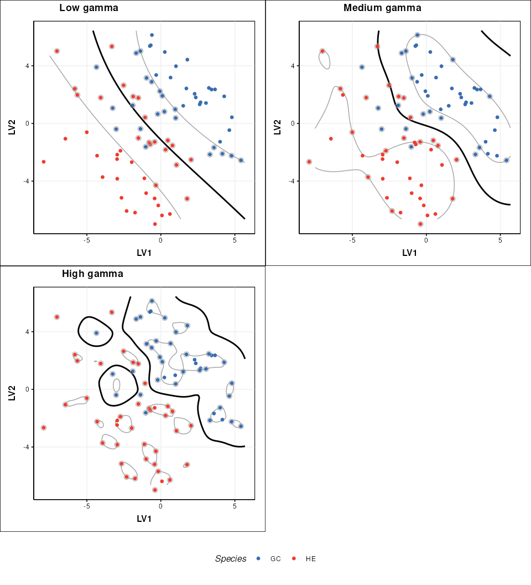

Note that best practice would be to select the optimal kernel
parameter(s) in combination with the cost parameter (e.g. by 2d grid
search) so that the best combination of both is identified.

## Session Info

\
[`sessionInfo`](https://rdrr.io/r/utils/sessionInfo.html)`(``)`

    ## R version 4.6.1 (2026-06-24)
    ## Platform: x86_64-pc-linux-gnu
    ## Running under: Ubuntu 24.04.5 LTS
    ## 
    ## Matrix products: default
    ## BLAS:   /usr/lib/x86_64-linux-gnu/openblas-pthread/libblas.so.3 
    ## LAPACK: /usr/lib/x86_64-linux-gnu/openblas-pthread/libopenblasp-r0.3.26.so;  LAPACK version 3.12.0
    ## 
    ## locale:
    ##  [1] LC_CTYPE=en_US.UTF-8       LC_NUMERIC=C              
    ##  [3] LC_TIME=en_US.UTF-8        LC_COLLATE=en_US.UTF-8    
    ##  [5] LC_MONETARY=en_US.UTF-8    LC_MESSAGES=en_US.UTF-8   
    ##  [7] LC_PAPER=en_US.UTF-8       LC_NAME=C                 
    ##  [9] LC_ADDRESS=C               LC_TELEPHONE=C            
    ## [11] LC_MEASUREMENT=en_US.UTF-8 LC_IDENTIFICATION=C       
    ## 
    ## time zone: UTC
    ## tzcode source: system (glibc)
    ## 
    ## attached base packages:
    ## [1] stats     graphics  grDevices utils     datasets  methods   base     
    ## 
    ## other attached packages:
    ##  [1] openxlsx_4.2.9       cowplot_1.2.0        gridExtra_2.3.1     
    ##  [4] ggplot2_4.0.3        BiocFileCache_3.3.3  dbplyr_2.6.0        
    ##  [7] ropls_1.45.0         pmp_1.25.1           structToolbox_1.25.0
    ## [10] struct_1.25.0        BiocStyle_2.41.0    
    ## 
    ## loaded via a namespace (and not attached):
    ##   [1] Rdpack_2.6.6                DBI_1.3.0                  
    ##   [3] MultiDataSet_1.41.0         httr2_1.3.0                
    ##   [5] rlang_1.3.0                 magrittr_2.0.5             
    ##   [7] otel_0.2.0                  e1071_1.7-17               
    ##   [9] matrixStats_1.5.0           compiler_4.6.1             
    ##  [11] RSQLite_3.53.3              systemfonts_1.3.2          
    ##  [13] vctrs_0.7.3                 reshape2_1.4.5             
    ##  [15] stringr_1.6.0               pkgconfig_2.0.3            
    ##  [17] fastmap_1.2.0               XVector_0.53.0             
    ##  [19] labeling_0.4.3              rmarkdown_2.32             
    ##  [21] itertools_0.1-3             ragg_1.5.2                 
    ##  [23] purrr_1.2.2                 bit_4.6.0                  
    ##  [25] xfun_0.62                   MultiAssayExperiment_1.39.1
    ##  [27] randomForest_4.7-1.2        cachem_1.1.0               
    ##  [29] jsonlite_2.0.0              blob_1.3.0                 
    ##  [31] DelayedArray_0.39.8         parallel_4.6.1             
    ##  [33] R6_2.6.1                    bslib_0.12.0               
    ##  [35] stringi_1.8.9               RColorBrewer_1.1-3         
    ##  [37] ranger_0.18.0               limma_3.99.4               
    ##  [39] GenomicRanges_1.65.4        jquerylib_0.1.4            
    ##  [41] Rcpp_1.1.2                  Seqinfo_1.3.2              
    ##  [43] bookdown_0.48               SummarizedExperiment_1.43.0
    ##  [45] iterators_1.0.14            knitr_1.52                 
    ##  [47] IRanges_2.47.5              Matrix_1.7-6               
    ##  [49] tidyselect_1.2.1            abind_1.4-8                
    ##  [51] yaml_2.3.12                 codetools_0.2-20           
    ##  [53] curl_8.1.0                  doRNG_1.8.6.3              
    ##  [55] lattice_0.23-1              tibble_3.3.1               
    ##  [57] plyr_1.8.9                  withr_3.0.3                
    ##  [59] Biobase_2.73.2              S7_0.2.2                   
    ##  [61] evaluate_1.0.5              desc_1.4.3                 
    ##  [63] isoband_0.3.0               proxy_0.4-29               
    ##  [65] zip_3.0.2                   filelock_1.0.3             
    ##  [67] pillar_1.11.1               BiocManager_1.30.27        
    ##  [69] MatrixGenerics_1.25.0       rngtools_1.5.2             
    ##  [71] foreach_1.5.2               stats4_4.6.1               
    ##  [73] generics_0.1.4              sp_2.2-4                   
    ##  [75] S4Vectors_0.51.10           scales_1.4.0               
    ##  [77] calibrate_1.7.7             class_7.3-24               
    ##  [79] glue_1.8.1                  tools_4.6.1                
    ##  [81] fs_2.1.0                    grid_4.6.1                 
    ##  [83] impute_1.87.0               missForest_1.6.1           
    ##  [85] rbibutils_2.4.1             cli_3.6.6                  
    ##  [87] textshaping_1.0.5           viridisLite_0.4.3          
    ##  [89] ggthemes_7.0.0              S4Arrays_1.13.2            
    ##  [91] dplyr_1.2.1                 pls_2.9-0                  
    ##  [93] pcaMethods_2.5.0            gtable_0.3.6               
    ##  [95] sass_0.4.10                 digest_0.6.39              
    ##  [97] BiocGenerics_0.59.13        SparseArray_1.13.5         
    ##  [99] htmlwidgets_1.6.4           farver_2.1.2               
    ## [101] memoise_2.0.1               htmltools_0.5.9            
    ## [103] pkgdown_2.2.1.9000          lifecycle_1.0.5            
    ## [105] statmod_1.5.2               qqman_0.1.9                
    ## [107] bit64_4.8.6                 MASS_7.3-66
