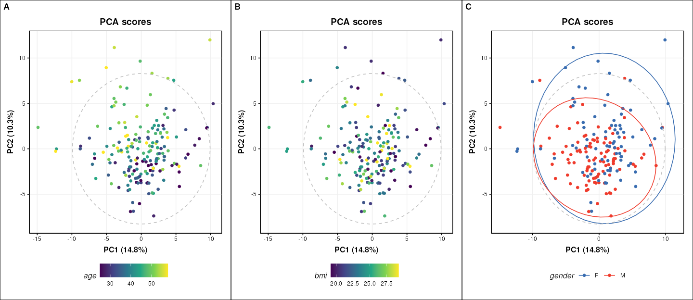
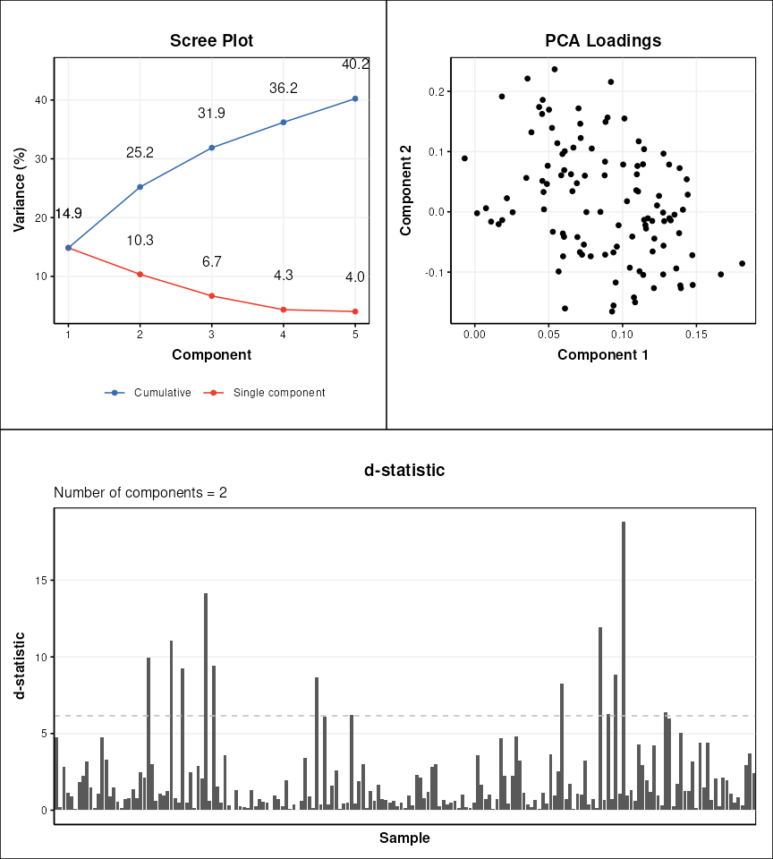
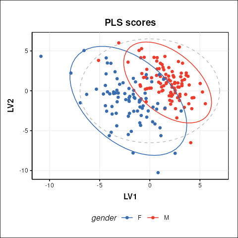
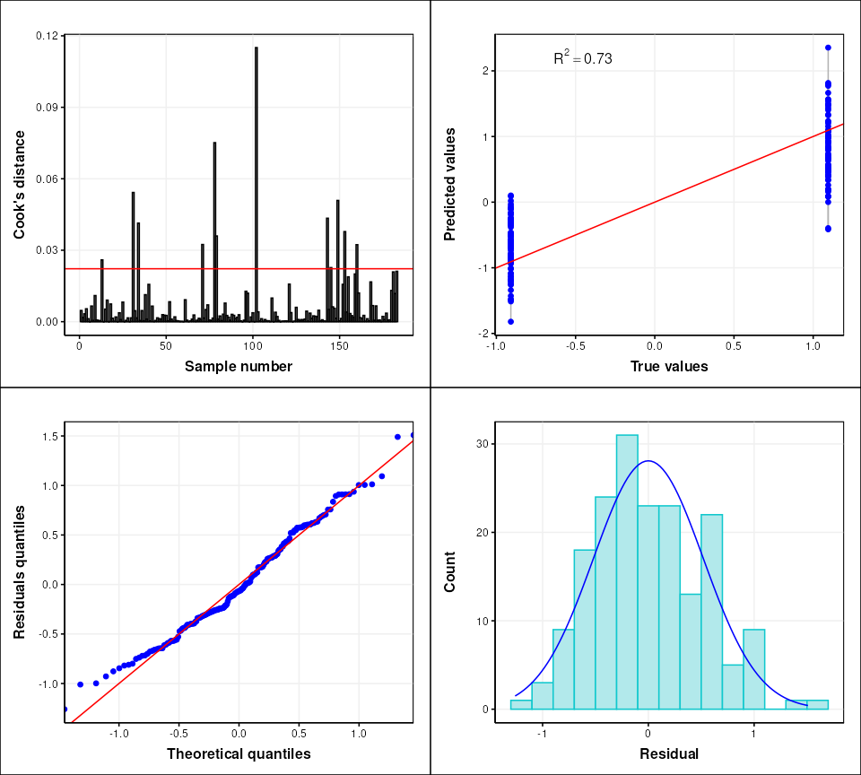
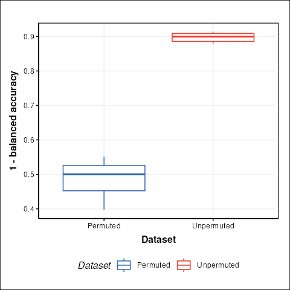

# Partial Least Squares (PLS) analysis of a untargeted LC-MS-based clinical metabolomics dataset.

## Introduction

The aim of this vignette is to demonstrate how to 1) apply and validate
Partial Least Squares (PLS) analysis using the structToolbox, 2)
reproduce statistical analysis in [Thevenot et
al. (2015)](https://pubs.acs.org/doi/10.1021/acs.jproteome.5b00354) and
3. compare different implementations of PLS.

## Dataset

The objective of the original study was to:

> …study the influence of age, body mass index (bmi), and gender on
> metabolite concentrations in urine, by analysing 183 samples from a
> cohort of adults with liquid chromatography coupled to high-resolution
> mass spectrometry.

[Thevenot et
al. (2015)](https://pubs.acs.org/doi/10.1021/acs.jproteome.5b00354)

The “Sacurine” dataset needs to be converted to a `DatasetExperiment`
object. The *[ropls](https://bioconductor.org/packages/3.24/ropls)*
package provides the data as a list containing a `dataMatrix`,
`sampleMetadata` and `variableMetadata`.

\
[`data`](https://rdrr.io/r/utils/data.html)`(``'sacurine'``,package ``=`` ``'ropls'``)`\
`# the 'sacurine' list should now be available`\
\
`# move the annotations to a new column and rename the features by index to avoid issues`\
`# later when data.frames get transposed and names get checked/changed`\
`sacurine``$``variableMetadata``$``annotation``=`[`rownames`](https://rdrr.io/r/base/colnames.html)`(``sacurine``$``variableMetadata``)`\
[`rownames`](https://rdrr.io/r/base/colnames.html)`(``sacurine``$``variableMetadata``)``=``1``:`[`nrow`](https://rdrr.io/r/base/nrow.html)`(``sacurine``$``variableMetadata``)`\
[`colnames`](https://rdrr.io/r/base/colnames.html)`(``sacurine``$``dataMatrix``)``=``1``:`[`ncol`](https://rdrr.io/r/base/nrow.html)`(``sacurine``$``dataMatrix``)`\
\
`# create DatasetExperiment`\
`DE`` ``=`` `[`DatasetExperiment`](https://rdrr.io/pkg/struct/man/struct_DatasetExperiment.html)`(``data ``=`` `[`data.frame`](https://rdrr.io/r/base/data.frame.html)`(``sacurine``$``dataMatrix``)``,`\
`                       sample_meta ``=`` ``sacurine``$``sampleMetadata``,`\
`                       variable_meta ``=`` ``sacurine``$``variableMetadata``,`\
`                       name ``=`` ``'Sacurine data'``,`\
`                       description ``=`` ``'See ropls package documentation for details'``)`\
\
`# print summary`\
`DE`

    ## A "DatasetExperiment" object
    ## ----------------------------
    ## name:          Sacurine data
    ## description:   See ropls package documentation for details
    ## data:          183 rows x 109 columns
    ## sample_meta:   183 rows x 3 columns
    ## variable_meta: 109 rows x 4 columns

## Data preprocessing

The Sacurine dataset used within this vignette has already been
pre-processed:

> After signal drift and batch effect correction of intensities, each
> urine profile was normalized to the osmolality of the sample. Finally,
> the data were log10 transformed.

## Exploratory data analysis

Since the data has already been processed the data can be visualised
using Principal Component Analysis (PCA) without further pre-processing.
The `ropls` package automatically applies unit variance scaling
(autoscaling) by default. The same approach is applied here.

\
`# prepare model sequence`\
`M`` ``=`` `[`autoscale`](https://computational-metabolomics.github.io/structToolbox/reference/autoscale.md)`(``)`` ``+`` `[`PCA`](https://computational-metabolomics.github.io/structToolbox/reference/PCA.md)`(``number_components ``=`` ``5``)`\
`# apply model sequence to dataset`\
`M`` ``=`` `[`model_apply`](https://computational-metabolomics.github.io/structToolbox/reference/model_apply.md)`(``M``,``DE``)`\
\
`# pca scores plots`\
`g``=`[`list`](https://rdrr.io/r/base/list.html)`(``)`\
`for`` ``(``k`` ``in`` `[`colnames`](https://rdrr.io/r/base/colnames.html)`(``DE``$``sample_meta``)``)`` ``{`\
`    ``C`` ``=`` `[`pca_scores_plot`](https://computational-metabolomics.github.io/structToolbox/reference/pca_scores_plot.md)`(``factor_name ``=`` ``k``)`\
`    ``g``[[``k``]``]`` ``=`` `[`chart_plot`](https://computational-metabolomics.github.io/structToolbox/reference/chart_plot.md)`(``C``,``M``[``2``]``)`\
`}`\
`# plot using cowplot`\
[`plot_grid`](https://wilkelab.org/cowplot/reference/plot_grid.html)`(``plotlist``=``g``, nrow``=``1``, align``=``'vh'``, labels``=`[`c`](https://rdrr.io/r/base/c.html)`(``'A'``,``'B'``,``'C'``)``)`

The third plot coloured by gender (C) is identical to Figure 2 of the
*[ropls](https://bioconductor.org/packages/3.24/ropls)* package
vignette. The `structToolbox` package provides a range of PCA-related
diagnostic plots, including D-statistic, scree, and loadings plots.
These plots can be used to further explore the variance of the data.

\
`C`` ``=`` `[`pca_scree_plot`](https://computational-metabolomics.github.io/structToolbox/reference/pca_scree_plot.md)`(``)`\
`g1`` ``=`` `[`chart_plot`](https://computational-metabolomics.github.io/structToolbox/reference/chart_plot.md)`(``C``,``M``[``2``]``)`\
\
`C`` ``=`` `[`pca_loadings_plot`](https://computational-metabolomics.github.io/structToolbox/reference/pca_loadings_plot.md)`(``)`\
`g2`` ``=`` `[`chart_plot`](https://computational-metabolomics.github.io/structToolbox/reference/chart_plot.md)`(``C``,``M``[``2``]``)`\
\
`C`` ``=`` `[`pca_dstat_plot`](https://computational-metabolomics.github.io/structToolbox/reference/pca_dstat_plot.md)`(``alpha``=``0.95``)`\
`g3`` ``=`` `[`chart_plot`](https://computational-metabolomics.github.io/structToolbox/reference/chart_plot.md)`(``C``,``M``[``2``]``)`\
\
`p1``=`[`plot_grid`](https://wilkelab.org/cowplot/reference/plot_grid.html)`(``plotlist ``=`` `[`list`](https://rdrr.io/r/base/list.html)`(``g1``,``g2``)``,align``=``'h'``,nrow``=``1``,axis``=``'b'``)`\
`p2``=`[`plot_grid`](https://wilkelab.org/cowplot/reference/plot_grid.html)`(``plotlist ``=`` `[`list`](https://rdrr.io/r/base/list.html)`(``g3``)``,nrow``=``1``)`\
[`plot_grid`](https://wilkelab.org/cowplot/reference/plot_grid.html)`(``p1``,``p2``,nrow``=``2``)`

## Partial Least Squares (PLS) analysis

The `ropls` package uses its own implementation of the (O)PLS
algorithms. `structToolbox` uses the `pls` package, so it is interesting
to compare the outputs from both approaches. For simplicity only the
scores plots are compared.

\
`# prepare model sequence`\
`M`` ``=`` `[`autoscale`](https://computational-metabolomics.github.io/structToolbox/reference/autoscale.md)`(``)`` ``+`` `[`PLSDA`](https://computational-metabolomics.github.io/structToolbox/reference/PLSDA.md)`(``factor_name``=``'gender'``)`\
`M`` ``=`` `[`model_apply`](https://computational-metabolomics.github.io/structToolbox/reference/model_apply.md)`(``M``,``DE``)`\
\
`C`` ``=`` `[`pls_scores_plot`](https://computational-metabolomics.github.io/structToolbox/reference/pls_scores_plot.md)`(``factor_name ``=`` ``'gender'``)`\
[`chart_plot`](https://computational-metabolomics.github.io/structToolbox/reference/chart_plot.md)`(``C``,``M``[``2``]``)`

The plot is similar to fig.3 of the
*[ropls](https://bioconductor.org/packages/3.24/ropls)* vignette.
Differences are due to inverted LV axes, a common occurrence with the
NIPALS algorithm (used by both `structToolbox` and `ropls`) which
depends on how the algorithm is initialised.

To compare the R2 values for the model in structToolbox we have to use a
regression model, instead of a discriminant model. For this we convert
the gender factor to a numeric variable before applying the model.

\
`# convert gender to numeric`\
`DE``$``sample_meta``$``gender``=`[`as.numeric`](https://rdrr.io/r/base/numeric.html)`(``DE``$``sample_meta``$``gender``)`\
\
`# models sequence`\
`M`` ``=`` `[`autoscale`](https://computational-metabolomics.github.io/structToolbox/reference/autoscale.md)`(``mode``=``'both'``)`` ``+`` `[`PLSR`](https://computational-metabolomics.github.io/structToolbox/reference/PLSR.md)`(``factor_name``=``'gender'``,number_components``=``3``)`\
`M`` ``=`` `[`model_apply`](https://computational-metabolomics.github.io/structToolbox/reference/model_apply.md)`(``M``,``DE``)`\
\
`# some diagnostic charts`\
`C`` ``=`` `[`plsr_cook_dist`](https://computational-metabolomics.github.io/structToolbox/reference/plsr_cook_dist.md)`(``)`\
`g1`` ``=`` `[`chart_plot`](https://computational-metabolomics.github.io/structToolbox/reference/chart_plot.md)`(``C``,``M``[``2``]``)`\
\
`C`` ``=`` `[`plsr_prediction_plot`](https://computational-metabolomics.github.io/structToolbox/reference/plsr_prediction_plot.md)`(``)`\
`g2`` ``=`` `[`chart_plot`](https://computational-metabolomics.github.io/structToolbox/reference/chart_plot.md)`(``C``,``M``[``2``]``)`\
\
`C`` ``=`` `[`plsr_qq_plot`](https://computational-metabolomics.github.io/structToolbox/reference/plsr_qq_plot.md)`(``)`\
`g3`` ``=`` `[`chart_plot`](https://computational-metabolomics.github.io/structToolbox/reference/chart_plot.md)`(``C``,``M``[``2``]``)`\
\
`C`` ``=`` `[`plsr_residual_hist`](https://computational-metabolomics.github.io/structToolbox/reference/plsr_residual_hist.md)`(``)`\
`g4`` ``=`` `[`chart_plot`](https://computational-metabolomics.github.io/structToolbox/reference/chart_plot.md)`(``C``,``M``[``2``]``)`\
\
[`plot_grid`](https://wilkelab.org/cowplot/reference/plot_grid.html)`(``plotlist ``=`` `[`list`](https://rdrr.io/r/base/list.html)`(``g1``,``g2``,``g3``,``g4``)``, nrow``=``2``,align``=``'vh'``)`

The `ropls` package automatically applies cross-validation to asses the
performance of the PLSDA model. In `structToolbox` this is applied
separately to give more control over the approach used if desired. The
default cross-validation used by the `ropls` package is 7-fold
cross-validation and we replicate that here.

\
`# model sequence`\
`M`` ``=`` `[`kfold_xval`](https://computational-metabolomics.github.io/structToolbox/reference/kfold_xval.md)`(``folds``=``7``, factor_name``=``'gender'``)`` ``*`` `\
`    ``(`[`autoscale`](https://computational-metabolomics.github.io/structToolbox/reference/autoscale.md)`(``mode``=``'both'``)`` ``+`` `[`PLSR`](https://computational-metabolomics.github.io/structToolbox/reference/PLSR.md)`(``factor_name``=``'gender'``)``)`\
`M`` ``=`` `[`run`](https://computational-metabolomics.github.io/structToolbox/reference/run.md)`(``M``,``DE``,`[`r_squared`](https://computational-metabolomics.github.io/structToolbox/reference/r_squared.md)`(``)``)`

Training set R2: 0.6975706 0.6798415 0.646671 0.6532914 0.7109769
0.670777 0.6935344

Test set Q2: 0.5460723

The validity of the model can further be assessed using permutation
testing. For this we will return to a discriminant model.

\
`# reset gender to original factor`\
`DE``$``sample_meta``$``gender``=``sacurine``$``sampleMetadata``$``gender`\
`# model sequence`\
`M`` ``=`` `[`permutation_test`](https://computational-metabolomics.github.io/structToolbox/reference/permutation_test.md)`(``number_of_permutations ``=`` ``10``, factor_name``=``'gender'``)`` ``*`\
`    `[`kfold_xval`](https://computational-metabolomics.github.io/structToolbox/reference/kfold_xval.md)`(``folds``=``7``,factor_name``=``'gender'``)`` ``*`\
`    ``(`[`autoscale`](https://computational-metabolomics.github.io/structToolbox/reference/autoscale.md)`(``)`` ``+`` `[`PLSDA`](https://computational-metabolomics.github.io/structToolbox/reference/PLSDA.md)`(``factor_name``=``'gender'``,number_components ``=`` ``3``)``)`\
`M`` ``=`` `[`run`](https://computational-metabolomics.github.io/structToolbox/reference/run.md)`(``M``,``DE``,`[`balanced_accuracy`](https://computational-metabolomics.github.io/structToolbox/reference/balanced_accuracy.md)`(``)``)`\
\
`C`` ``=`` `[`permutation_test_plot`](https://computational-metabolomics.github.io/structToolbox/reference/permutation_test_plot.md)`(``style``=``'boxplot'``)`\
[`chart_plot`](https://computational-metabolomics.github.io/structToolbox/reference/chart_plot.md)`(``C``,``M``)``+`[`ylab`](https://ggplot2.tidyverse.org/reference/labs.html)`(``'1 - balanced accuracy'``)`

The permuted models have a balanced accuracy of around 50%, which is to
be expected for a dataset with two groups. The unpermuted models have a
balanced accuracy of around 90% and is therefore much better than might
be expected to occur by chance.
