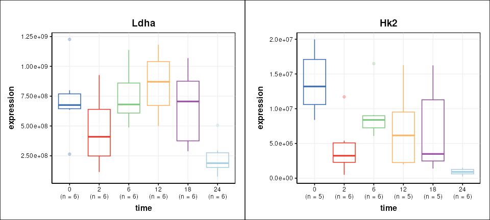
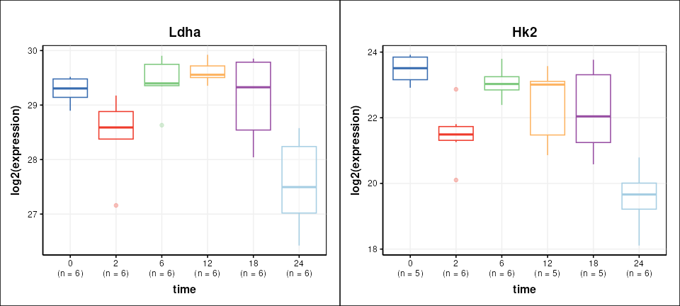
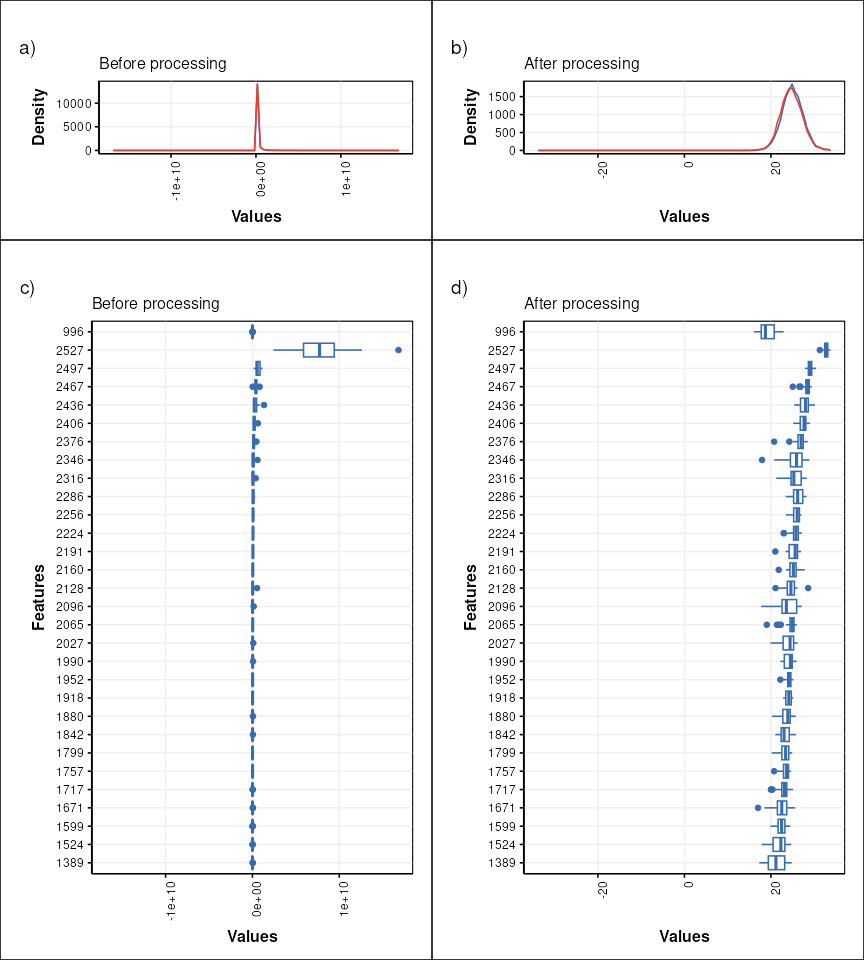
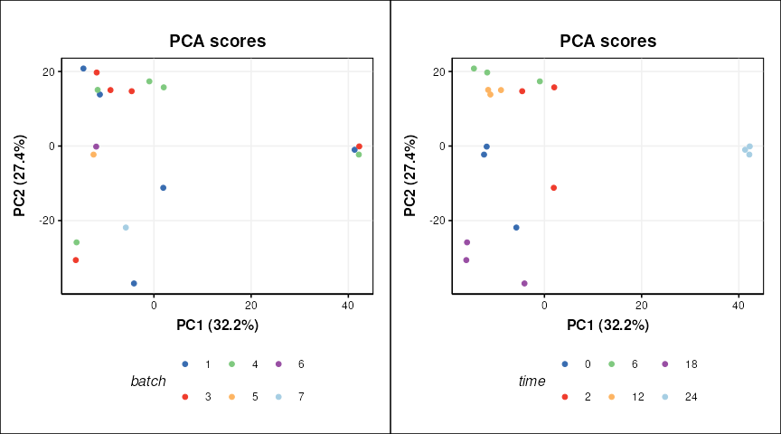
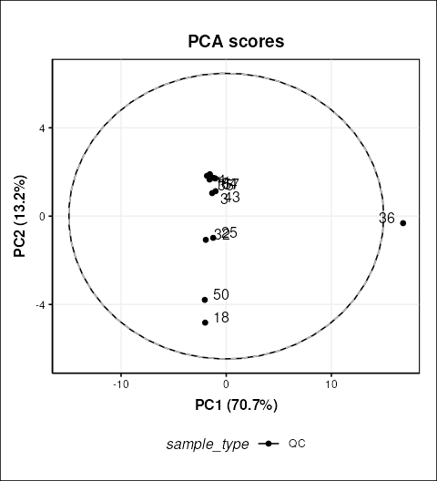
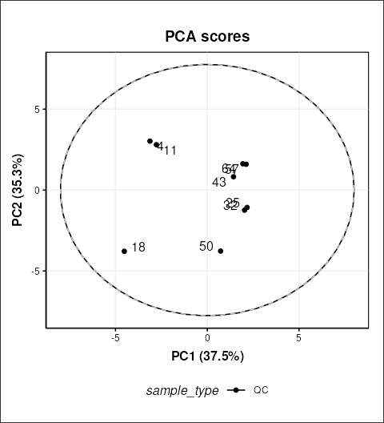
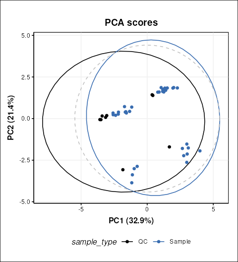
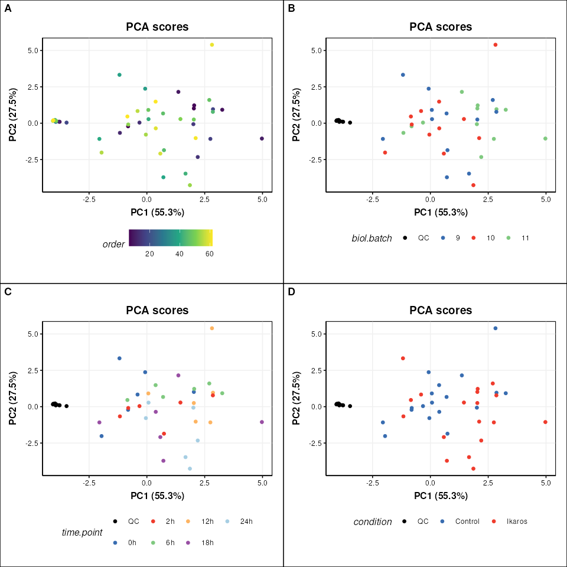
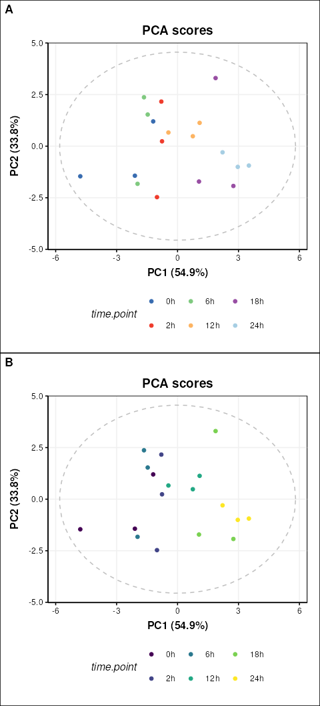

# Exploratory data analysis of LC-MS-based proteomics and metabolomics datasets (STATegra project)

## Exploratory data analysis of LC-MS-based proteomics and metabolomics datasets (STATegra project)

### Introduction

The aim of this vignette is to conduct data preprocessing and
exploratory analysis of data from the STATegra project
(<https://www.nature.com/articles/s41597-019-0202-7>). For demonstration
purposes we will focus on the Proteomics and Metabolomics datasets that
are publicly available as part of the STATegra multi-omics dataset.

> …the STATegra multi-omics dataset combines measurements from up to 10
> different omics technologies applied to the same biological system,
> namely the well-studied mouse pre-B-cell differentiation. STATegra
> includes high-throughput measurements of chromatin structure, gene
> expression, proteomics and metabolomics, and it is complemented with
> single-cell data. [Gomez-Cabrero et
> al](https://www.nature.com/articles/s41597-019-0202-7)

STATegra includes high-throughput measurements of chromatin structure,
gene expression, proteomics and metabolomics, and it is complemented
with single-cell data.

### LC-MS-based proteomics dataset

The LC-MS-based proteomics dataset from the STATegra multi-omics dataset
(see Introduction) can be found on
[github](https://github.com/STATegraData/STATegraData) and must be
extracted from the zip file prior to data analysis.

\
`# path to zip`\
`zipfile`` ``=`` ``"https://raw.github.com/STATegraData/STATegraData/master/Script_STATegra_Proteomics.zip"`\
\
`## retrieve from BiocFileCache`\
`path`` ``=`` `[`bfcrpath`](https://rdrr.io/pkg/BiocFileCache/man/BiocFileCache-class.html)`(``bfc``,``zipfile``)`\
`temp`` ``=`` `[`bfccache`](https://rdrr.io/pkg/BiocFileCache/man/BiocFileCache-class.html)`(``bfc``)`\
\
`## ... or download to temp location`\
`# path = tempfile()`\
`# temp = tempdir()`\
`# download.file(zipfile,path)`\
\
`# unzip`\
[`unzip`](https://rdrr.io/r/utils/unzip.html)`(``path``, files ``=`` ``"Proteomics_01_uniprot_canonical_normalized.txt"``, exdir``=``temp``)`\
`# read samples`\
`all_data`` ``<-``  `[`read.delim`](https://rdrr.io/r/utils/read.table.html)`(`[`file.path`](https://rdrr.io/r/base/file.path.html)`(``temp``,``"Proteomics_01_uniprot_canonical_normalized.txt"``)``, as.is ``=`` ``TRUE``, header ``=`` ``TRUE``, sep ``=`` ``"\t"``)`

The imported data needs to be converted to `DatasetExperiment` format
for use with `structToolbox`.

\
`# extract data matrix`\
`data`` ``=`` ``all_data``[``1``:``2527``,``51``:``86``]`\
`# shorten sample names`\
[`colnames`](https://rdrr.io/r/base/colnames.html)`(``data``)`` ``=`` `[`lapply`](https://rdrr.io/r/base/lapply.html)`(`[`colnames`](https://rdrr.io/r/base/colnames.html)`(``data``)``, ``function`` ``(``x``)`` `[`substr`](https://rdrr.io/r/base/substr.html)`(``x``, ``27``, `[`nchar`](https://rdrr.io/r/base/nchar.html)`(``x``)``)``)`\
`# replace 0 with NA`\
`data``[``data`` ``==`` ``0``]`` ``<-`` ``NA`\
`# transpose`\
`data``=`[`as.data.frame`](https://rdrr.io/r/base/as.data.frame.html)`(`[`t`](https://rdrr.io/r/base/t.html)`(``data``)``)`\
\
`# prepare sample meta`\
`SM`` ``=`` `[`lapply`](https://rdrr.io/r/base/lapply.html)`(`[`rownames`](https://rdrr.io/r/base/colnames.html)`(``data``)``,``function``(``x``)`` ``{`\
`  ``s``=`[`strsplit`](https://rdrr.io/r/base/strsplit.html)`(``x``,``'_'``)``[[``1``]``]`` ``# split at underscore`\
`  ``out``=`[`data.frame`](https://rdrr.io/r/base/data.frame.html)`(`\
`    ``'treatment'`` ``=`` ``s``[[``1``]``]``,`\
`    ``'time'`` ``=`` `[`substr`](https://rdrr.io/r/base/substr.html)`(``s``[[``2``]``]``,``1``,`[`nchar`](https://rdrr.io/r/base/nchar.html)`(``s``[[``2``]``]``)``-``1``)`` ,    `\
`    ``'batch'`` ``=`` `[`substr`](https://rdrr.io/r/base/substr.html)`(``s``[[``3``]``]``,``6``,`[`nchar`](https://rdrr.io/r/base/nchar.html)`(``s``[[``3``]``]``)``)``,`\
`    ``'condition'`` ``=`` `[`substr`](https://rdrr.io/r/base/substr.html)`(``x``,``1``,``6``)`` ``# interaction between treatment and time`\
`  ``)`\
`  `[`return`](https://rdrr.io/r/base/function.html)`(``out``)`\
`}``)`\
`SM`` ``=`` `[`do.call`](https://rdrr.io/r/base/do.call.html)`(``rbind``,``SM``)`\
[`rownames`](https://rdrr.io/r/base/colnames.html)`(``SM``)``=`[`rownames`](https://rdrr.io/r/base/colnames.html)`(``data``)`\
`# convert to factors`\
`SM``$``treatment``=`[`factor`](https://rdrr.io/r/base/factor.html)`(``SM``$``treatment``)`\
`SM``$``time``=`[`ordered`](https://rdrr.io/r/base/factor.html)`(``SM``$``time``,`[`c`](https://rdrr.io/r/base/c.html)`(``"0"``,``"2"``,``"6"``,``"12"``,``"18"``,``"24"``)``)`\
`SM``$``batch``=`[`ordered`](https://rdrr.io/r/base/factor.html)`(``SM``$``batch``,`[`c`](https://rdrr.io/r/base/c.html)`(``1``,``3``,``4``,``5``,``6``,``7``)``)`\
`SM``$``condition``=`[`factor`](https://rdrr.io/r/base/factor.html)`(``SM``$``condition``)`\
\
`# variable meta data`\
`VM`` ``=`` ``all_data``[``1``:``2527``,`[`c`](https://rdrr.io/r/base/c.html)`(``1``,``6``,``7``)``]`\
[`rownames`](https://rdrr.io/r/base/colnames.html)`(``VM``)``=`[`colnames`](https://rdrr.io/r/base/colnames.html)`(``data``)`\
\
`# prepare DatasetExperiment`\
`DS`` ``=`` `[`DatasetExperiment`](https://rdrr.io/pkg/struct/man/struct_DatasetExperiment.html)`(`\
`  data ``=`` ``data``, `\
`  sample_meta ``=`` ``SM``, `\
`  variable_meta ``=`` ``VM``, `\
`  name ``=`` ``'STATegra Proteomics'``,`\
`  description ``=`` ``'downloaded from: https://github.com/STATegraData/STATegraData/'`\
`)`\
`DS`

    ## A "DatasetExperiment" object
    ## ----------------------------
    ## name:          STATegra Proteomics
    ## description:   downloaded from: https://github.com/STATegraData/STATegraData/
    ## data:          36 rows x 2527 columns
    ## sample_meta:   36 rows x 4 columns
    ## variable_meta: 2527 rows x 3 columns

A number of Reporter genes were included in the study. We plot two of
them here to illustrate some trends in the data.

\
`# find id of reporters`\
`Ldha`` ``=`` `[`which`](https://rdrr.io/r/base/which.html)`(``DS``$``variable_meta``$``Gene.names``==``'Ldha'``)`\
`Hk2`` ``=`` `[`which`](https://rdrr.io/r/base/which.html)`(``DS``$``variable_meta``$``Gene.names``==``'Hk2'``)`\
\
`# chart object`\
`C`` ``=`` `[`feature_boxplot`](https://computational-metabolomics.github.io/structToolbox/reference/feature_boxplot.md)`(``feature_to_plot``=``Ldha``,factor_name``=``'time'``,label_outliers``=``FALSE``)`\
`g1``=`[`chart_plot`](https://computational-metabolomics.github.io/structToolbox/reference/chart_plot.md)`(``C``,``DS``)``+`[`ggtitle`](https://ggplot2.tidyverse.org/reference/labs.html)`(``'Ldha'``)``+`[`ylab`](https://ggplot2.tidyverse.org/reference/labs.html)`(``'expression'``)`\
`C`` ``=`` `[`feature_boxplot`](https://computational-metabolomics.github.io/structToolbox/reference/feature_boxplot.md)`(``feature_to_plot``=``Hk2``,factor_name``=``'time'``,label_outliers``=``FALSE``)`\
`g2``=`[`chart_plot`](https://computational-metabolomics.github.io/structToolbox/reference/chart_plot.md)`(``C``,``DS``)``+`[`ggtitle`](https://ggplot2.tidyverse.org/reference/labs.html)`(``'Hk2'``)``+`[`ylab`](https://ggplot2.tidyverse.org/reference/labs.html)`(``'expression'``)`\
\
[`plot_grid`](https://wilkelab.org/cowplot/reference/plot_grid.html)`(``g1``,``g2``,nrow``=``1``,align``=``'vh'``,axis``=``'tblr'``)`

#### Data transformation

The data is log2 transformed, then scaled such that the mean of the
medians is equal for all conditions. These steps are available in
`structToolbox` using `log_transform` and `mean_of_medians` objects.

\
`# prepare model sequence`\
`M`` ``=`` `[`log_transform`](https://computational-metabolomics.github.io/structToolbox/reference/log_transform.md)`(`\
`  base``=``2``)`` ``+`` `\
`  `[`mean_of_medians`](https://computational-metabolomics.github.io/structToolbox/reference/mean_of_medians.md)`(`\
`    factor_name ``=`` ``'condition'``)`\
`# apply model sequence`\
`M`` ``=`` `[`model_apply`](https://computational-metabolomics.github.io/structToolbox/reference/model_apply.md)`(``M``,``DS``)`` `\
\
`# get transformed data`\
`DST`` ``=`` `[`predicted`](https://rdrr.io/pkg/struct/man/predicted.html)`(``M``)`

The Reporter genes are plotted again for comparison.

\
`# chart object`\
`C`` ``=`` `[`feature_boxplot`](https://computational-metabolomics.github.io/structToolbox/reference/feature_boxplot.md)`(``feature_to_plot``=``Ldha``,factor_name``=``'time'``,label_outliers``=``FALSE``)`\
`g1``=`[`chart_plot`](https://computational-metabolomics.github.io/structToolbox/reference/chart_plot.md)`(``C``,``DST``)``+`[`ggtitle`](https://ggplot2.tidyverse.org/reference/labs.html)`(``'Ldha'``)``+`[`ylab`](https://ggplot2.tidyverse.org/reference/labs.html)`(``'log2(expression)'``)`\
`C`` ``=`` `[`feature_boxplot`](https://computational-metabolomics.github.io/structToolbox/reference/feature_boxplot.md)`(``feature_to_plot``=``Hk2``,factor_name``=``'time'``,label_outliers``=``FALSE``)`\
`g2``=`[`chart_plot`](https://computational-metabolomics.github.io/structToolbox/reference/chart_plot.md)`(``C``,``DST``)``+`[`ggtitle`](https://ggplot2.tidyverse.org/reference/labs.html)`(``'Hk2'``)``+`[`ylab`](https://ggplot2.tidyverse.org/reference/labs.html)`(``'log2(expression)'``)`\
\
[`plot_grid`](https://wilkelab.org/cowplot/reference/plot_grid.html)`(``g1``,``g2``,nrow``=``1``,align``=``'vh'``,axis``=``'tblr'``)`

#### Missing value filtering

Missing value filtering involves removing any feature (gene) where there
are at least 3 missing values per group in at least 11 samples.

This specific filter is not in `structToolbox` at this time, but can be
achieved by combining `filter_na_count` and `filter_by_name` objects.

Specifically, the default output of `filter_na_count` is changed to
return a matrix of NA counts per class. This output is then connected to
the ‘names’ input of `filter_by_names` and converted to TRUE/FALSE using
the ‘seq_fcn’ input.

The ‘seq_fcn’ function processes the NA counts *before* they are used as
inputs for `filter_by_names`. When data is passed along the model
sequence it passes unchanged through the `filter_na_count` object
becuase the default output has been changed, so the `filter_na_count`
and `filter_by_name` objects are working together as a single filter.

\
`# build model sequence`\
`M2`` ``=`` `[`filter_na_count`](https://computational-metabolomics.github.io/structToolbox/reference/filter_na_count.md)`(`\
`  threshold``=``2``,`\
`  factor_name``=``'condition'``, `\
`  predicted``=``'na_count'``)`` ``+``    ``# override the default output`\
`  `[`filter_by_name`](https://computational-metabolomics.github.io/structToolbox/reference/filter_by_name.md)`(`\
`    mode``=``'exclude'``,`\
`    dimension``=``'variable'``,`\
`    names``=``'place_holder'``,`\
`    seq_in``=``'names'``,`\
`    seq_fcn``=``function``(``x``)`` ``{``      ``# convert NA count pre group to true/false`\
`      ``x``=``x``>``2``                  ``# more the two missing per group`\
`      ``x``=`[`rowSums`](https://rdrr.io/r/base/colSums.html)`(``x``)``>``10``        ``# in more than 10 groups`\
`      `[`return`](https://rdrr.io/r/base/function.html)`(``x``)`\
`    ``}`\
`  ``)`\
`# apply to transformed data`\
`M2`` ``=`` `[`model_apply`](https://computational-metabolomics.github.io/structToolbox/reference/model_apply.md)`(``M2``,``DST``)`\
\
`# get the filtered data`\
`DSTF`` ``=`` `[`predicted`](https://rdrr.io/pkg/struct/man/predicted.html)`(``M2``)`

#### Missing value imputation

STATegra uses two imputation methods that are not available as `struct`
objects, so we create temporary `STATegra_impute` objects to do this
using some functions from the `struct` package.

The first imputation method imputes missing values for any treatment
where values are missing for all samples using a “random value below
discovery”. We create a new struct object using `set_struct_obj` in the
global environment, and a “method_apply” method that implements the
imputation.

\
`# create new imputation object`\
[`set_struct_obj`](https://rdrr.io/pkg/struct/man/set_struct_obj.html)`(`\
`  class_name ``=`` ``'STATegra_impute1'``,`\
`  struct_obj ``=`` ``'model'``,`\
`  params``=`[`c`](https://rdrr.io/r/base/c.html)`(``factor_sd``=``'character'``,factor_name``=``'character'``)``,`\
`  outputs``=`[`c`](https://rdrr.io/r/base/c.html)`(``imputed``=``'DatasetExperiment'``)``,`\
`  prototype ``=`` `[`list`](https://rdrr.io/r/base/list.html)`(`\
`    name ``=`` ``'STATegra imputation 1'``,`\
`    description ``=`` ``'If missing values are present for all one group then they are replaced with min/2 + "random value below discovery".'``,`\
`    predicted ``=`` ``'imputed'`\
`  ``)`` `\
`)`\
\
`# create method_apply for imputation method 1`\
[`set_obj_method`](https://rdrr.io/pkg/struct/man/set_obj_method.html)`(`\
`  class_name``=``'STATegra_impute1'``,`\
`  method_name``=``'model_apply'``,`\
`  definition``=``function``(``M``,``D``)`` ``{`\
`    `\
`    ``# for each feature count NA within each level`\
`    ``na`` ``=`` `[`apply`](https://rdrr.io/r/base/apply.html)`(``D``$``data``,``2``,``function``(``x``)``{`\
`      `[`tapply`](https://rdrr.io/r/base/tapply.html)`(``x``,``D``$``sample_meta``[[``M``$``factor_name``]``]``,``function``(``y``)``{`\
`        `[`sum`](https://rdrr.io/r/base/sum.html)`(`[`is.na`](https://rdrr.io/r/base/NA.html)`(``y``)``)`\
`      ``}``)`\
`    ``}``)`\
`    ``# count number of samples in each group`\
`    ``count``=`[`summary`](https://rdrr.io/r/base/summary.html)`(``D``$``sample_meta``[[``M``$``factor_name``]``]``)`\
`    ``# standard deviation of features within levels of factor_sd`\
`    ``sd`` ``=`` `[`apply`](https://rdrr.io/r/base/apply.html)`(``D``$``data``,``2``,``function``(``x``)`` ``{`[`tapply`](https://rdrr.io/r/base/tapply.html)`(``x``,``D``$``sample_meta``[[``M``$``factor_sd``]``]``,``sd``,na.rm``=``TRUE``)``}``)`\
`    ``sd`` ``=`` `[`median`](https://rdrr.io/r/stats/median.html)`(``sd``,na.rm``=``TRUE``)`\
`    `\
`    ``# impute or not`\
`    ``check``=``na`` ``==`` `[`matrix`](https://rdrr.io/r/base/matrix.html)`(``count``,nrow``=``2``,ncol``=`[`ncol`](https://rdrr.io/r/base/nrow.html)`(``D``)``)`` ``# all missing in one class`\
`    `\
`    ``# impute matrix`\
`    ``mi`` ``=`` ``D``$``data`\
`    ``for`` ``(``j`` ``in`` ``1``:`[`nrow`](https://rdrr.io/r/base/nrow.html)`(``mi``)``)`` ``{`\
`      ``# index of group for this sample`\
`      ``g`` ``=`` `[`which`](https://rdrr.io/r/base/which.html)`(`[`levels`](https://rdrr.io/r/base/levels.html)`(``D``$``sample_meta``[[``M``$``factor_name``]``]``)``==``D``$``sample_meta``[[``M``$``factor_name``]``]``[``j``]``)`\
`      ``iv``=`[`rnorm`](https://rdrr.io/r/stats/Normal.html)`(`[`ncol`](https://rdrr.io/r/base/nrow.html)`(``D``)``,`[`min`](https://rdrr.io/r/base/Extremes.html)`(``D``$``data``[``j``,``]``,na.rm``=``TRUE``)``/``2``,``sd``)`\
`      ``mi``[``j``,`[`is.na`](https://rdrr.io/r/base/NA.html)`(``mi``[``j``,``]``)`` ``&`` ``check``[``g``,``]``]`` ``=`` ``iv``[`[`is.na`](https://rdrr.io/r/base/NA.html)`(``mi``[``j``,``]``)`` ``&`` ``check``[``g``,``]``]`\
`    ``}`\
`    ``D``$``data`` ``=`` ``mi`\
`    ``M``$``imputed``=``D`\
`    `[`return`](https://rdrr.io/r/base/function.html)`(``M``)`\
`  ``}`\
`)`

The second imputation method replacing missing values in any condition
with exactly 1 missing value with the mean of the values for that
condition. Again we create a new struct object and corresponding method
for the the new object to implement the filter.

\
`# create new imputation object`\
[`set_struct_obj`](https://rdrr.io/pkg/struct/man/set_struct_obj.html)`(`\
`  class_name ``=`` ``'STATegra_impute2'``,`\
`  struct_obj ``=`` ``'model'``,`\
`  params``=`[`c`](https://rdrr.io/r/base/c.html)`(``factor_name``=``'character'``)``,`\
`  outputs``=`[`c`](https://rdrr.io/r/base/c.html)`(``imputed``=``'DatasetExperiment'``)``,`\
`  prototype ``=`` `[`list`](https://rdrr.io/r/base/list.html)`(`\
`    name ``=`` ``'STATegra imputation 2'``,`\
`    description ``=`` ``'For those conditions with only 1 NA impute with the mean of the condition.'``,`\
`    predicted ``=`` ``'imputed'`\
`  ``)`` `\
`)`\
\
`# create method_apply for imputation method 2`\
[`set_obj_method`](https://rdrr.io/pkg/struct/man/set_obj_method.html)`(`\
`  class_name``=``'STATegra_impute2'``,`\
`  method_name``=``'model_apply'``,`\
`  definition``=``function``(``M``,``D``)`` ``{`\
`    ``# levels in condition`\
`    ``L`` ``=`` `[`levels`](https://rdrr.io/r/base/levels.html)`(``D``$``sample_meta``[[``M``$``factor_name``]``]``)`\
`    `\
`    ``# for each feature count NA within each level`\
`    ``na`` ``=`` `[`apply`](https://rdrr.io/r/base/apply.html)`(``D``$``data``,``2``,``function``(``x``)``{`\
`      `[`tapply`](https://rdrr.io/r/base/tapply.html)`(``x``,``D``$``sample_meta``[[``M``$``factor_name``]``]``,``function``(``y``)``{`\
`        `[`sum`](https://rdrr.io/r/base/sum.html)`(`[`is.na`](https://rdrr.io/r/base/NA.html)`(``y``)``)`\
`      ``}``)`\
`    ``}``)`\
`    `\
`    ``# standard deviation of features within levels of factor_sd`\
`    ``sd`` ``=`` `[`apply`](https://rdrr.io/r/base/apply.html)`(``D``$``data``,``2``,``function``(``x``)`` ``{`[`tapply`](https://rdrr.io/r/base/tapply.html)`(``x``,``D``$``sample_meta``[[``M``$``factor_name``]``]``,``sd``,na.rm``=``TRUE``)``}``)`\
`    ``sd`` ``=`` `[`median`](https://rdrr.io/r/stats/median.html)`(``sd``,na.rm``=``TRUE``)`\
`    `\
`    ``# impute or not`\
`    ``check``=``na`` ``==`` ``1`` ``# only one missing for a condition`\
`    `\
`    ``# index of samples for each condition`\
`    ``IDX`` ``=`` `[`list`](https://rdrr.io/r/base/list.html)`(``)`\
`    ``for`` ``(``k`` ``in`` ``L``)`` ``{`\
`      ``IDX``[[``k``]``]``=`[`which`](https://rdrr.io/r/base/which.html)`(``D``$``sample_meta``[[``M``$``factor_name``]``]``==``k``)`\
`    ``}`\
`    `\
`    ``## impute`\
`    ``# for each feature`\
`    ``for`` ``(``k`` ``in`` ``1``:`[`ncol`](https://rdrr.io/r/base/nrow.html)`(``D``)``)`` ``{`\
`      ``# for each condition`\
`      ``for`` ``(``j`` ``in`` ``1``:`[`length`](https://rdrr.io/r/base/length.html)`(``L``)``)`` ``{`\
`        ``# if passes test`\
`        ``if`` ``(``check``[``j``,``k``]``)`` ``{`\
`          ``# mean of samples in group`\
`          ``m`` ``=`` `[`mean`](https://rdrr.io/r/base/mean.html)`(``D``$``data``[``IDX``[[``j``]``]``,``k``]``,na.rm``=``TRUE``)`\
`          ``# imputed value`\
`          ``im`` ``=`` `[`rnorm`](https://rdrr.io/r/stats/Normal.html)`(``1``,``m``,``sd``)`\
`          ``# replace NA with imputed`\
`          ``D``$``data``[`[`is.na`](https://rdrr.io/r/base/NA.html)`(``D``$``data``[``,``k``]``)`` ``&`` ``D``$``sample_meta``[[``M``$``factor_name``]``]``==``L``[``j``]``,``k``]``=``im`\
`        ``}`\
`      ``}`\
`    ``}`\
`    ``M``$``imputed``=``D`\
`    `[`return`](https://rdrr.io/r/base/function.html)`(``M``)`\
`  ``}`\
`)`

The new STATegra imputation objects can now be used in model sequences
like any other `struct` object. A final filter is added to remove any
feature that has missing values after imputation.

\
`# model sequence`\
`M3`` ``=`` ``STATegra_impute1``(``factor_name``=``'treatment'``,factor_sd``=``'condition'``)`` ``+`\
`     ``STATegra_impute2``(``factor_name ``=`` ``'condition'``)`` ``+`` `\
`     `[`filter_na_count`](https://computational-metabolomics.github.io/structToolbox/reference/filter_na_count.md)`(``threshold ``=`` ``3``, factor_name``=``'condition'``)`\
`# apply model`\
`M3`` ``=`` `[`model_apply`](https://computational-metabolomics.github.io/structToolbox/reference/model_apply.md)`(``M3``,``DSTF``)`\
`# get imputed data`\
`DSTFI`` ``=`` `[`predicted`](https://rdrr.io/pkg/struct/man/predicted.html)`(``M3``)`\
`DSTFI`

    ## A "DatasetExperiment" object
    ## ----------------------------
    ## name:          STATegra Proteomics
    ## description:   downloaded from: https://github.com/STATegraData/STATegraData/
    ## data:          36 rows x 864 columns
    ## sample_meta:   36 rows x 4 columns
    ## variable_meta: 864 rows x 3 columns

#### Exploratory analysis

It is often useful to visualise the distribution of values across
samples to verify that the transformations/normalisation/filtering etc
have been effective.

The values are no longer skewed and show an approximately normal
distribution. The boxplots are comparable in width with very few
outliers indicated, so the transformations etc have had an overall
positive effect.

PCA is used to provide a graphical representation of the data. For
comparison with the outputs from STATegra a filter is included to reduce
the data to include only the treated samples (IKA)

\
`# model sequence`\
`P`` ``=`` `[`filter_smeta`](https://computational-metabolomics.github.io/structToolbox/reference/filter_smeta.md)`(``mode``=``'include'``,factor_name``=``'treatment'``,levels``=``'IKA'``)`` ``+`\
`    `[`mean_centre`](https://computational-metabolomics.github.io/structToolbox/reference/mean_centre.md)`(``)`` ``+`` `\
`    `[`PCA`](https://computational-metabolomics.github.io/structToolbox/reference/PCA.md)`(``number_components ``=`` ``2``)`\
`# apply model`\
`P`` ``=`` `[`model_apply`](https://computational-metabolomics.github.io/structToolbox/reference/model_apply.md)`(``P``,``DSTFI``)`\
\
`# scores plots coloured by factors`\
`g`` ``=`` `[`list`](https://rdrr.io/r/base/list.html)`(``)`\
`for`` ``(``k`` ``in`` `[`c`](https://rdrr.io/r/base/c.html)`(``'batch'``,``'time'``)``)`` ``{`\
`  ``C`` ``=`` `[`pca_scores_plot`](https://computational-metabolomics.github.io/structToolbox/reference/pca_scores_plot.md)`(``factor_name``=``k``,ellipse``=``'none'``)`\
`  ``g``[[``k``]``]``=`[`chart_plot`](https://computational-metabolomics.github.io/structToolbox/reference/chart_plot.md)`(``C``,``P``[``3``]``)`\
`}`\
\
[`plot_grid`](https://wilkelab.org/cowplot/reference/plot_grid.html)`(``plotlist ``=`` ``g``,nrow``=``1``)`

There does not appear to be a strong batch effect. PC1 is dominated by
time point “24” and some potentially outlying points from time points
“2” and “0”.

### LC-MS-based metabolomics dataset

The LC-MS-based metabolomics dataset from the STATegra multi-omics
dataset (see Introduction) can be found on
[github](https://github.com/STATegraData/STATegraData) and must be
extracted from zip file prior to data analysis.

\
`# path to zip`\
`zipfile`` ``=`` ``"https://raw.github.com/STATegraData/STATegraData/master/Script_STATegra_Metabolomics.zip"`\
\
`## retrieve from BiocFileCache`\
`path`` ``=`` `[`bfcrpath`](https://rdrr.io/pkg/BiocFileCache/man/BiocFileCache-class.html)`(``bfc``,``zipfile``)`\
`temp`` ``=`` `[`bfccache`](https://rdrr.io/pkg/BiocFileCache/man/BiocFileCache-class.html)`(``bfc``)`\
\
`## ... or download to temp location`\
`# path = tempfile()`\
`# temp = tempdir()`\
`# download.file(zipfile,path)`\
\
`# unzip`\
[`unzip`](https://rdrr.io/r/utils/unzip.html)`(``zipfile``=``path``, files ``=`` ``"LC_MS_raw_data.xlsx"``, exdir``=``temp``)`\
\
`# read samples`\
`data`` ``<-`` `[`as.data.frame`](https://rdrr.io/r/base/as.data.frame.html)`(`[`read.xlsx`](https://rdrr.io/pkg/openxlsx/man/read.xlsx.html)`(`[`file.path`](https://rdrr.io/r/base/file.path.html)`(``temp``,``"LC_MS_raw_data.xlsx"``)``,sheet ``=`` ``'Data'``)``)`

The imported data needs to be converted to `DatasetExperiment` format
for use with `structToolbox`.

\
`# extract sample meta data`\
`SM`` ``=`` ``data``[`` ,``1``:``8``]`\
\
`# add coloumn for sample type (QC, blank etc)`\
`blanks``=`[`c`](https://rdrr.io/r/base/c.html)`(``1``,``2``,``33``,``34``,``65``,``66``)`\
`QCs``=`[`c`](https://rdrr.io/r/base/c.html)`(``3``,``4``,``11``,``18``,``25``,``32``,``35``,``36``,``43``,``50``,``57``,``64``)`\
`SM``$``sample_type``=``'Sample'`\
`SM``$``sample_type``[``blanks``]``=``'Blank'`\
`SM``$``sample_type``[``QCs``]``=``'QC'`\
\
`# put qc/blank labels in all factors for plotting later`\
`SM``$``biol.batch``[``SM``$``sample_type``!=``'Sample'``]``=``SM``$``sample_type``[``SM``$``sample_type``!=``'Sample'``]`\
`SM``$``time.point``[``SM``$``sample_type``!=``'Sample'``]``=``SM``$``sample_type``[``SM``$``sample_type``!=``'Sample'``]`\
`SM``$``condition``[``SM``$``sample_type``!=``'Sample'``]``=``SM``$``sample_type``[``SM``$``sample_type``!=``'Sample'``]`\
\
`# convert to factors`\
`SM``$``biol.batch``=`[`ordered`](https://rdrr.io/r/base/factor.html)`(``SM``$``biol.batch``,`[`c`](https://rdrr.io/r/base/c.html)`(``'9'``,``'10'``,``'11'``,``'12'``,``'QC'``,``'Blank'``)``)`\
`SM``$``time.point``=`[`ordered`](https://rdrr.io/r/base/factor.html)`(``SM``$``time.point``,`[`c`](https://rdrr.io/r/base/c.html)`(``'0h'``,``'2h'``,``'6h'``,``'12h'``,``'18h'``,``'24h'``,``'QC'``,``'Blank'``)``)`\
`SM``$``condition``=`[`factor`](https://rdrr.io/r/base/factor.html)`(``SM``$``condition``)`\
`SM``$``sample_type``=`[`factor`](https://rdrr.io/r/base/factor.html)`(``SM``$``sample_type``)`\
\
`# variable meta data`\
`VM`` ``=`` `[`data.frame`](https://rdrr.io/r/base/data.frame.html)`(``'annotation'``=`[`colnames`](https://rdrr.io/r/base/colnames.html)`(``data``)``[``9``:`[`ncol`](https://rdrr.io/r/base/nrow.html)`(``data``)``]``)`\
\
`# raw data`\
`X`` ``=`` ``data``[``,``9``:`[`ncol`](https://rdrr.io/r/base/nrow.html)`(``data``)``]`\
`# convert 0 to NA`\
`X``[``X``==``0``]``=``NA`\
`# force to numeric; any non-numerics will become NA`\
`X``=`[`data.frame`](https://rdrr.io/r/base/data.frame.html)`(`[`lapply`](https://rdrr.io/r/base/lapply.html)`(``X``,``as.numeric``)``,check.names ``=`` ``FALSE``)`\
\
`# make sure row/col names match`\
[`rownames`](https://rdrr.io/r/base/colnames.html)`(``X``)``=``data``$``label`\
[`rownames`](https://rdrr.io/r/base/colnames.html)`(``SM``)``=``data``$``label`\
[`rownames`](https://rdrr.io/r/base/colnames.html)`(``VM``)``=`[`colnames`](https://rdrr.io/r/base/colnames.html)`(``X``)`\
\
\
`# create DatasetExperiment object`\
`DE`` ``=`` `[`DatasetExperiment`](https://rdrr.io/pkg/struct/man/struct_DatasetExperiment.html)`(`\
`  data ``=`` ``X``, `\
`  sample_meta ``=`` ``SM``, `\
`  variable_meta ``=`` ``VM``, `\
`  name ``=`` ``'STATegra Metabolomics LCMS'``,`\
`  description ``=`` ``'https://www.nature.com/articles/s41597-019-0202-7'`\
`)`\
\
`DE`

    ## A "DatasetExperiment" object
    ## ----------------------------
    ## name:          STATegra Metabolomics LCMS
    ## description:   https://www.nature.com/articles/s41597-019-0202-7
    ## data:          66 rows x 152 columns
    ## sample_meta:   66 rows x 9 columns
    ## variable_meta: 152 rows x 1 columns

#### Data preprocessing

In the STATegra project the LCMS data was combined with GCMS data and
multiblock analysis was conducted. Here only the LCMS will be explored,
so the data will be processed differently in comparison to
[Gomez-Cabrero et
al](https://www.nature.com/articles/s41597-019-0202-7). Some basic
processing steps will be applied in order to generate a valid PCA plot
from the biological and QC samples.

\
`# prepare model sequence`\
`MS`` ``=`` `[`filter_smeta`](https://computational-metabolomics.github.io/structToolbox/reference/filter_smeta.md)`(``mode ``=`` ``'include'``, levels``=``'QC'``, factor_name ``=`` ``'sample_type'``)`` ``+`\
`     `[`knn_impute`](https://computational-metabolomics.github.io/structToolbox/reference/knn_impute.md)`(``neighbours``=``5``)`` ``+`\
`     `[`vec_norm`](https://computational-metabolomics.github.io/structToolbox/reference/vec_norm.md)`(``)`` ``+`` `\
`     `[`log_transform`](https://computational-metabolomics.github.io/structToolbox/reference/log_transform.md)`(``base ``=`` ``10``)`` `\
\
`# apply model sequence`\
`MS`` ``=`` `[`model_apply`](https://computational-metabolomics.github.io/structToolbox/reference/model_apply.md)`(``MS``, ``DE``)`

    ## Warning in knnimp(x, k, maxmiss = rowmax, maxp = maxp): 3 rows with more than 50 % entries missing;
    ##  mean imputation used for these rows

#### Exploratory analysis

First we will use PCA to look at the QC samples in order to make an
assessment of the data quality.

\
`# pca model sequence`\
`M`` ``=``  `[`mean_centre`](https://computational-metabolomics.github.io/structToolbox/reference/mean_centre.md)`(``)`` ``+`\
`     `[`PCA`](https://computational-metabolomics.github.io/structToolbox/reference/PCA.md)`(``number_components ``=`` ``3``)`\
\
`# apply model`\
`M`` ``=`` `[`model_apply`](https://computational-metabolomics.github.io/structToolbox/reference/model_apply.md)`(``M``,`[`predicted`](https://rdrr.io/pkg/struct/man/predicted.html)`(``MS``)``)`\
\
\
`# PCA scores plot`\
`C`` ``=`` `[`pca_scores_plot`](https://computational-metabolomics.github.io/structToolbox/reference/pca_scores_plot.md)`(``factor_name ``=`` ``'sample_type'``,label_factor ``=`` ``'order'``,points_to_label ``=`` ``'all'``)`\
`# plot`\
[`chart_plot`](https://computational-metabolomics.github.io/structToolbox/reference/chart_plot.md)`(``C``,``M``[``2``]``)`

The QC labelled “36” is clearly very different to the other QCs. In
STATegra this QC was removed, so we will exclude it here as well. This
corresponds to QC H1. STATegra also excluded QC samples measured
immediately after a blank, which we will also do here.

\
`# prepare model sequence`\
`MS`` ``=`` `[`filter_smeta`](https://computational-metabolomics.github.io/structToolbox/reference/filter_smeta.md)`(`\
`      mode ``=`` ``'include'``, `\
`      levels``=``'QC'``, `\
`      factor_name ``=`` ``'sample_type'``)`` ``+`\
`  `\
`     `[`filter_by_name`](https://computational-metabolomics.github.io/structToolbox/reference/filter_by_name.md)`(`\
`      mode ``=`` ``'exclude'``, `\
`      dimension``=``'sample'``,`\
`      names ``=`` `[`c`](https://rdrr.io/r/base/c.html)`(``'1358BZU_0001QC_H1'``,``'1358BZU_0001QC_A1'``,``'1358BZU_0001QC_G1'``)``)`` ``+`\
`  `\
`     `[`knn_impute`](https://computational-metabolomics.github.io/structToolbox/reference/knn_impute.md)`(`\
`      neighbours``=``5``)`` ``+`\
`  `\
`     `[`vec_norm`](https://computational-metabolomics.github.io/structToolbox/reference/vec_norm.md)`(``)`` ``+`` `\
`  `\
`     `[`log_transform`](https://computational-metabolomics.github.io/structToolbox/reference/log_transform.md)`(`\
`       base ``=`` ``10``)`` ``+`` `\
`  `\
`     `[`mean_centre`](https://computational-metabolomics.github.io/structToolbox/reference/mean_centre.md)`(``)`` ``+`\
`  `\
`     `[`PCA`](https://computational-metabolomics.github.io/structToolbox/reference/PCA.md)`(`\
`       number_components ``=`` ``3``)`\
\
`# apply model sequence`\
`MS`` ``=`` `[`model_apply`](https://computational-metabolomics.github.io/structToolbox/reference/model_apply.md)`(``MS``, ``DE``)`

    ## Warning in knnimp(x, k, maxmiss = rowmax, maxp = maxp): 4 rows with more than 50 % entries missing;
    ##  mean imputation used for these rows

\
`# PCA scores plot`\
`C`` ``=`` `[`pca_scores_plot`](https://computational-metabolomics.github.io/structToolbox/reference/pca_scores_plot.md)`(``factor_name ``=`` ``'sample_type'``,label_factor ``=`` ``'order'``,points_to_label ``=`` ``'all'``)`\
`# plot`\
[`chart_plot`](https://computational-metabolomics.github.io/structToolbox/reference/chart_plot.md)`(``C``,``MS``[``7``]``)`

Now we will plot the QC samples in context with the samples. There are
several possible approaches, and we will apply the approach of applying
PCA to the full dataset including the QCs. We will exclude the blanks as
it is likely that they will dominate the plot if not removed. All
samples from batch 12 were excluded from STATegra and we will replicate
that here.

\
`# prepare model sequence`\
`MS`` ``=`` `[`filter_smeta`](https://computational-metabolomics.github.io/structToolbox/reference/filter_smeta.md)`(`\
`      mode ``=`` ``'exclude'``, `\
`      levels``=``'Blank'``, `\
`      factor_name ``=`` ``'sample_type'``)`` ``+`\
`  `\
`     `[`filter_smeta`](https://computational-metabolomics.github.io/structToolbox/reference/filter_smeta.md)`(`\
`      mode ``=`` ``'exclude'``, `\
`      levels``=``'12'``, `\
`      factor_name ``=`` ``'biol.batch'``)`` ``+`\
`  `\
`     `[`filter_by_name`](https://computational-metabolomics.github.io/structToolbox/reference/filter_by_name.md)`(`\
`      mode ``=`` ``'exclude'``, `\
`      dimension``=``'sample'``,`\
`      names ``=`` `[`c`](https://rdrr.io/r/base/c.html)`(``'1358BZU_0001QC_H1'``,`\
`                ``'1358BZU_0001QC_A1'``,`\
`                ``'1358BZU_0001QC_G1'``)``)`` ``+`\
`  `\
`     `[`knn_impute`](https://computational-metabolomics.github.io/structToolbox/reference/knn_impute.md)`(`\
`      neighbours``=``5``)`` ``+`\
`  `\
`     `[`vec_norm`](https://computational-metabolomics.github.io/structToolbox/reference/vec_norm.md)`(``)`` ``+`` `\
`  `\
`     `[`log_transform`](https://computational-metabolomics.github.io/structToolbox/reference/log_transform.md)`(`\
`       base ``=`` ``10``)`` ``+`` `\
`  `\
`     `[`mean_centre`](https://computational-metabolomics.github.io/structToolbox/reference/mean_centre.md)`(``)`` ``+`\
`  `\
`     `[`PCA`](https://computational-metabolomics.github.io/structToolbox/reference/PCA.md)`(`\
`       number_components ``=`` ``3``)`\
\
`# apply model sequence`\
`MS`` ``=`` `[`model_apply`](https://computational-metabolomics.github.io/structToolbox/reference/model_apply.md)`(``MS``, ``DE``)`

    ## Warning in knnimp(x, k, maxmiss = rowmax, maxp = maxp): 2 rows with more than 50 % entries missing;
    ##  mean imputation used for these rows

\
`# PCA scores plots`\
`C`` ``=`` `[`pca_scores_plot`](https://computational-metabolomics.github.io/structToolbox/reference/pca_scores_plot.md)`(``factor_name ``=`` ``'sample_type'``)`\
`# plot`\
[`chart_plot`](https://computational-metabolomics.github.io/structToolbox/reference/chart_plot.md)`(``C``,``MS``[``8``]``)`

The QCs appear to representative of the samples, but there are strong
clusters in the data, including the QC samples which have no biological
variation. There is likely to be a number of ‘low quality’ features that
should be excluded, so we will do that now, and use more sophisticated
normalisation (PQN) and scaling methods (glog).

\
`MS`` ``=``  `[`filter_smeta`](https://computational-metabolomics.github.io/structToolbox/reference/filter_smeta.md)`(`\
`       mode ``=`` ``'exclude'``, `\
`       levels ``=`` ``'12'``, `\
`       factor_name ``=`` ``'biol.batch'``)`` ``+`\
`  `\
`      `[`filter_by_name`](https://computational-metabolomics.github.io/structToolbox/reference/filter_by_name.md)`(`\
`       mode ``=`` ``'exclude'``, `\
`       dimension``=``'sample'``,`\
`       names ``=`` `[`c`](https://rdrr.io/r/base/c.html)`(``'1358BZU_0001QC_H1'``,`\
`                 ``'1358BZU_0001QC_A1'``,`\
`                 ``'1358BZU_0001QC_G1'``)``)`` ``+`\
\
`      `[`blank_filter`](https://computational-metabolomics.github.io/structToolbox/reference/blank_filter.md)`(`\
`       fold_change ``=`` ``20``,`\
`       qc_label ``=`` ``'QC'``,`\
`       factor_name ``=`` ``'sample_type'``)`` ``+`\
\
`      `[`filter_smeta`](https://computational-metabolomics.github.io/structToolbox/reference/filter_smeta.md)`(`\
`       mode``=``'exclude'``,`\
`       levels``=``'Blank'``,`\
`       factor_name``=``'sample_type'``)`` ``+`\
`  `\
`      `[`mv_feature_filter`](https://computational-metabolomics.github.io/structToolbox/reference/mv_feature_filter.md)`(`\
`       threshold ``=`` ``80``, `\
`       qc_label ``=`` ``'QC'``, `\
`       factor_name ``=`` ``'sample_type'``, `\
`       method ``=`` ``'QC'``)`` ``+`\
`     `\
`      `[`mv_feature_filter`](https://computational-metabolomics.github.io/structToolbox/reference/mv_feature_filter.md)`(`\
`        threshold ``=`` ``50``, `\
`        factor_name ``=`` ``'sample_type'``, `\
`        method``=``'across'``)`` ``+`\
`  `\
`     `[`rsd_filter`](https://computational-metabolomics.github.io/structToolbox/reference/rsd_filter.md)`(`\
`       rsd_threshold``=``20``, `\
`       qc_label``=``'QC'``,`\
`       factor_name``=``'sample_type'``)`` ``+`\
`  `\
`     `[`mv_sample_filter`](https://computational-metabolomics.github.io/structToolbox/reference/mv_sample_filter.md)`(`\
`       mv_threshold ``=`` ``50``)`` ``+`\
`     `\
`     `[`pqn_norm`](https://computational-metabolomics.github.io/structToolbox/reference/pqn_norm.md)`(`\
`       qc_label``=``'QC'``,`\
`       factor_name``=``'sample_type'``)`` ``+`\
`     `\
`     `[`knn_impute`](https://computational-metabolomics.github.io/structToolbox/reference/knn_impute.md)`(`\
`       neighbours``=``5``, `\
`       by``=``'samples'``)`` ``+`\
`     `\
`     `[`glog_transform`](https://computational-metabolomics.github.io/structToolbox/reference/glog_transform.md)`(`\
`       qc_label ``=`` ``'QC'``,`\
`       factor_name ``=`` ``'sample_type'``)`` ``+`\
`     `\
`     `[`mean_centre`](https://computational-metabolomics.github.io/structToolbox/reference/mean_centre.md)`(``)`` ``+`` `\
`     `\
`     `[`PCA`](https://computational-metabolomics.github.io/structToolbox/reference/PCA.md)`(`\
`       number_components ``=`` ``10``)`\
\
`# apply model sequence`\
`MS`` ``=`` `[`model_apply`](https://computational-metabolomics.github.io/structToolbox/reference/model_apply.md)`(``MS``, ``DE``)`

    ## Warning: blank_filter: no samples have blank_label "blank" in factor
    ## "sample_type", so no features will be removed.

\
`# PCA plots using different factors`\
`g``=`[`list`](https://rdrr.io/r/base/list.html)`(``)`\
`for`` ``(``k`` ``in`` `[`c`](https://rdrr.io/r/base/c.html)`(``'order'``,``'biol.batch'``,``'time.point'``,``'condition'``)``)`` ``{`\
`  ``C`` ``=`` `[`pca_scores_plot`](https://computational-metabolomics.github.io/structToolbox/reference/pca_scores_plot.md)`(``factor_name ``=`` ``k``,ellipse``=``'none'``)`\
`  ``# plot`\
`  ``g``[[``k``]``]``=`[`chart_plot`](https://computational-metabolomics.github.io/structToolbox/reference/chart_plot.md)`(``C``,``MS``[`[`length`](https://rdrr.io/r/base/length.html)`(``MS``)``]``)`\
`}`\
\
[`plot_grid`](https://wilkelab.org/cowplot/reference/plot_grid.html)`(``plotlist ``=`` ``g``,align``=``'vh'``,axis``=``'tblr'``,nrow``=``2``,labels``=`[`c`](https://rdrr.io/r/base/c.html)`(``'A'``,``'B'``,``'C'``,``'D'``)``)`

We can see now that the QCs are tightly clustered. This indicates that
the biological variance of the remaining high quality features is much
greater than the technical variance represented by the QCs.

There does not appear to be a trend by measurement order (A), which is
an important indicator that instrument drift throughout the run is not a
large source of variation in this dataset.

There does not appear to be strong clustering related to biological
batch (B).

There does not appear to be a strong trend with time (C) but this is
likely to be a more subtle variation and might be masked by other
sources of variance at this stage.

There is some clustering related to condition (D) but with overlap.

To further explore any trends with time, we will split the data by the
condition factor and only explore the Ikaros group. Removing the
condition factor variation will potentially make it easier to spot any
more subtle trends. We will extract the glog transformed matrix from the
previous model sequence and continue from there.

\
`# get the glog scaled data`\
`GL`` ``=`` `[`predicted`](https://rdrr.io/pkg/struct/man/predicted.html)`(``MS``[``11``]``)`\
\
`# extract the Ikaros group and apply PCA`\
`IK`` ``=`` `[`filter_smeta`](https://computational-metabolomics.github.io/structToolbox/reference/filter_smeta.md)`(`\
`      mode``=``'include'``,`\
`      factor_name``=``'condition'``,`\
`      levels``=``'Ikaros'``)`` ``+`\
`     `[`mean_centre`](https://computational-metabolomics.github.io/structToolbox/reference/mean_centre.md)`(``)`` ``+`` `\
`     `[`PCA`](https://computational-metabolomics.github.io/structToolbox/reference/PCA.md)`(``number_components ``=`` ``5``)`\
\
`# apply the model sequence to glog transformed data`\
`IK`` ``=`` `[`model_apply`](https://computational-metabolomics.github.io/structToolbox/reference/model_apply.md)`(``IK``,``GL``)`\
\
`# plot the PCA scores`\
`C`` ``=`` `[`pca_scores_plot`](https://computational-metabolomics.github.io/structToolbox/reference/pca_scores_plot.md)`(``factor_name``=``'time.point'``,ellipse ``=`` ``'sample'``)`\
`g1``=`[`chart_plot`](https://computational-metabolomics.github.io/structToolbox/reference/chart_plot.md)`(``C``,``IK``[``3``]``)`\
`g2``=``g1`` ``+`` `[`scale_color_viridis_d`](https://ggplot2.tidyverse.org/reference/scale_viridis.html)`(``)`` ``# add continuous scale colouring`\
\
[`plot_grid`](https://wilkelab.org/cowplot/reference/plot_grid.html)`(``g1``,``g2``,nrow``=``2``,align``=``'vh'``,axis ``=`` ``'tblr'``,labels``=`[`c`](https://rdrr.io/r/base/c.html)`(``'A'``,``'B'``)``)`

Colouring by groups (A) makes the time point trend difficult to see, but
by adding a `ggplot` continuous colour scale “viridis” (B) the trend
with time along PC1 becomes much clearer.
